# jiuwen TUI 适配 SwarmFlow 三算子转测文档

> 关联设计：[SDD-0009](../../archive/SDD-0009-jiuwen-tui-swarmflow-human-session-adaptation/design.md)（已归档 shipped）。
> 判定原则：**设计文档与代码冲突时，以当前代码实现为准**。本文测试范围、测试点严格对齐 TUI 实际暴露的接口与键位操作，不保留已被重构 / 废弃的用例。

## 1. 转测范围

本次转测覆盖 jiuwen TUI 的 SwarmFlow 开关、真人回复闭环、工作流浏览与四类节点（`agent` / `agent_session` / `human` / `human_session`）的可见行为。

**纳入转测**
- `/swarmflow` 开关与状态（读写真实配置键 `enable_swarmflow` + mode 联动）。
- 主界面 pending human 提示与 `h` 键进入 pending-list。
- pending-list 导航、回复输入闭环（`Tab` 回复 / `Enter`/`→` 进详情 / `q` 看 Question / `s` 看 session history）。
- 节点详情页按节点类型差异化的字段与功能键（human：`q`/`a`/`Tab`/`s`；agent：`p`/`o`/`e`）。
- `/swarmflows` 工作流面板进入与全页面键盘导航（`←`/`→`/`Esc`/`r`）。
- 四类节点的分组与 turn 展示、Session History、turn 编号与跨 phase 行为。
- 真人回复异常处理（空输入、Esc 取消、超时→failed）。

**排除（不在本次范围）**
- 超大工作流降级（list/get 分拆、`truncated`/`detail_pending` 裁切）——本期不转测，后续需求单独跟踪。此为代码已实现能力，但不纳入本版用例。
- 缓存与并发执行（journal cache 命中占位、多 run 并发隔离、`parallel` 同名节点）——本期不转测，后续需求单独跟踪。同上。
- 人机全链路真实 LLM 系统测试需 model endpoint，依赖真实模型效果，无法保证生成脚本的正确性。

> **串行优先**：有状态算子（`agent_session` / `human_session`）workflow 本版先验证**串行场景**；并行场景后续需求单独转测（已有功能，但不完善）。

## 2. 测试环境

**环境类型**：开发 / 联调环境。

**依赖服务与版本**
- `jiuwenswarm` 运行环境，已接入当前 `agent-core`（OpenJiuwen）改动（双仓联调：AgentCore 提交到 `feat/swarmflow` 分支，jiuwenswarm 提交到 `dev/jiuwenswarm` 分支；本地 editable 联调时 `openjiuwen` 改 path editable，提交前还原 `git+https`）。
- 真实模型 endpoint 可用（涉及 LLM 的流程需保证模型可用；纯 `human()` / `human_session()` 回复路径在后端路由 + avatar harness endpoint 可用即可）。

**测试数据准备**
- 从 TUI 进入 team 模式，准备可执行 SwarmFlow 的团队与模型配置。
- 准备三个最小可观察 workflow 脚本（`scripts/workflow.py`）：
  - A：包含一个 `agent()` 和一个 `human()`。
  - B：至少两轮 `agent_session()`（同 phase、同 label）。
  - C：至少两轮 `human_session()`（同 phase、同 label，每轮问题可区分）。
- 触发 workflow 生成：① 自然语言 query（依赖模型效果生成 `workflow.py`，无法保证脚本正确性）；② swarmskill creator（斜杠调用为强约束，自然语言提示为软约束）。Skill 污染问题由其他特性跟踪。

**通用记录**
每条用例应记录：TUI 截图、workflow 名称、run ID（若界面/日志可获得）、输入与实际显示。以下"实际结果"初始为"待执行"。

## 3. 测试策略

- **测试层级**：以 TUI 手工 E2E 为主；配合现有单元测试确认事件、状态和 RPC 路由（见 §10 代码依据）。
- **测试方法**：黑盒（测试人员只观察可见的输入、界面和结果，不要求观察内部 topic / future / 状态机实现）。
- **覆盖率要求**：四类节点 × 各状态（running / waiting_for_human / completed / failed）的可视行为全覆盖；三种回复入口（pending-list / agents focus Tab / 详情 Tab）与 Session History 覆盖；`/swarmflow` 四种重复输入边界覆盖。
- **自动化比例**：单元测试（事件 / 状态 / RPC 路由）已自动化通过（AgentCore 127 passed，jiuwenswarm agentserver+gateway 1583 passed / 3 skipped，TUI typecheck + build 全净）；TUI 可视行为为本转测手工执行。

## 4. 测试用例

### 4.1 可见对象与节点类型（前置原理）

SwarmFlow 将每次节点执行以工作流进度事件推送给 TUI。前端只需按下表理解和验证可见结果：

| 节点来源 | workflow 语法表示（`prompt` 之后均为 keyword-only） | TUI 节点类型 | 主展示字段 | 交互特点 |
|---|---|---|---|---|
| `agent()` | `await agent(prompt, *, label=None, phase=None, schema=None, options=None)` | agent | 模型、Prompt、Outcome/Error | 一次性节点；不带 `correlation_id`；不聚合为 session 树；不支持 Session History |
| `agent_session()` | `session = agent_session(*, label=None, phase=None, instructions=None, options=None)`；`await session.send(prompt, *, schema=None, notify=False, options=None)` | agent | 模型、Prompt、Outcome/Error | 工厂函数**同步**创建，不可 `await`；同 phase、同 label 的 turn 聚合为父子树（含单轮 `turn 0`）；可查看 Session History |
| `human()` | `await human(prompt, *, schema=None, label=None, phase=None, options=None)` | human | `human` 或 `human(模型)`（进度事件携带模型时）、Question、Answer | 一次性节点；带 `correlation_id`（`turn 0`）但**不聚合为 session 树**；不支持 Session History；超时或失败时返回 `None` |
| `human_session()` | `session = human_session(*, label=None, phase=None, instructions=None, options=None)`；`await session.send(prompt, *, schema=None, notify=False, options=None)` | human | 同 human | 工厂函数**同步**创建；同 phase、同 label 显示 session 树（含单轮）；可回复当前 waiting turn；可查看 Session History |

**参数约定（与 `swarmflow` facade 一致）**：
- `prompt`：发给 agent / human / session 的文本（位置参数）。
- `label` / `phase`：稳定 literal 字符串；`phase("...")` 会覆盖 session 默认 phase。
- `schema`：结构化输出约束；`human()` / `session.send()` 可省略，此时返回原始文本。
- `instructions`：仅 session 工厂支持，会话级指令。
- `options`：调优与前向兼容参数 bag（如 `model`、`timeout` 等）；未知键会被拒绝。
- `session.send(notify=True)`：单向推送，返回 `None`，且不能与 `schema` 同时使用。

**进度定位说明**：
- 进度 UI 按 run ID、节点 ID（`agent_id`）和 `correlation_id` 定位。
- `agent_session` / `human_session` / 一次性 `human()` 在 `AGENT_STARTED` 中携带 `{phase}:{label}:{turn}` 形式的 `correlation_id`；普通 `agent()` 不带。
- `correlation_id` 中的 `turn` 是同一 session 对象全生命周期的递增索引；**TUI 在每个 phase 内按同 label、同 `node_type` 排序后，以 phase-local 的 0-based 索引显示 turn**，因此跨 phase 的同一 session 会在新 phase 从 `turn 0` 重新显示。
- human 节点的 Question / Answer 不放在 Activity 中，直接显示在节点字段（`human_prompt` / `human_reply`）。

### 4.2 功能一：`/swarmflow` 开关与状态

**原理与生效边界**：`/swarmflow` 读写真实配置键 `enable_swarmflow`（`modes.team.jiuwen_team.enable_swarmflow`），并同时报告当前 TUI mode。`on` 在非 team 模式会请求切换至 team；`off` 不会自动切离 team。命令先经 `config.get` 读当前值，目标值未变时不写配置。

| 编号 | 前置条件 | 输入/操作 | 预期可见结果 | 异常/边界检查 | 实际结果 |
|---|---|---|---|---|---|
| SF-CMD-01 | 任意 mode、已知配置状态 | `/swarmflow` | 显示 `swarmflow: on/off · mode: <当前mode>` | 配置状态可通过该命令查询 | 待执行 |
| SF-CMD-02 | 非 team，开关为 off | `/swarmflow on` | 显示 `swarmflow on. Switched to team mode — swarmflow activates on the next workflow run.` | `mode.set` 为 best-effort；随后启动 workflow，确认服务端实际已切换并能看到工作流状态/节点；无需 `/new` | 待执行 |
| SF-CMD-03 | 已在 team，开关为 off | `/swarmflow on` | 显示 `swarmflow on. The handler activates on the next new session — use /new to apply immediately.` | `/new` 后再启动 workflow；当前旧 session 不应因命令立即补出监控界面 | 待执行 |
| SF-CMD-04 | team，开关为 on 且已有活动 workflow | `/swarmflow off` | 显示 `swarmflow off. Takes effect on the next new session — use /new to apply immediately. Use /mode to switch away from team if needed.` | mode 保持 team；当前 workflow/已有 handler 不应被命令中断或立刻消失 | 待执行 |
| SF-CMD-05 | 非 team，开关为 on/off 均可 | `/swarmflow off` | 显示 `swarmflow off. Takes effect on the next team session — when you switch to team mode via /mode, swarmflow will not start.` | mode 不变；切至 team 并新建 session 后验证不开启 | 待执行 |
| SF-CMD-06 | 任意 | `/swarmflow invalid` | 显示 `Unknown argument: "invalid". Use /swarmflow on|off` | 不应改 mode 或配置 | 待执行 |
| SF-CMD-07 | 任意 | `config.set` 人为失败/断开服务后执行 `/swarmflow on` | 显示 `config.set enable_swarmflow failed: ...` | 失败后不应继续切换 mode | 待执行 |
| SF-CMD-08 | team，开关已为 on | 连续两次 `/swarmflow on` | 第二次显示 `SwarmFlow is already on in team mode. No changes were made.` | 不应再次调用 `config.set` | 待执行 |
| SF-CMD-09 | team，开关已为 off | 连续两次 `/swarmflow off` | 第二次显示 `SwarmFlow is already off. Mode remains team. No changes were made.` | 不应再次调用 `config.set` | 待执行 |
| SF-CMD-10 | 非 team，开关已为 on | 连续两次 `/swarmflow on` | 第二次仍切 team，提示 `SwarmFlow is already on. Switched to team mode — the next workflow run uses the enabled setting.` | 不应写配置 | 待执行 |
| SF-CMD-11 | 非 team，开关已为 off | 连续两次 `/swarmflow off` | 第二次显示 `SwarmFlow is already off. Current mode unchanged. No changes were made.` | 不应写配置或切 mode | 待执行 |

**配置生效时机汇总**：

| 操作 | 当前 session | 新 session |
|---|---|---|
| `on`（非 team → team） | mode 已切 team，下条消息触发 team runtime 重建读新配置 | 创建 handler ✓ |
| `on`（已在 team） | 不补建 handler | 创建 handler ✓ |
| `off`（team） | handler 不销毁（若已存在则继续工作） | 不创建 handler ✓ |
| `off`（非 team） | 仅写配置 | 切 team 时不启动 ✓ |

### 4.3 功能二：主界面真人回复、节点详情与键位

**主界面验证**

当有等待真人输入的节点时，主聊天界面会显示 workflow runtime 横幅。存在 pending human 输入时，主界面按小写 `h` 进入 pending-list；`/swarmflows`（别名 `/swarmworkflows`）进入工作流列表。工作流视图中 `p`/`o`/`e`/`r` 由当前 keymap 绑定（`defaultBindings.ts`）；`q`/`s`/`Tab` 与主界面 `h` 由当前实现直接处理。

| 编号 | 前置条件 | 输入/操作 | 预期可见结果 | 实际结果 |
|---|---|---|---|---|
| SF-HITL-01 | `human()` 到达等待状态 | 主界面观察 | runtime 横幅显示 `☺ {M} inputs waiting · h to view human inputs · ...`；进入 pending-list/详情后该节点显示为 human（`· human` 或 `· human(模型)`），而非模型 agent | 待执行 |
| SF-HITL-02 | `human_session()` 第 N 轮等待 | 主界面观察 | 等待数 `M` 增加，并显示对应 workflow 的 `· K waiting` | 待执行 |
| SF-HITL-03 | 存在 pending human | 主界面按小写 `h` | 进入 pending-list（previous_phase=`chat`），而不是 `/swarmflows` 工作流列表 | 待执行 |

> 主界面 `h` 键的触发前置：必须已合并至少一个 `waiting_for_human` 的工作流更新，且当前没有 overlay、普通 `PendingQuestion` 或已打开的 SwarmFlow 回复框。

**pending-list 与回复键位**

| 编号 | 起点 | 输入/操作 | 预期可见结果 | 实际结果 |
|---|---|---|---|---|
| SF-HITL-05 | 主界面有 waiting human | 按小写 `h` | 进入 pending-list；按 workflow 分组显示等待项；`human()` 单节点平铺，`human_session` 显示父汇总行（不可选）+ waiting turn 子行（可选） | 待执行 |
| SF-HITL-06 | pending-list | `↑/↓`（或 `j/k`）选择 | 光标只在可回复的 waiting 项之间移动，显示所选项 Question 预览 | 待执行 |
| SF-HITL-07 | pending-list 选中项 | `Tab` | 打开回复框，显示对应 label、turn、Question 和 `Your answer` | 待执行 |
| SF-HITL-08 | pending-list 选中项 | `Enter` 或 `→` | 进入该 human turn 的节点详情页 | 待执行 |
| SF-HITL-09 | 回复框 | 输入非空 Answer 后 `Enter` | 前端发送 `chat.swarmflow_reply`（参数 `session_id`/`run_id`/`correlation_id`/`answer`）后立即关闭并清空回复框；`human_replied` 对应更新后节点退出 waiting、显示原始 Answer 并短暂为 running，随后进入 completed 或 failed | 待执行 |
| SF-HITL-10 | 回复框 | 空输入后 `Enter` | 不提交、不关闭回复模式 | 待执行 |
| SF-HITL-11 | 回复框 | `Esc` | 不发送回复 RPC，关闭并清空回复编辑状态；Question 保持等待状态（`←` 仅由编辑器处理光标，不发送） | 待执行 |
| SF-HITL-12 | pending-list | `q` | 显示当前可获得的 Question；本地字段缺失或含截断标记时 `ensureHumanPromptLoaded` 补拉全文（`get_human_prompt`） | 待执行 |
| SF-HITL-13 | `human_session()` 的 pending-list 项，或 `agent_session()` / `human_session()` 节点详情 | `s` | 进入 Session History；返回后回到原视图 | 待执行 |
| SF-HITL-14 | pending-list/工作流/详情/会话历史 | `Esc` 或 `←` | 按界面层级返回，最终可回主聊天 | 待执行 |
| SF-HITL-15 | 任意工作流面板页面 | `r` | 刷新列表快照；在 pending-list、workflow、agent 或 session-history 中额外刷新关联 workflow 详情 | 待执行 |

**节点详情差异与功能键**

| 节点状态/类型 | 应显示内容 | 可测试键位 |
|---|---|---|
| `agent` 运行中 | 进度事件携带的模型、Prompt；Outcome 尚未产生时不显示 | `p` 查看完整 Prompt |
| `agent` 已完成 | 进度事件携带的模型、Prompt、Outcome | `p` 查看 Prompt；`o` 查看 Outcome；JSON 正文应格式化为多行 |
| `agent` 失败 | 进度事件携带的模型、Prompt、Error | `e` 查看完整 Error |
| `human()` 等待 | `human` 或 `human(模型)`（进度事件携带模型时）、Question、Answer 下的 `(waiting for reply)` | `Tab` 回复；`q` 看 Question |
| `human()` 已回复 | Question、Answer | `q` 看 Question；`a` 看 Answer |
| `human_session()` 等待/已回复 | 同 human；多轮以 turn 展示 | `Tab` 回复；`q` 看 Question；`a` 看 Answer；`s` 看历史 |

补充用例：

| 编号 | 前置条件 | 输入/操作 | 预期可见结果 | 实际结果 |
|---|---|---|---|---|
| SF-DETAIL-01 | 同时有 agent 与 human 节点 | 逐个进入详情 | agent 显示 Prompt 和已产生的 Outcome；human 显示 Question/Answer；不混用字段名 | 待执行 |
| SF-DETAIL-02 | human waiting 节点 | 详情页按 `Tab`，输入并提交 | 只出现一个回复编辑框（主聊天编辑器被 `hideMainEditor` 隐藏）；主聊天编辑器不应同时出现 | 待执行 |
| SF-DETAIL-03 | human 已回复节点 | 按 `a` | 打开完整 Answer；JSON Answer 为缩进多行 | 待执行 |
| SF-DETAIL-04 | agent 已完成节点 | 按 `p`、`o` | 分别显示完整 Prompt、Outcome，不能错位 | 待执行 |
| SF-DETAIL-05 | agent 失败节点 | 按 `e` | 显示错误正文；返回详情后状态不变 | 待执行 |
| SF-DETAIL-07 | human 配置较短的 `options.timeout`（未配置时默认 600 秒） | 等待超时后刷新详情，尝试再次按 `Tab` | 不产生 `human_replied`；节点显示 failed（图标 `×`）及 Error，保留 Question 且无 Answer；已不再提供正常回复入口 | 待执行 |

> 超时行为以代码为准：超时该轮返回 `None`、发 `AGENT_FAILED`，节点进入 `failed`（非 skipped），TUI 显示 `× failed` + Error。

### 4.4 功能三：`/swarmflows`、四类节点与 session history

**进入与导航**

在交互式 TUI 输入 `/swarmflows`（别名 `/swarmworkflows`）会打开工作流页；非交互命令处理的回退信息不等同于工作流页，因此本项必须在真实 TUI 验证。

| 编号 | 前置条件 | 输入/操作 | 预期可见结果 | 实际结果 |
|---|---|---|---|---|
| SF-VIEW-01 | 当前 session 有至少一个 run | 输入 `/swarmflows` | 打开 run 列表（`action=list` 轻量摘要），显示名称、状态、phase 骨架 | 待执行 |
| SF-VIEW-02 | 同 SF-VIEW-01 | 输入 `/swarmworkflows` | 与 `/swarmflows` 行为一致（别名） | 待执行 |
| SF-VIEW-03 | 列表页 | `↑/↓` 选择，`Enter/→` 进入 | 发起 `command.workflows`（`action: "get"` + `workflow_id`）请求并构建所选 workflow 详情页；`Esc/←` 返回列表 | 待执行 |
| SF-VIEW-04 | 详情 phases/agents 焦点 | phases 按 `Enter/→`；agents 按 `←` | phases 切换到 agents 焦点；agents 按 `←` 回 phases；phases 按 `Esc/←` 回 run 列表 | 待执行 |
| SF-VIEW-05 | agents 焦点 | 选中 turn 或 session 父行后 `Enter/→` | turn 进入节点详情；session 父行**不可选**（不在 SelectList 中），仅 turn 子行可选 | 待执行 |

> 注：原设计中"Workers 汇总行 Enter → session-detail"（入口 C）**未实现**——session 父汇总行不可选，Session History 改由 `s` 键进入（见 SF-HISTORY-01/02）。本表以代码为准。

**四类节点的显示验收**

| 编号 | 触发数据 | 预期显示 | 关键负向检查 | 实际结果 |
|---|---|---|---|---|
| SF-VIEW-10 | 一个 `agent()` | 单行 agent；显示进度事件携带的模型、Prompt/Outcome | 展示 Prompt/Outcome 字段 | 待执行 |
| SF-VIEW-10A | 同一 phase 内两个同 label 的普通 `agent()` | 显示两个独立的 agent 节点 | 不显示 session 父行或 turn 子行；`s` 不打开 Session History | 待执行 |
| SF-VIEW-11 | 同一 phase、同一 label 的两轮 `agent_session()` | 可显示 session 父/turn 子行；每轮为 agent；显示进度事件携带的模型、Prompt/Outcome | 显示 `turn 0`、`turn 1`，并按本 phase 内轮次顺序展示 | 待执行 |
| SF-VIEW-12 | 一个 `human()` | human 类型及 Question/Answer 正确；等待时显示 waiting | 展示 Question/Answer 字段；`s` 不打开 Session History（`node_type=human` 非 session） | 待执行 |
| SF-VIEW-13 | 两轮 `human_session()` | human session 树/turn；等待轮醒目；每轮 Q/A 对应正确 | 前一轮 Answer 不落到下一轮；回复当前轮不改历史轮 | 待执行 |
| SF-VIEW-14 | human 节点的进度事件携带模型 | 行内显示 `human(模型名)` | human 类型与模型名同时展示 | 待执行 |

> 分组判定以代码为准：按 `sessionGroupKey`（`name + node_type`）分组，`node_type` 为 `agent_session`/`human_session` 参与 session 聚合（含单轮 `turn 0` 父子树）；普通 `agent()`/`human()` 一次性平铺，for 循环同名也不合并。

**Session History 验收**

| 编号 | 前置条件 | 输入/操作 | 预期可见结果 | 实际结果 |
|---|---|---|---|---|
| SF-HISTORY-01 | 同一 phase、同一 label 的至少两轮 `human_session()` | 从 turn 详情或 pending-list 按 `s` | 显示多轮 Question/Answer，按本 phase 内从 `turn 0` 起的编号展示 | 待执行 |
| SF-HISTORY-02 | 同一 phase、同一 label 的至少两轮 `agent_session()` | 按 `s` | 显示多轮 Prompt/Outcome，按本 phase 内从 `turn 0` 起的编号展示 | 待执行 |
| SF-HISTORY-03 | 历史内容超出屏幕 | `↑/↓`、`j/k`、PgUp/PgDn、Home/End | 历史正文滚动；固定头尾和返回提示仍可用 | 待执行 |
| SF-HISTORY-04 | human_session 有 waiting turn | 在 Session History 按 `Tab` | 进入该 waiting turn 的回复模式；Enter 提交、Esc 取消（`←` 仅移动编辑器光标） | 待执行 |

> Session History 范围限定**当前 phase**（避免跨 phase 同名串扰）；`canOpenSessionHistory` 门槛：`isSessionNode`（`node_type` 为 `agent_session`/`human_session`）；一次性 `human()`/`agent()` 不支持 `s`。

**Turn 编号与跨 phase 验收**

| 编号 | 前置条件 | 输入/操作 | 预期可见结果 | 实际结果 |
|---|---|---|---|---|
| SF-TURN-01 | 同一 phase、同一 label 的 `agent_session()` 连续 `send` 两轮 | 打开 workflow 详情和 Session History | 两轮显示为 `turn 0`、`turn 1`；各自 Prompt/Outcome 与发起顺序一致 | 待执行 |
| SF-TURN-02 | 同一 `agent_session()` 或 `human_session()` 在 phase A 完成一轮后，在 phase B 再完成一轮 | 分别进入 A、B 的节点详情；`human_session()` 另打开 Session History | 两个 phase 中的该轮均显示为 `turn 0`；human Session History 仅列出当前 phase 的同 label 轮次，不把另一 phase 的轮次合并进来 | 待执行 |
| SF-TURN-03 | 同一 phase、同一 label 的 `human_session()` 已完成一轮，第二轮处于 waiting | 从 pending-list、节点详情和 Session History 分别查看第二轮 | 三处均指向 `turn 1` 的同一 Question；提交 Answer 后仅该轮显示该 Answer，`turn 0` 的 Q/A 保持不变 | 待执行 |

### 4.5 真人回复可见链路

`human()` 与 `human_session()` 使用相同的回复 RPC 链路，但在历史查看和 session 树展示上不同：

- **`human()`**：一次性真人输入节点。测试人员可在主界面 pending-list、节点详情中查看并回复当前轮的 Question/Answer；**不支持**按 `s` 打开 Session History（`node_type=human`）。
- **`human_session()`**：多轮真人会话节点。同一 phase、同一 label 下显示 session 父行和 turn 子行（仅一轮时也为父行 + `turn 0`）；测试人员在节点上可按 `s` 进入 Session History，并在 waiting turn 上继续回复。

**human 相关事件（测试可见链路）**：

| 名称 | 方向 | 作用 | TUI 可见结果 |
|---|---|---|---|
| `human_prompt` | 引擎 → Monitor → TUI | 进度事件 `kind=human_prompt`；携带 `prompt`（Question）、`correlation_id` 及 avatar 成员名 | Monitor 按 `correlation_id` 定位节点，将其置为 `waiting_for_human`，Question 写入 `human_prompt` |
| `human_replied` | 引擎 → Monitor → TUI | 进度事件 `kind=human_replied`；携带 `correlation_id`、`answer`（原始 Answer） | 节点 `human_reply` 更新为 Answer，状态由 `waiting_for_human` 变为 `running`；终态由后续完成/失败事件更新 |
| `chat.swarmflow_reply` | TUI → 后端 | RPC 消息；参数 `session_id`、`run_id`、`correlation_id`、`answer` | 回复框立即关闭；不等待 RPC 回执，后续靠 `human_replied` + `workflow.updated` 刷新 |

简要时序：`human_prompt` → `workflow.updated` 显示 Question → 用户提交 → TUI 发送 `chat.swarmflow_reply` → backend 接收 Answer → `human_replied` → `workflow.updated` 显示原始 Answer 并将节点置为 `running` → 后续完成/失败事件更新终态。

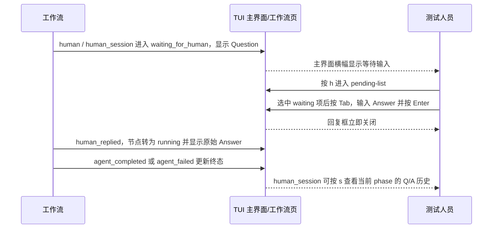

**已实现的异常处理**：
- 空 Answer 按 Enter 不提交，回复框保持可编辑。
- 在回复框按 `Esc` 取消编辑，不发送回复，工作流继续等待；`←` 由编辑器处理。
- 提交后回复框立即关闭且输入清空；后续状态通过工作流进度事件刷新。
- 等待超过 `options.timeout`（默认 600 秒）时不产生 `human_replied`，引擎发出失败事件，节点进入 `failed`。

### 4.6 测试截图示例

> 以下截图仅作示例，实际结果以本次转测环境中的界面为准。

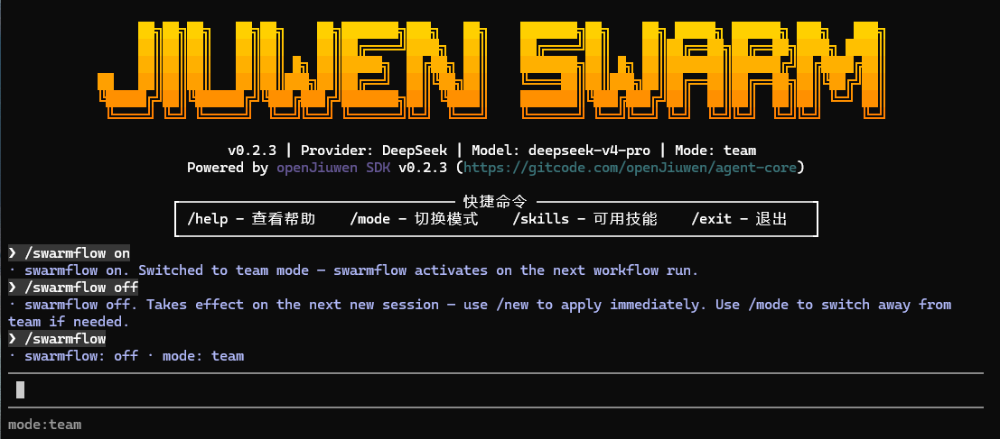

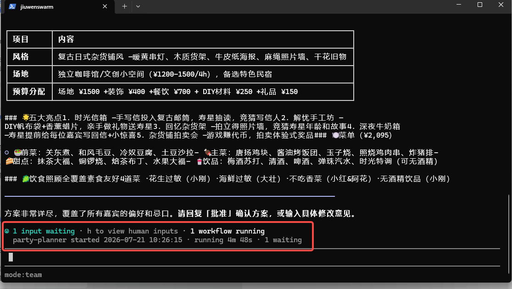

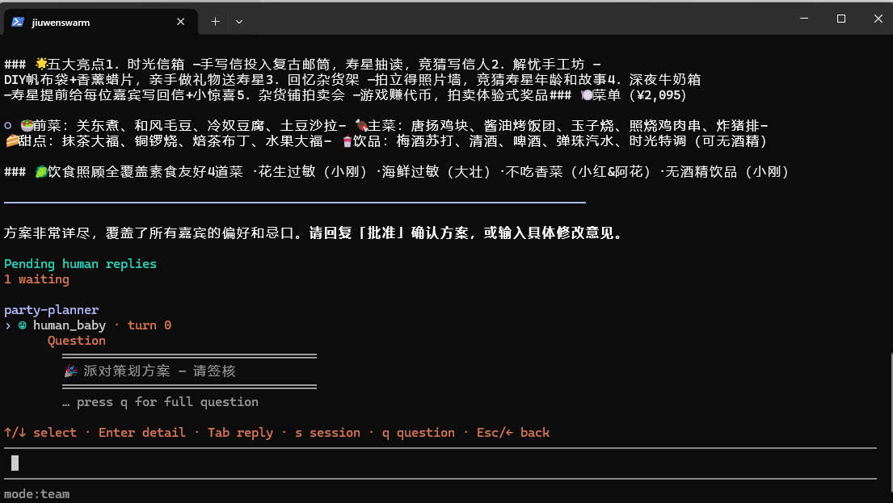

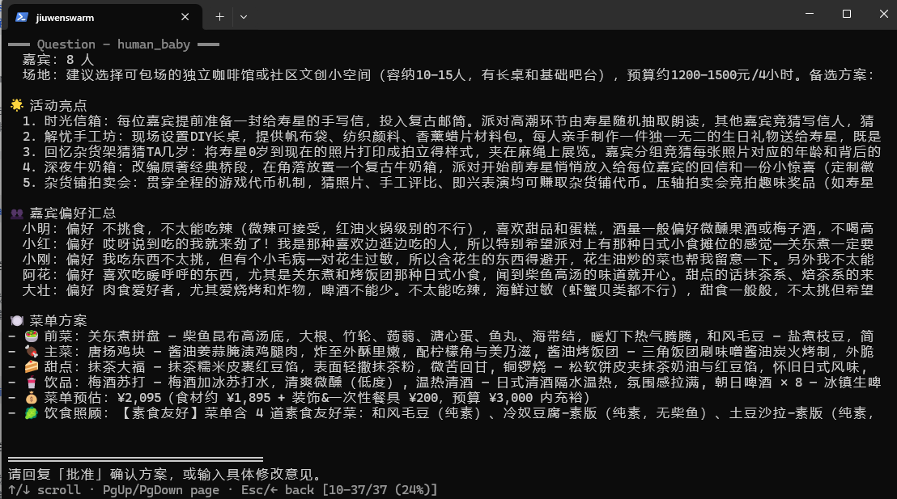

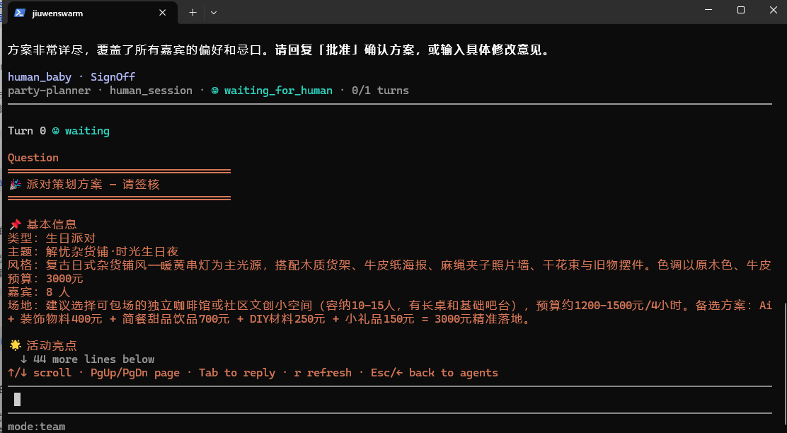

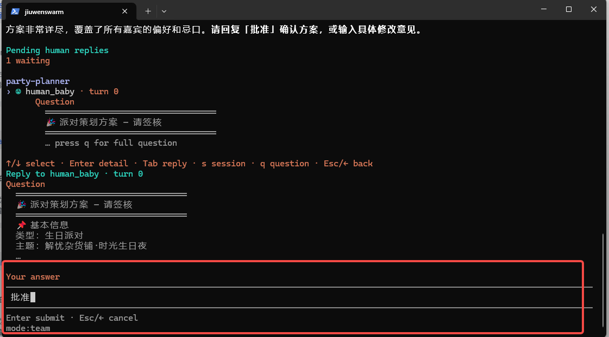

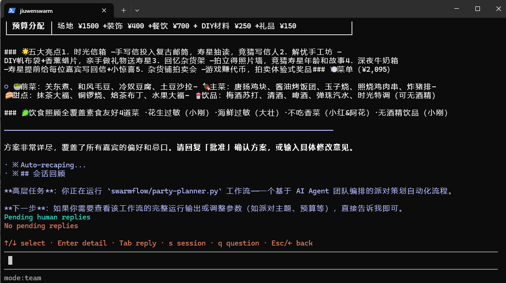

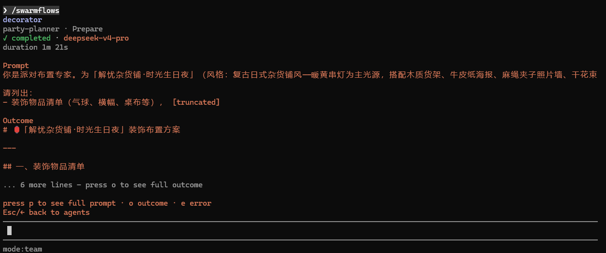

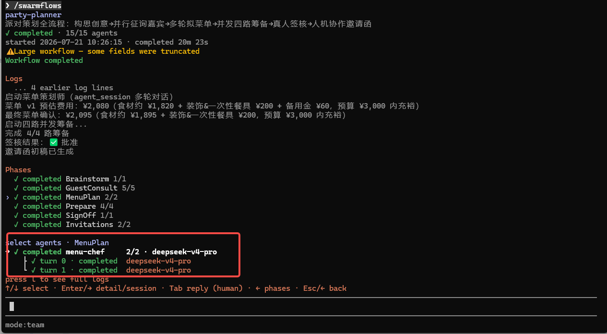

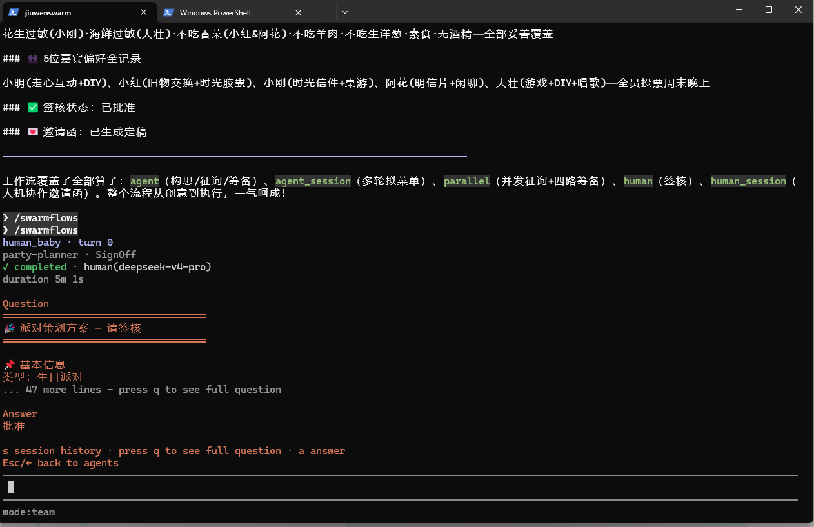

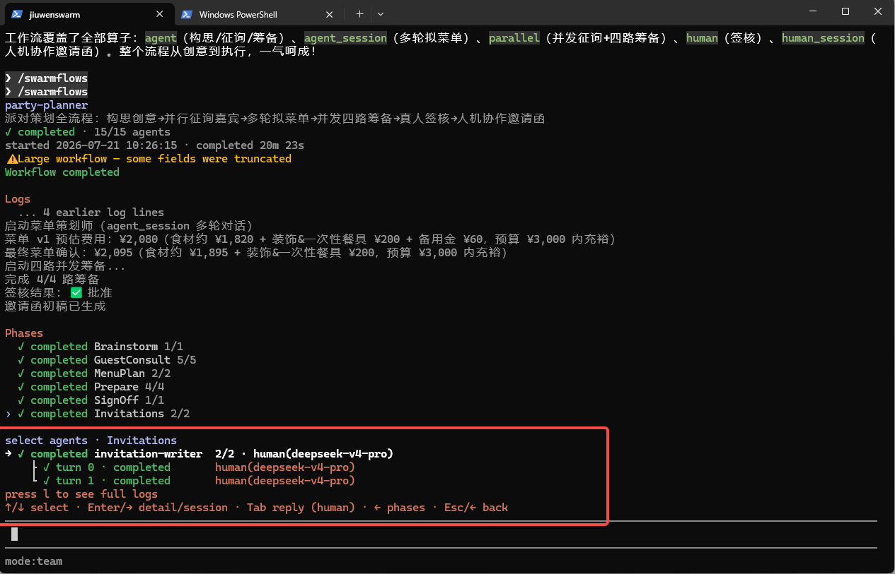

## 5. 测试结果

（在 status 变为 completed 时填写。执行用例总数 / 通过数 / 失败数 / 阻塞数、通过率、测试执行时间范围。）

## 6. 缺陷清单

（测试过程中发现的缺陷。）

| 缺陷编号 | 严重程度 | 描述 | 状态 | 关联用例 |
|---|---|---|---|---|
| BUG-001 | 致命/严重/一般/提示 | <描述> | 新建/修复中/已修复/延期 | <用例编号> |

## 7. 风险与遗留

- 真人回复闭环依赖 AgentCore 的真人回复路由与后续模型格式化所需的 endpoint 可用；回复后须以 `workflow.updated` 确认状态变化。
- 超大工作流降级（list/get 分拆、`truncated`/`detail_pending` 裁切）与缓存并发隔离为代码已实现能力，但本期不转测，后续需求单独跟踪。
- 自然语言 query 生成的 `workflow.py` 依赖模型效果，无法保证脚本正确性；建议优先用 swarmskill creator（斜杠强约束）生成测试数据。
- Skill 污染问题由其他特性跟踪。

## 8. 转测结论

（在 status 变为 completed 或 failed 时填写。）

- **结论：** 通过 / 不通过 / 有条件通过
- **条件（如有）：** <需满足的附加条件>
- **签字：** @chenchunzhou / @reviewer

## 9. 评审记录

| 轮次 | 日期 | 版本 | 评审人 | 结论 | 主要修改/讨论 |
|---|---|---|---|---|---|
| 1 | 2026-07-21 | 1 | — | — | v1.0 初稿（含超大工作流降级 / 缓存与并发） |
| 2 | 2026-07-28 | 2 | @chenchunzhou | draft | 缩减范围至开关 / 真人回复 / 工作流浏览 / 四类节点；测试点对齐实际 TUI 键位（h/q/a/s/Tab/←/→/Esc/r、`☺` 图标、超时→failed、`node_type` 分组）；移除入口 C；归档到 testing/ 目录并补 frontmatter（design-id/test-type） |

## 10. 代码依据

- TUI 命令及开关行为：`jiuwenswarm/channels/tui/frontend/src/core/commands/builtins/swarmflow.ts`、`swarmflows.ts`
- TUI 页面、导航、回复输入、详情与历史：`jiuwenswarm/channels/tui/frontend/src/ui/app-screen.ts`、`src/core/app-state.ts`
- 工作流数据模型及分组 / turn 辅助：`jiuwenswarm/channels/tui/frontend/src/core/workflows.ts`、`src/core/event-handlers.ts`
- 键位绑定：`jiuwenswarm/channels/tui/frontend/src/.../defaultBindings.ts`（`p`/`o`/`e`/`r`/`←`/`→`/`Esc`/`l`）
- 进度状态与 human 节点字段（`kind`/`node_type`/`correlation_id`/`human_prompt`/`human_reply`）：`jiuwenswarm/agents/harness/team/handlers/workflow_state.py`
- 进度事件抽取：`jiuwenswarm/agents/harness/team/handlers/workflow_monitor_handler.py`
- 回复路由契约：`tests/unit_tests/agentserver/test_swarmflow_reply_rpc.py`、`tests/unit_tests/gateway/test_swarmflow_reply_forward.py`
- 状态定位与 human 生命周期：`tests/unit_tests/agentserver/test_workflow_state.py`
- list/get 与超大快照裁切（本期不转测，仅备查）：`jiuwenswarm/server/agent_ws_server.py`、`server/wire_truncate.py`
- agent-core 三算子与事件字段：`openjiuwen/agent_teams/workflow/engine/{primitives,progress,facade}.py`、`workflow/runner.py`、`schema/events.py`

## 11. 参考与关联设计

- [SDD-0009](../../archive/SDD-0009-jiuwen-tui-swarmflow-human-session-adaptation/design.md)：jiuwen TUI 适配 SwarmFlow 三算子（已归档 shipped），本转测文档关联的权威设计。
- [SDD-0002](../../archive/SDD-0002-swarmflow-stateful-sessions-and-human/design.md)：SwarmFlow 有状态会话与人机交互编排（三算子定义、薄路由规则、关联号约定）。
- [SDD-0003](../../archive/SDD-0003-swarmflow-interruption-recovery-and-durable-state/design.md)：中断恢复与崩溃可恢复状态持久化（`agent_id` 确定性依赖）。
- openspec 变更 `2026-07-20-swarmflow-human-session-adaptation`：落地实现记录与偏差校正出处（`D:/Code/Projects/JiuwenSwarm/jiuwenswarm/openspec/changes/archive/2026-07-20-swarmflow-human-session-adaptation/`）。
