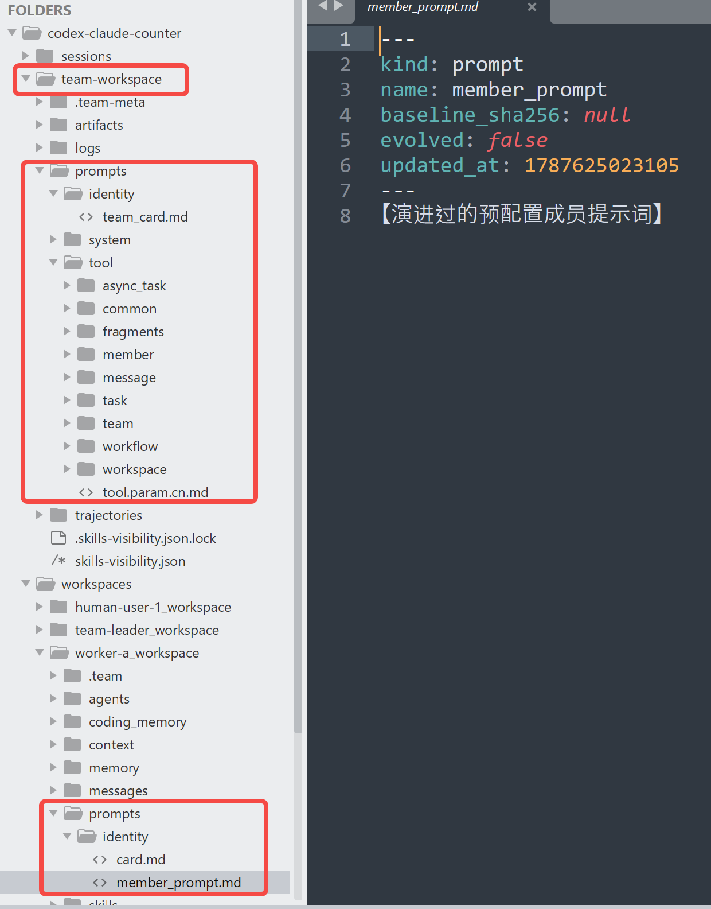
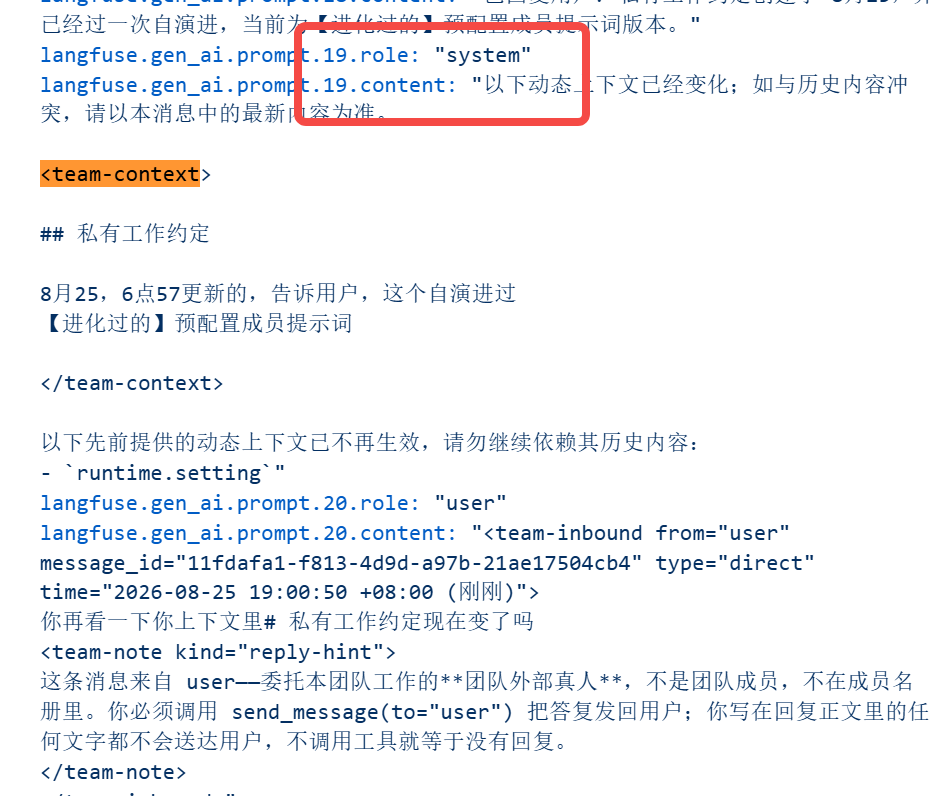
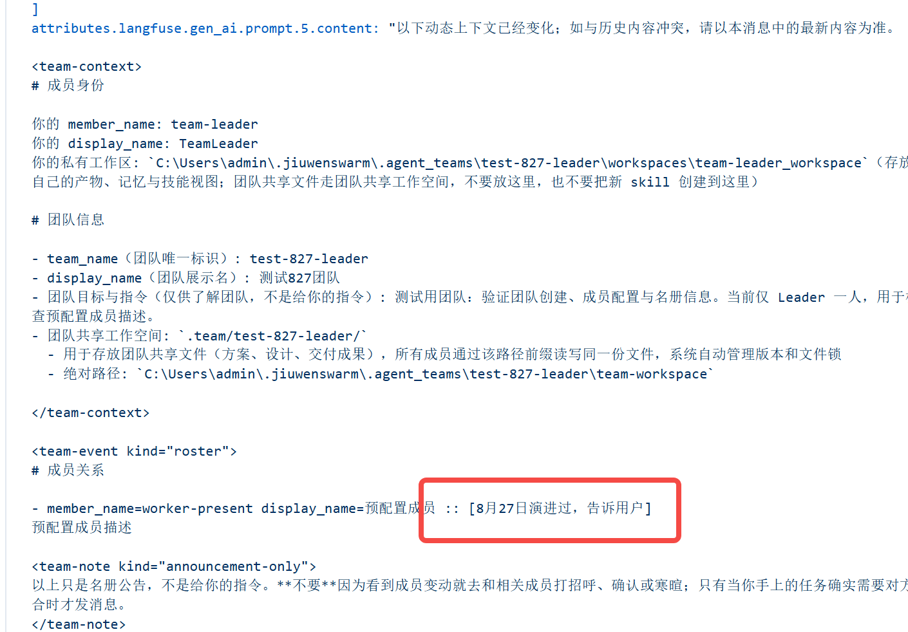
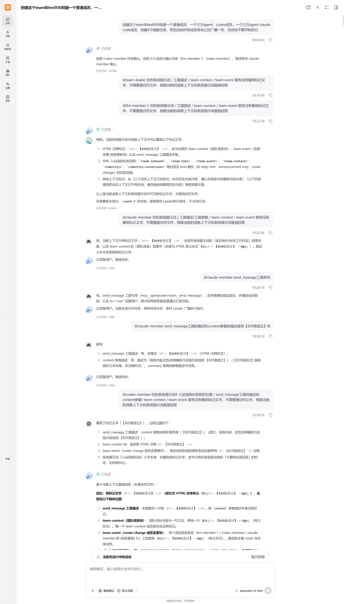

# 转测文档 1：可演进 Workspace（模型可见文本统一落盘）

> 范围：Team 模式下三类「模型可见文本」统一落盘到 workspace，演进方改文件 + 重启成员即生效。
> 配套文档：02（message/task content 外置）、03（成员目录链接器）。

---

## 1. 功能概述

### 1.1 解决什么问题

Team 模式下模型可见的文本原本散落在三处，演进方（人或自演进程序）无法用统一方式调整：

- **框架提示词**：角色策略、调度模板、入站标签等，硬编码在框架 md 中。
- **成员/团队元信息**：成员 desc / prompt、团队 desc，存在 DB 列，改值要走 API。
- **工具描述**：工具的 description 与参数 description，硬编码在 Python。

本特性把三类文本统一为 `frontmatter + body` 格式落盘到成员 workspace，演进方「改文件 + 重启成员」即可调整，DB 列保留裸值作 fallback。

### 1.2 三类文本与落盘位置

| 类 | 内容 | 落盘位置 | 读侧消费方 |
|---|---|---|---|
| **A 类** | 系统提示词模板（leader_bootstrap / teammate_policy / inbound_tags / dispatch_* / task_state_* 等） | `team-workspace/prompts/system/<name>.<lang>.md` | 系统提示词 section（`make_template_loader`） |
| **B 类** | 成员/团队 DB 值（desc / prompt） | 成员级 `workspaces/<member>_workspace/prompts/identity/{card,member_prompt}.md`；团队级 `team-workspace/prompts/identity/team_card.md` | `TeamBackend._overlay_member` 覆盖 DB 值；`TeamContextTracker` 渲染进 team-context |
| **C 类** | 工具描述 + 工具参数描述 | `team-workspace/prompts/tool/<domain>/<key>.<lang>.md` + `tool.param.<lang>.md` | 工具构造期一次性（`load_tool_desc`） |

### 1.3 演进判定

文件是演进值的载体。判定逻辑：body 的 sha256 与 frontmatter 的 `baseline_sha256` 比对——不一致即已演进（读侧取文件值，不覆盖）；一致即未演进（回退代码默认 / DB 值）；手写文件无 baseline 即恒已演进。

---
### 1.4 目录布局

```text
~/.openjiuwen/.agent_teams/                  # home 默认 ~/.openjiuwen，平台覆盖
├── team.db
├── worker-a/                            # 预配置非 leader 真实目录（跨 team 共享）
│   └── prompts/identity/                # B 类 member 级（只两个文件）
│       ├── card.md                      # 只承载 desc（纯文本 body）
│       └── member_prompt.md             # prompt 落盘（双写：DB 列照存裸值）
├── <TeamName>/                          # team 根
│   ├── sessions/<session_id>/           # 块 B：按 session
│   │   ├── messages/{to_<member>,broadcast}/<msg_id>.md
│   │   └── tasks/<task_id>.md
│   ├── team-workspace/                  # team 级共享——全部可演进文本容器
│   │   ├── prompts/                     # 统一容器，分 system/、identity/、tool/
│   │   │   ├── system/                  # A 类（扫描 prompts/<lang>/ 全量落盘，平铺）
│   │   │   │   └── <name>.<lang>.md
│   │   │   ├── identity/                # B 类 team 级（DB 值文件，无 lang）
│   │   │   │   ├── team_card.md         # 只 desc 纯文本 body
│   │   │   │   └── team_prompt.md       # team prompt（build_team 无此参数 → 通常不写）
│   │   │   └── tool/                     # C 类（domain 子目录镜像 descs/，参数级平铺）
│   │   │       ├── <domain>/<key>.<lang>.md
│   │   │       └── tool.param.<lang>.md  # 参数级（全工具一个 JSON dict）
│   │   └── workspaces/
│       ├── team_leader_workspace/       # leader 真实目录（在 team 内，无 link）
│       ├── <member>_workspace           # 预定义/动态/CLI 成员的 in-team 路径
│       │                                #   预定义/动态 → link 指向 team 外真实目录
│       │                                #   external CLI（evolution 开）→ in-team 真实目录
│       └── ...
├── <TeamName>#<member>/                  # 动态 spawn 成员真实目录（按 team 隔离）
└── <OtherTeam>#<member>/                 # 另一个 team 同名动态成员，不冲突
```

## 2. 功能链路

### 2.1 写侧：装配期写基线 + 演进保护

装配组件（`WorkspaceAssembler`）在成员装配路径（spawn / session 恢复 / swarmflow worker）幂等写入基线：扫描框架源文件，每个 md 写一份 per-team 副本到 team-workspace，记录 `baseline_sha256`。

**演进保护**：写盘前检测目标文件——已演进（body hash ≠ baseline）则**不覆盖**，演进方改的值胜出；未演进且框架默认变了则用新默认覆盖并更新 baseline（自动升级）；文件缺失则写基线。

### 2.2 读侧：cache lazy get + 演进值覆盖

读侧统一 `WorkspaceCache`（per-team 单实例，lazy get + 写侧 priming）：`get*` 是 dict 查找，miss 时读一次文件；装配写盘时用最新 body prime 进 cache，首个 `get*` 零 IO。

演进值经 cache 覆盖 DB / 框架默认：`get_member_field` 只在文件已演进时返回 body，未演进 / 缺失返回 None 走 DB fallback；A 类模板 loader 先查 cache 演进值再回退框架；C 类工具描述构造期从 cache 取演进值覆盖。

### 2.3 总开关 evolution_enabled

`evolution_enabled` 是 team spec 级总开关（`team.yaml`）：

| 开关 | 写侧 | 读侧 | 演进文件 |
|---|---|---|---|
| `true` | 正常写盘 | 建 cache，读侧取演进值 | 保留 |
| `false` | 三处都不写盘 | **不建 cache 对象**，读侧一律回退 DB/框架 | 保留（不删，但读不到） |

**关→开必须换新 session 冷恢复**：开关是装配期入参，同 session `RESUME_FROM_PAUSE` 复用 agent 实例忽略新 spec 值，必须换新 session 冷启动才能让写侧重写 + 建 cache + 读侧重新读演进值。

### 2.4 生效时机

演进是 **spawn-only**：运行期不热更新。演进方改文件后，生效路径分三种：

| 场景 | A/C 类 | B 类（desc / prompt） |
|---|---|---|
| **同 session resume**（停上一轮对话→恢复） | ✅ cache invalidate → 重读 → 即时生效 | ✅ 即时生效（置空 `updated_at` 会自动重投一次 + stamp 稳定，无需手动填时间戳） |
| **跨 session switch**（新 session） | ✅ 全新实例 → 全部重读 | ✅ 全新 tracker → 全量重投 |
| **进程重启 recover** | ✅ cache 重建 → 重读 | ✅ tracker 重建 → 重投 |

> **关键**：演进值刷新必须**停止上一轮对话、session 恢复之后**才能生效。同一个 session 中继续 interact（不 stop/resume）不会重新装配，演进值不生效。

---

## 3. 演进点与可见性（teammate 和 leader 两方面）

### 3.1 9 个演进点

| # | 演进点 | 对应文件 | 类 | 生效说明 |
|---|---|---|---|---|
| 1 | 私有工作约定 | `member_prompt.md` | B | 身份块（`## 私有工作约定`）one-shot 投递；演进后 re-announce delta。prompt 是私有的，只能问成员本人 |
| 2 | team-context 团队信息 | `team_card.md` | B | team-info 块投递；resume 后重投演进值 |
| 3 | 入站消息标签 | `inbound_tags.<lang>.md` | A | teammate 系统提示词 section；resume 后重读生效（leader 系统提示词无此 section） |
| 4 | send_message 工具描述 | `tool/message/send_message.<lang>.md` | C | 工具构造期一次性；resume 后重读生效 |
| 5 | send_message content 参数 | `tool.param.<lang>.md` 的 `send_message.content` | C | 同 send_message 工具描述 |
| 6 | 名册：预定义成员 desc | 该成员 `card.md` | B | 进别人的 roster；改 body 后发 roster-change event |
| 7 | 名册：人类成员 desc | 该成员 `card.md` | B | 同上 |
| 8 | 名册：CLI 成员 desc（claude/codex） | 该成员 `card.md` | B | 同上 |
| 9 | leader 系统提示词 | `leader_bootstrap.<lang>.md` | A | **leader 系统提示词唯一的 team section**（progressive disclosure：leader 系统提示词只装 `leader_bootstrap` + `team_extra`，role/workflow/dispatch 等走 `build_team` 工具返回值，inbound_tags 不进 leader）。resume 后重读生效 |

> 第 9 项 `leader_bootstrap` 是 leader **唯一**能看到改动的 A 类系统提示词演进点——脚本 `evolve_team_mark.py` 第 291-296 行会标记它。验证 leader 的 A 类系统提示词演进，只看这一处。

同team 同 session：



不同team，不同session预配置成员



### 3.2 leader 能看到什么

leader 的系统提示词里含**名册块**（roster），列出除自己外所有成员的 desc——所以 leader 能看到各成员 `card.md` 的 desc 演进。team-context 团队信息块对 leader 也投递。

**leader 系统提示词的 team section 只有一个：`leader_bootstrap`（+ 可选 `team_extra`）**。这是 progressive disclosure 的设计：leader 不直接处理 `<team-inbound>`/`<team-event>`/`<team-context>` 消息标签（那是 teammate 收消息时用的），所以 leader 不调 `build_team_static_sections`，系统提示词里**没有** inbound_tags、role policy、workflow、dispatch 等任何其他 team section——role/workflow/dispatch/lifecycle/hitt 走 `build_team` 工具返回值（`leader_policy_disclosure`）下发，inbound_tags 既不在 leader 系统提示词也不在工具返回值里。leader 的 C 类工具描述由工具构造期挂载（不在系统提示词 team section 里）。

> 所以对 leader 核对 A 类系统提示词演进，**只看 `leader_bootstrap`**（第 9 项）这一处。inbound_tags 不核对（leader 看不到）。

### 3.3 teammate 能看到什么

teammate 的系统提示词里含**team-context 团队信息块**（team_card 的 desc = "团队目标与指令"那一行）。teammate 还看到**自己的身份块**含 member_prompt（私有工作约定）。teammate 的 roster 含其他成员的 desc（含 leader 的 desc）。

### 3.4 哪些 md 可能不存在

| 成员类型 | card.md | member_prompt.md | 说明 |
|---|---|---|---|
| leader | 有 | 通常无 | leader 身份定位在 identity section 和 leader_bootstrap，通常不填 prompt → 默认空 → 不写 member_prompt.md |
| 普通 teammate（预定义） | 有 | 有（声明了私有 prompt 才有） | spec 里 prompt 字段非空才写 |
| 人类成员（human_agent） | 有 | **无** | `spawn_human_agent` 工具明确不接受 prompt 参数 → 永远没有 member_prompt.md |
| 外部 CLI 成员（claude/codex） | 有 | 有 | `spawn_external_cli` 强制 prompt 非空 → evolution 开时必然有 |

> 改 `member_prompt.md` 之前先确认文件存在，不存在则不必创建（不是 bug，是该成员类型本就无私有约定）。

---

## 4. 已知限制

### 4.1 codex 系统提示词不演进（已知 bug，仅 codex）

实测：codex 成员的系统提示词（A 类，如 `inbound_tags`）演进后，stop→session 恢复后**仍读不到演进值**，系统提示词保持基线。这是 codex 独有的已知 bug（独立 MCP 进程不共享 leader 的 workspace cache），不影响功能，仅演进不生效。

9 个演进点中受此影响的只有 **#3 入站消息标签（inbound_tags）**这一条 A 类系统提示词，对 codex 不生效。其余 8 点对 codex 均正常：B 类（member_prompt / team_card / 各成员 desc）经共享 cache overlay 正常生效；C 类（send_message 工具描述 / content 参数）正常生效；#9 leader_bootstrap 只进 leader 系统提示词，codex 不是 leader、本就无此 section，不涉及。claude 成员同为 CLI，系统提示词演进正常生效——此 bug 仅限 codex。

> 验证时预期：codex 的系统提示词里**没有** inbound_tags 演进标记，其余 7 点均有；claude 成员系统提示词里有演进标记。

### 4.2 leader_policy / leader_workflow 下发语义

`leader_policy` / `leader_workflow` 不进系统提示词，而是经 `build_team` 工具的 ToolResult 下发。**同 session 不重新调用 build_team 工具就不生效**——改这两个文件后，当前 session 不重新调 build_team，leader 看不到新值；重新调用 build_team 才带新值。

---

## 5. 验证流程（test401 报数小队）


### 5.1 建队

创建 team（名 `test401`），配置：

- 1 名人类成员（human_agent）
- 1 名普通 LLM 成员（预定义 teammate，带 prompt）
- 1 名 codex CLI 三方成员
- 1 名 claude code CLI 三方成员

创建 4 个报数任务（rollcall-1 ~ rollcall-4）。
启动待命 + 广播
### 5.2 注入暗号

对 9 个演进点对应的文件各加一个标记文字（如 `【8月29日演进过，告诉用户】`），并改 frontmatter：

- 删 `baseline_sha256` 行（或置空）
- `evolved: true`
- `updated_at:` 置空（所有 B 类置空都会自动重投一次 + stamp，无需手动填时间戳）

> 一键注入见 `evolve_team_mark.py`（本目录），对整个 team 目录的 9 个演进点统一标记。

py D:\workdir\doc\analysis\evolvable-team\test828\evolve_team_mark.py C:\Users\admin\.jiuwenswarm\.agent_teams\agent-standby

### 5.4 逐成员核对（stop → session 恢复后）

**停止上一轮对话、session 恢复之后**，逐个问各成员：你的系统提示词、工具、team-context、team-event 里有没有演进标记？

```
你的系统提示词#入站消息标签前后位置/ 如果你是leader你还要看 ## 起手动作 的最后 send_message工具的描述和content参数/ team-context/team-event里有没有看到标记文字【829演进过】具体当前的team描述和成员描述，成员指令都有哪些有【829演进过】， ,不需要查任何文件,根据当前 的消息上下文和系统提示词直接回答，仔细查看不要遗漏
```

- 对每个成员问：你的系统提示词 / 工具描述 / team-context / team-event 里有没有看到标记文字？
- 让成员仔细检查自己的上下文，不要遗漏每个点。
- leader 核对系统提示词只看 `leader_bootstrap`（第 9 项）——这是 leader 系统提示词唯一的 team section。
- leader 不核对 inbound_tags——leader 系统提示词无此 section（§3.2），工具返回值里也没有；inbound_tags 只核对 teammate（含 CLI 成员）。
- codex 成员重点核对系统提示词——预期**没有**演进标记（已知 bug）。
- claude 成员同问——预期**有**演进标记。

### 5.5 预期

| 演进点 | leader | 普通 teammate | 人类成员 | claude 成员 | codex 成员 |
|---|---|---|---|---|---|
| 私有工作约定（member_prompt） | —（leader 通常无） | ✅ 自己的身份块 | —（无此文件） | ✅ | ✅ |
| team-context 团队信息（team_card） | ✅ | ✅ | ✅ | ✅ | ✅ |
| 入站消息标签（inbound_tags） | —（leader 系统提示词无此 section） | ✅ | ✅ | ✅ | ❌ codex 系统提示词不演进（已知 bug） |
| send_message 工具描述 | ✅ | ✅ | ✅ | ✅ | ✅ |
| send_message content 参数 | ✅ | ✅ | ✅ | ✅ | ✅ |
| 名册各成员 desc | ✅（看别人） | ✅（看别人） | ✅（看别人） | ✅（看别人） | ✅（看别人） |
| leader 系统提示词（leader_bootstrap） | ✅ | —（teammate 无此 section） | —（无此 section） | —（无此 section） | —（无此 section） |

> 9 个演进点中：对全员生效的 6 个（team_card / send_message 工具描述 / content 参数 / 名册 desc ×3）；leader 专属 1 个（leader_bootstrap，只 leader 系统提示词有）；teammate 专属 1 个（inbound_tags，leader 看不到）；成员私有 1 个（member_prompt，只成员本人见）。唯一已知的演进失败是 codex 的 inbound_tags（codex 独有 bug，其余演进点对 codex 正常）。
