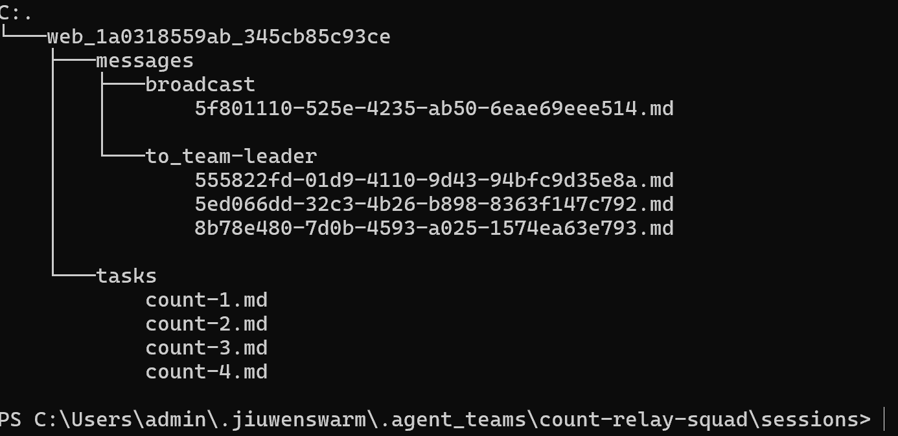

# 转测文档 2：Message/Task Content 外置（SessionFileStore）

> 范围：message / task 的 `content` 正文从 SQLite 移入 session 文件，DB 只存 `#file#` 占位符，DAO 对上层透明解引用，不改 schema、不改调用方签名。
> 配套文档：01（可演进 workspace）、03（成员目录链接器）。

---

## 1. 功能概述

### 1.1 解决什么问题

message 和 task 的 `content` 正文原存在 SQLite 的 content 列，长文本撑大 DB。

本特性把正文写入 session 文件，DB content 列只存 `#file#` 占位符；读取时按 DB 行内字段推导路径读文件返回正文，上层调用方不感知占位符。

### 1.2 机制要点

- **写**：`SessionFileStore.put(正文, address)` → 原子写文件 → 返回 `#file#` 占位符 → DAO 存占位符进 content 列
- **读**：`SessionFileStore.get(address)` → 按行内字段推导路径 → 读文件返回正文 → DAO 对上层返回完整 content
- **DB**：content 列只存 `#file#`，路径完全由行内字段（team_name / session_id / kind / object_id / to_member）推导，占位符只是「内容在文件里」的信号
- **无阈值**：短文本也写文件，不做「超过 N 才溢出」分级
- **不走演进 cache**：message/task content 是运行时动态数据，不使用 WorkspaceCache（该缓存只服务装配期定稿的 A/B/C 演进文本）
- **无 frontmatter**：纯文本，content 是动态数据无演进概念

---

## 2. 功能链路

### 2.1 目录结构

```
<team>/sessions/<session_id>/
  ├── messages/
  │   ├── broadcast/<msg_id>.md           # 广播消息
  │   └── to_<member>/<msg_id>.md         # 定向消息（member 含 CLI 成员）
  └── tasks/
      └── <task_id>.md                    # 任务正文
```

### 2.2 路径推导规则

路径由 `FileAddress(team_name, session_id, kind, object_id, to_member)` 完全推导：

| kind | 行内字段 | 逻辑路径 |
|---|---|---|
| direct（定向） | `to_member`、`object_id` | `messages/to_<to_member>/<object_id>.md` |
| broadcast（广播） | `object_id` | `messages/broadcast/<object_id>.md` |
| task（任务） | `object_id` | `tasks/<object_id>.md` |

DB 存占位符纯属冗余标记——占位符只是「内容在文件里」的信号，路径在读取时现算。

### 2.3 读写链路

- **写**：上层调 TeamMessageManager / TeamTaskManager（薄包装：校验、事件广播）→ MessageDao / TaskDao 的 `_to_stored` 判定 file_store 启用 → 调 `SessionFileStore.put` → DAO 拿 `#file#` 存 content 列。file_store 未启用或 put 失败时存原文降级。
- **读**：DAO 的 `_from_stored` / `_is_spilled` 判定 content 是否为 `#file#` → 是则用行内字段构造 FileAddress 调 `get` 读文件返回正文；否则原样返回（历史内联行、降级行、模板空消息天然被排除）。
- **透明性**：`format.py` / `render.py` 等既有格式化函数接收的是已解引用的对象，不直接读 DB 或文件，改动对它们完全透明。

### 2.4 session 清理

散团 / 释放 session 时，`SessionFileStore.remove_session(team_name, session_id)` 删除该 session 的 `messages/` 和 `tasks/` 目录（best-effort，IO 失败只 warning 不阻塞）。

---

## 3. 与演进体系的区别

| | 本特性（message/task content） | 演进体系（A/B/C 文本） |
|---|---|---|
| 机制 | DB 存 `#file#` 占位符（文件是唯一副本） | DB 存裸值 fallback + 文件存演进值（双写） |
| 缓存 | 不走 WorkspaceCache（动态数据，每次 `get` 实时解引用） | 走 WorkspaceCache（装配期定稿） |
| frontmatter | 无 | 有（baseline_sha256 / evolved 等演进元信息） |
| 删除语义 | session 清理时删目录 | 演进保护 + 基线重建 |

---

## 4. CLI 成员定向消息

CLI 成员（claude / codex）作为收件人时，direct 消息路径 `messages/to_<to_member>/<object_id>.md` 的 `to_member` 取自 DB 行的 `to_member_name`，**对成员类型无过滤**——CLI 成员的 message to 目录照常存在。

CLI 成员的 MCP server 子进程读 DB 行见 `#file#` → 用 `to_member_name` 推导路径读文件拿正文。这要求 CLI 子进程能解析到正确的 home（`OPENJIUWEN_HOME`）：spawn CLI 子进程时注入 `OPENJIUWEN_HOME` env，MCP server env allow-list 含 `OPENJIUWEN_HOME`，否则子进程解析到默认 home 找不到文件 → 显示原始 `#file#` 占位符（泄漏）。

---

## 5. 验证流程

覆盖多种成员类型 + 消息形态 + 任务全周期 + 目录落地 + session 善后。

### 5.1 成员与消息场景

建一个含以下成员的 team：

- 1 名普通 LLM 成员（in-process teammate）
- 1 名人类成员（human_agent）
- 1 名 claude code CLI 成员
- 1 名 codex CLI 成员
- （可选）swarmflow 流程

依次执行并验证：

| # | 场景 | 预期 |
|---|---|---|
| 1 | leader 广播一条消息 | `messages/broadcast/<msg_id>.md` 落地；DB content 列为 `#file#`；各成员读到完整正文 |
| 2 | leader 给普通成员发 P2P 定向消息 | `messages/to_<普通成员>/<msg_id>.md` 落地；普通成员读到正文 |
| 3 | leader 给人类成员发定向消息 | `messages/to_<人类成员>/<msg_id>.md` 落地；人类成员经 inbox 读到正文 |
| 4 | leader 给 claude 成员发定向消息 | `messages/to_<claude成员>/<msg_id>.md` 落地；claude 输出无 `#file#` 泄漏 |
| 5 | leader 给 codex 成员发定向消息 | `messages/to_<codex成员>/<msg_id>.md` 落地；codex 输出无 `#file#` 泄漏（`OPENJIUWEN_HOME` 注入生效） |
| 6 | 成员间 P2P 互发消息 | 各自 `to_<收件人>/` 目录有文件；双方读到正文 |
| 7 | swarmflow 流程中广播 | 广播消息文件落地，worker 读到正文 |

### 5.2 任务全周期

| # | 场景 | 预期 |
|---|---|---|
| 8 | leader 创建任务（create_task） | `tasks/<task_id>.md` 落地；DB content 列为 `#file#` |
| 9 | 成员查看任务（view_task） | 拿到完整正文，不感知 `#file#` |
| 10 | leader 更新任务内容（update_task content） | 同名文件被覆盖写入（task_id 不变）；新正文可读 |
| 11 | 成员认领、执行、完成任务 | 任务流转正常，正文全程可读 |

### 5.3 目录落地核对

执行上述场景后，检查磁盘：

- `<team>/sessions/<session_id>/messages/broadcast/` 下有广播消息文件
- `messages/to_<各成员>/` 下有定向消息文件（含 CLI 成员目录）
- `tasks/` 下有任务文件
- DB 查询：对应 content 列均为 `#file#`

### 5.4 session 善后

| #   | 场景              | 预期                                        |
| --- | --------------- | ----------------------------------------- |
| 12  | 散团 / 释放 session | `messages/` 和 `tasks/` 目录被删除（best-effort） |

