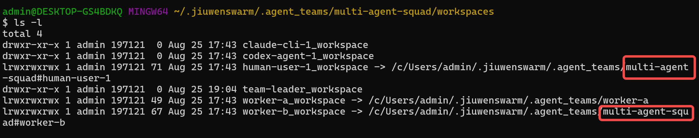

# 转测文档 3：成员目录链接器（Block C）+ ref 清理

> 范围：成员真实目录拉平到 team 树外跨 team 共享，team 内经 link 保持既有访问路径；散团时引用计数正确清理预定义/动态成员真实目录。
> 配套文档：01（可演进 workspace）、02（message/task content 外置）。

---

## 1. 功能概述

### 1.1 解决什么问题

成员真实目录原在 team 树内，同名预定义成员加入多个 team 时各 team 各一份目录，无法跨 team 共享。

本特性把成员真实目录拉平到 `.agent_teams/` 根下（team 外），在 team 内 `workspaces/<member>_workspace` 建一个 link 指过去。link 是透明层：harness 的 root_path 和 identity store 恒走 team 内路径，谁都不需要知道 link 背后是真实目录还是 link。

### 1.2 四类成员目录模型

| 成员类型 | 真实目录位置 | team 内路径 | link |
|---|---|---|---|
| **leader** | team 内 `workspaces/team_leader_workspace/` | 就是真实目录 | 无（leader 恒在 team 内，不拉平） |
| **预定义 teammate / human_agent** | `.agent_teams/<member>/`（team 外，跨 team 共享） | `workspaces/<member>_workspace` → link | symlink/junction |
| **动态 teammate / human_agent** | `.agent_teams/<team>#<member>/`（带 `#` 前缀按 team 隔离） | `workspaces/<member>_workspace` → link | symlink/junction |
| **外部 CLI 成员**（evolution 开） | team 内 `workspaces/<member>_workspace/`（真实目录） | 就是真实目录 | 无（不 link 出去） |

---

## 2. 功能链路

### 2.1 role 白名单分类

成员按 role 白名单分类决定目录形态（不是按 mode 字段）：

- **leader**（或成员名等于 leader 名）：team 内真实目录，不 link
- **预定义成员**（在 predefined 集合）：team 外真实目录 + link，跨 team 共享
- **动态 teammate / human_agent**：`team#member` 真实目录 + link
- **外部 CLI 成员**：team 内真实目录，不 link 出去（CLI 成员由单独路径建 workspace，不跨 team 复用）

### 2.2 link 建立

对预定义/动态成员，装配时在 team 外建真实目录，在 team 内 `workspaces/<member>_workspace` 建 link 指过去：

1. 先试 `os.symlink`（POSIX / Windows 开发者模式或有特权）
2. Windows 无特权时 fallback 到 `mklink /J` junction（**junction 无需特权**）
3. link 建成功 → team 内路径是 link，透明映射到 team 外真实目录（跨 team 复用达成）

**复用优先**：已存在的 link 或真实目录（历史会话留下的）原样保留，幂等。

### 2.3 引用计数（`.refs.json`）

预定义/动态成员真实目录跨 team 共享，需引用计数防误删。每个真实目录下有 `.refs.json`：

```
.agent_teams/<member>/.refs.json
{
  "kind": "predefined",           # dynamic / predefined / leader
  "teams": ["team-a", "team-b"]   # 该成员加入了哪些 team（计数 = len(teams)）
}
```

`teams` 列表是真相源——记录「哪些 team 引用了这个目录」，计数 = `len(teams)`。

### 2.4 散团清理

散团（`clean_team` / `delete_team`）时完整清理链路：

1. **摘 link**：摘除 `workspaces/` 下所有 link（绝不 rmtree 下钻 junction，否则会删 target 内容）
2. **释放预定义 ref**：扫所有非 `#` 前缀的扁平目录，drop 该 team 名（预定义真实目录**保留**，共享资产）
3. **释放动态 ref**：扫 `<team>#*` 动态目录，每个 drop 该 team
4. **归零删目录**：动态成员 ref 归零 → rmtree 真实目录；预定义/leader 归零也不删（共享资产）

| 场景 | refs 变化 | 真实目录 |
|---|---|---|
| 预定义成员加入 team-a 后加入 team-b | `teams: [team-a, team-b]` | 共享 |
| team-a 散团 | drop team-a → `teams: [team-b]` | 保留 |
| team-b 也散团 | refs 清零 → 删 `.refs.json` | 保留（predefined 共享资产） |
| 动态成员 team-a 散团 | refs 清零 | rmtree 删除 |
| leader 退出 team | team 内真实目录随 team 树 rmtree | 不误删其他 team |

---

## 3. 新建会话 link 出去，存量不补 link

**新建会话**首次 spawn 成员时，预定义/动态成员正常 link 出去（§2.2）。

**存量 session 的 workspace 不补 link**：成员若以 in-team 真实目录形态留下（link 建不出退回 team 内，或历史会话残留），装配时对已有真实目录原样复用、不补建 link、不补 ref 计数。这是有意为之——补 link 等于把已有真实目录内容迁出到 team 外再建 link，是 legacy 迁移语义；历史会话状态不可控（真实目录 / 残缺 / 残留 link 混杂），强行统一成 link 形态要处理目标已存在、内容冲突、迁移原子性等边界。历史预定义成员同名 link 出去还可能冲突。收益（跨 team 共享、ref 计数清理）不抵风险；in-team 真实目录是成员的稳定访问路径（cwd / memory / skills / `.team` mount 均正常），不补 link 不影响功能。

---

## 4. 已知限制

### 4.1 CLI 成员 workspace 不作 cwd

外部 CLI 成员的 workspace（存 identity md）和 cwd（shell 运行处）是分离的两层：workspace 只用于存 `prompts/identity/card.md` + `member_prompt.md`（演进方改这里），cwd 由 spawn 时的路径解析另算（通常是 team-workspace 或 worktree），两者正交。

### 4.2 存量 session 不补 link

见 §3。存量 session 成员以 in-team 真实目录形态留下的，原样保留不补 link。

---

## 5. 验证流程（基于实际 team 目录核对）

### 5.1 配置预定义成员 -- 等专家团上线可能会有修改

在 `team.yaml` 的 `predefined_members` 列表声明预定义成员：

```yaml
predefined_members:
  - member_name: worker-present        # 语义化 slug，kebab-case
    display_name: 预配置成员
    desc: 预配置成员描述
    prompt: 预配置成员提示词基线       # 声明了私有 prompt 才有 member_prompt.md
    role_type: teammate
```

建队时 `build_team` 对 `predefined_members` 逐个调 `spawn_member`（写 DB 行），再 `startup` 拉起所有未启动成员。

### 5.2 建队后目录核对

建一个含 leader + 预定义 teammate + 动态 human_agent + claude CLI + codex CLI 的 team，建队后核对磁盘：

| 成员 | `workspaces/<member>_workspace` 形态 | 真实目录位置 | `.refs.json` |
|---|---|---|---|
| leader | 真实目录 | team 内 | kind=leader，归零不删 |
| 预定义 teammate | link → team 外 | `.agent_teams/<member>/` | kind=predefined，teams 含本 team |
| 动态 human_agent | link → team 外 | `.agent_teams/<team>#<member>/` | kind=dynamic |
| claude CLI 成员 | 真实目录（in-team） | team 内 | 无（不 link 不计数） |
| codex CLI 成员 | 真实目录（in-team） | team 内 | 无 |

### 5.3 跨 team 复用

| #   | 场景                        | 预期                                                   |
| --- | ------------------------- | ---------------------------------------------------- |
| 1   | 预定义成员加入 team-a 后加入 team-b | 真实目录共享，`.refs.json` `teams = [team-a, team-b]`       |
| 2   | team-a 散团                 | drop team-a，真实目录**不删**（team-b 还在），`teams = [team-b]` |
| 3   | team-b 也散团                | refs 清零 → 删 `.refs.json`，真实目录**保留**（predefined 共享资产） |
| 4   | 动态成员 team-a 散团            | refs 清零 → rmtree 真实目录                                |

### 5.4 散团清理核对

| # | 场景 | 预期 |
|---|---|---|
| 5 | 预定义 teammate 退出 team | link 摘除 → ref 减 → 保留真实目录 |
| 6 | 动态 teammate 退出 team | link 摘除 → ref 清零 → rmtree 真实目录 |
| 7 | leader 退出 team | team 内真实目录随 team 树 rmtree，不误删其他 team |
| 8 | 散团完整链路 | 所有 link 摘除，预定义 refs 减，动态归零删 |
