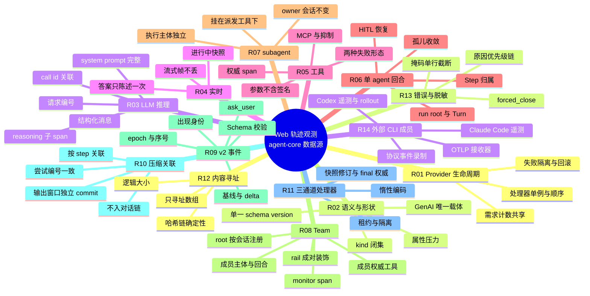

# Web 轨迹界面观测特性（agent-core 侧）测试设计与自验报告

> - **关联设计**：[SDD-0022](../../proposals/SDD-0022-trajectory-observability-framework/design.md)（轨迹观测框架）。它的数据经 SDD-0025（会话存储与服务）送到 SDD-0026（前端轨迹 UI）。
> - **被测版本**：agent-core `dev/swarm/room-mode@9e3390195`（2026-09-23），已经 MR !2995 合入 `develop`。
> - **执行日期**：2026-09-29；执行环境为 macOS、Python 3.11.13、pytest 9.0.2。
> - **判定原则**：设计文档与代码不一致时，以当前代码为准。SDD-0022 撰写后（09-16 至 09-23），agent-core 又落地了一批相关提交，包括 Claude/Codex 桥迁到 `harness_providers`、Team root 按会话注册、Team 成员权威工具 span、成员回合等。本文的测试点已按这些变化对齐。

## 0. 提交模板（可直接粘贴）

**【测试设计】**

附本文件 `testing/SDD-0022-trajectory-observability-framework/testing.md`：
- 脑图：§3.1
- 需求与用例映射：§3.3
- 测试点设计：§4
- 需求用例全量清单：附录 A（302 条）

**【自验结论】**：

1、新增 level0 用例 58 个、level1 用例 140 个（合计 198 个）。本特性修改或复用的存量用例 104 个（level0 29 个、level1 75 个）也纳入需求用例集，**需求用例合计 302 个**（level0 87 个、level1 215 个）。
   - **用例路径**：
     - `tests/unit_tests/extensions/observability/`（不含 `test_langfuse_exporter.py`、`test_file_exporter.py`）
     - `tests/unit_tests/harness/observability/`
     - `tests/unit_tests/agent_teams/observability/`（不含 `test_file_exporter_integration.py`）
     - `tests/unit_tests/agent_teams/harness/test_member_turn.py`
     - `tests/unit_tests/harness_providers/{test_trajectory_recorder.py, telemetry/, test_claudecode_observation.py, test_codex_observation.py, test_codex_rollout_trace.py}`
     - `tests/unit_tests/core/context_engine/test_compression_{state_modified_messages,observability_scope}.py`
     - `tests/unit_tests/core/foundation/llm/test_model_call_scope.py`
   - **需求用例通过率 100%**（302/302，失败 0 个，无遗留 issue）。
   - **关联回归用例** 422 个，全部通过。

2、开发新增 + 修改代码量 **11,833 行**（不含测试用例代码），共 65 个提交，统计口径见 §5.3。同期删除 5,186 行，净增 6,647 行。

## 1. 转测范围

### 1.1 特性边界

Web 轨迹界面（jiuwenswarm 前端）展示的每一条数据，都由 agent-core 在运行时产生：

- 标准 GenAI span 与 openjiuwen 扩展属性；
- 实时快照、流式帧；
- v2 轨迹事件（上下文窗口链、压缩、ask_user）；
- 按内容寻址的存储编码。

本文测试的是 **agent-core 这一侧的数据源**：数据采集是否正确、结构是否可信、实时通道是否可靠、处理器是否隔离。jiuwenswarm 的存储、HTTP 与前端（SDD-0025/0025）另行转测。

```
 agent 运行 ──► [采集层] callback / rails / run root / team root / 外部 CLI 录制器
                    │   产出规范 span + v2 事件（R02–R10、R13、R14）
                    ▼
               [Provider] 需求协调 · 处理器顺序 · 失败隔离（R01）
                    │
                    ▼
               [处理器层] SpanRecordProcessor：快照 / final / 帧三通道（R11）· 内容寻址（R12）
                    │
                    ▼  ← 本文测试边界（agent-core 输出）
               jiuwenswarm sink → SQLite → HTTP/WS → 浏览器（SDD-0025/0025，不在本文）
```

### 1.2 纳入范围：需求点

| 编号 | 需求点 | 被测代码（agent-core） |
|---|---|---|
| **R01** | Provider 生命周期与处理器挂载：agent/team 需求计数共享 provider；轨迹处理器和记录处理器全进程单例；处理器失败隔离；初始化失败回滚 | `extensions/observability/{runtime,demand,setup}.py`、`agent_teams/observability/setup.py` |
| **R02** | 语义约定与记录形状：GenAI 标准键唯一载体；span 级单一 schema version；record/event kind 为闭集；usage 只用标准键；属性压力下身份键保留 | `extensions/observability/{gen_ai_semconv,semconv}.py`、`callback_handler.py` |
| **R03** | LLM 推理 span：按 call id 关联请求；结构化输入输出；system prompt 完整保留；prompt attachment 来源；请求编号；reasoning 子 span；内部探测请求不入轨迹 | `callback_handler.py`、`core/foundation/llm/call_scope.py` |
| **R04** | 实时可见：进行中 span 发布快照；流式帧离开快照路径、逐帧不丢；流式回答只陈述一次 | `callback_handler.py`、`demand.py`、`harness/observability/rail.py` |
| **R05** | 工具 span：权威工具 span、全局回调只补字段不重复开 span；两种失败形态（抛异常 / `success=False`）；参数不含调用签名；MCP 名称匹配；成员工具不重复记录 | `harness/observability/rail.py`、`callback_handler.py`、`tool_outcome.py`、`span_context.py` |
| **R06** | 单 agent 回合结构：run root（Turn）；Step 挂在 root 下；invoke/iteration 规则；孤儿 span 收敛；按会话解析 root；HITL 恢复沿用 Step 身份 | `harness/observability/{run_span,rail,span_context}.py`、`extensions/observability/span_context.py` |
| **R07** | subagent：挂在派发它的工具 span 之下；执行主体独立；轨迹 owner 会话不变；未注册会话不串到其他 root | `harness/observability/{subagent,rail,span_context}.py`、`harness/tools/subagent/task_tool.py` |
| **R08** | Team：team root 按会话注册、interact 路径也开 root；leader/成员执行主体；成员回合（每轮一个 Turn）；成员权威工具 span；monitor 生成 task/msg/member span；team rail 与 agent rail 成对装饰 | `agent_teams/observability/*`、`agent_teams/harness/turn.py`、`core/runner/team_runner.py` |
| **R09** | v2 轨迹事件与上下文窗口：`context.window.commit` 基线加增量；按出现身份比较；epoch 与主体序号稠密；ask_user 请求与答复事件；payload 符合 JSON Schema；消息来源（origin） | `extensions/observability/{trajectory_events,span_context}.py`、`schemas/trajectory_v2_payloads.schema.json` |
| **R10** | 上下文压缩关联：压缩请求不进入对话链；按 step 关联；同一操作的多次尝试编号一致；压缩输出窗口作为独立 commit；压缩状态携带修改过的消息与 offload 句柄 | `context_compression_handler.py`、`trajectory_events.py`、`core/context_engine/*` |
| **R11** | 处理器层三通道：快照带修订号且 final 为准；惰性编码；消费者按身份去重、失败隔离、注销等待租约 | `span_record_processor.py`、`otlp_codec.py` |
| **R12** | 内容寻址：复述型 GenAI 属性（数组）替换为 `@oj-seq` 引用；哈希链确定、共享前缀；逻辑大小按还原后计算 | `content_addressing.py`、`otlp_codec.py` |
| **R13** | 错误原因与脱敏：错误原因优先级链；单行、掩码、截断；system prompt 不截断；兜底关闭标 `forced_close` 且不伪装成功 | `error_reporting.py`、`redaction.py`、`span_context.py`、`run_span.py` |
| **R14** | 外部 CLI 成员轨迹：把 HarnessProtocol 事件流录制为规范轨迹（每 turn 一条 trace、推理 + window commit、工具归属请求）；回环 OTLP 接收器；Claude Code / Codex 原生遥测转换为 ModelRequestEvent；Codex rollout 读取 | `harness_providers/{trajectory.py, telemetry/otlp_receiver.py, claudecode/observation.py, codex/observation.py}`、`harness_protocol/events.py` |

### 1.3 排除范围

| 排除项 | 原因 | 去向 |
|---|---|---|
| Langfuse 投影与文件导出：`bd9cf4f89`、`0c3f90947`、`6100c35f3`；用例 `test_langfuse_exporter.py`、`test_file_exporter.py`、`test_file_exporter_integration.py` | 属于导出特性 | SDD-0023 |
| 演进与 RL 轨迹投影：`a51e9fe08`、`af3970ff3`、`2105c5e1c`、`4ddca8ff4`、`b40b484bc`、`bd05f8262`、`755b06222`；`53c9a29c0` 中 `agent_evolving/` 部分；用例 `tests/unit_tests/agent_evolving/**` | 属于投影特性 | SDD-0024 |
| jiuwenswarm 存储、HTTP/WS 与前端 | 不在 agent-core | SDD-0025 / SDD-0026 |
| 纯风格或静态检查修复：`395ad194e`、`564997732`、`7be1c7202`、`cfc5443ac`、`8bfcf1f62`；纯文档提交 | 无功能变化 | — |
| `05fc1de53` 及其 revert `0f1b465be` | 净变更为零，内容已由独立提交落地 | — |
| `extensions/tracer_otel` | 独立的遗留栈（SDD-0022 §6.4） | — |
| 外部 CLI 的非观测逻辑（进程生命周期、鉴权回退、模型切换等） | 与轨迹无关 | 外部 CLI 成员特性 |

## 2. 测试环境

- **环境类型**：开发环境，单机本地执行。
- **依赖**：agent-core 仓内 `.venv`（Python 3.11.13）、pytest 9.0.2（插件 asyncio 1.3.0、mock 3.15.1、html 4.2.0）、`opentelemetry-sdk`（`openjiuwen[observability]`）。
- **数据准备**：
  - 全部为确定性单元与组件测试，使用内存导出器（`InMemorySpanExporter`）、mock LLM 与 mock 回调；
  - 外部 CLI 用例使用录制的遥测载荷与 rollout fixture；
  - 不依赖真实模型、网络或外部 CLI 二进制。
- **执行命令**（在 agent-core 仓库根目录）：

```bash
PYTHONPATH=. .venv/bin/python -m pytest \
  tests/unit_tests/extensions/observability \
  --ignore=tests/unit_tests/extensions/observability/test_langfuse_exporter.py \
  --ignore=tests/unit_tests/extensions/observability/test_file_exporter.py \
  tests/unit_tests/harness/observability \
  tests/unit_tests/agent_teams/observability/test_observability.py \
  tests/unit_tests/agent_teams/observability/test_team_observability_mock_llm.py \
  tests/unit_tests/agent_teams/observability/test_team_root_session_registry.py \
  tests/unit_tests/harness_providers/test_trajectory_recorder.py \
  tests/unit_tests/harness_providers/telemetry \
  tests/unit_tests/harness_providers/test_claudecode_observation.py \
  tests/unit_tests/harness_providers/test_codex_observation.py \
  tests/unit_tests/harness_providers/test_codex_rollout_trace.py \
  tests/unit_tests/agent_teams/harness/test_member_turn.py \
  tests/unit_tests/core/context_engine/test_compression_state_modified_messages.py \
  tests/unit_tests/core/context_engine/test_compression_observability_scope.py \
  tests/unit_tests/core/foundation/llm/test_model_call_scope.py
```

- **关联回归集**：

```bash
PYTHONPATH=. .venv/bin/python -m pytest \
  tests/unit_tests/harness/tools/test_task_tool.py tests/unit_tests/harness/subagent_runtime \
  tests/unit_tests/harness_protocol/test_protocol.py tests/unit_tests/agent_teams/external/test_member_runtime.py \
  tests/unit_tests/harness_providers/test_claudecode.py tests/unit_tests/harness_providers/test_codex.py \
  tests/unit_tests/harness/test_deep_agent.py tests/unit_tests/harness/test_image_modality_probe.py
```

- **特殊配置**：无。`pyproject.toml` 的 `addopts` 会生成 `report/index.html`，该目录已被 `.gitignore` 忽略。

## 3. 测试策略

### 3.1 测试设计脑图



### 3.2 层级与方法

| 维度 | 策略 |
|---|---|
| 测试层级 | **单元**：纯函数与状态机，例如内容寻址、窗口 delta、编号、脱敏。**组件**：真实 `TracerProvider` 加内存导出器，驱动回调框架、rail、Runner 与 mock LLM，断言 span 树与属性。**系统级**：真实模型或 CLI 的 e2e，已有用例 `tests/system_tests/harness_providers/*_e2e.py`，**本轮未执行**，见 §7 |
| 测试方法 | 以白盒为主。断言 span 的父子关系、属性键值、事件与状态，以及处理器收到的记录序列；外部 CLI 用例用录制的真实遥测载荷做黑盒转换校验 |
| 分级 | **Level 0**：冒烟与正向主路径，每个需求点的核心契约，PR gate 必须全绿。**Level 1**：分支、异常、并发、生命周期边界、兼容性。标准与 `tests/unit_tests/agent_teams/docs/test_design.md` §3 一致 |
| 自动化比例 | 需求用例 100% 自动化（302/302），可以在 CI 中确定性执行，全量耗时约 44 s |
| 覆盖要求 | 14 个需求点每个至少 1 条 L0；每条 L0 路径都有对应的异常或边界 L1（R04 除外，理由见 §4.2） |

### 3.3 需求与用例统计

| 需求 | L0 | L1 | 合计 | 其中新增（L0/L1） | 主要用例文件 |
|---|---:|---:|---:|---|---|
| R01 Provider 生命周期 | 9 | 16 | 25 | 1 / 2 | `test_demand.py`、`test_runtime.py`、`test_callback_runtime.py`、`test_import_boundary.py`、`agent_teams/.../test_observability.py` |
| R02 语义与形状 | 2 | 9 | 11 | 2 / 8 | `test_gen_ai_semconv.py`、`test_callback_handler.py`、`test_trajectory_events.py`、`test_observability.py` |
| R03 LLM 推理 | 8 | 27 | 35 | 3 / 20 | `test_callback_handler.py`、`test_model_call_scope.py`、`test_system_prompt_preservation.py`、`test_observability.py` |
| R04 实时可见 | 3 | 1 | 4 | 3 / 1 | `test_callback_handler.py`、`harness/.../test_rail.py` |
| R05 工具 span | 6 | 11 | 17 | 6 / 11 | `harness/.../test_rail.py`、`test_callback_handler.py`、`test_tool_span_suppression.py` |
| R06 单 agent 回合 | 8 | 24 | 32 | 3 / 5 | `test_rail.py`、`test_run_span.py`、`harness/.../test_span_context.py`、`extensions/.../test_span_context.py` |
| R07 subagent | 5 | 7 | 12 | 2 / 1 | `test_subagent.py`、`test_rail.py`、`test_observability.py` |
| R08 Team | 15 | 32 | 47 | 8 / 15 | `test_observability.py`、`test_team_root_session_registry.py`、`test_member_turn.py`、`test_rail.py` |
| R09 v2 事件与窗口 | 6 | 9 | 15 | 6 / 9 | `test_trajectory_events.py`、`test_trajectory_payload_schema.py`、`test_context_message_origin.py` |
| R10 压缩关联 | 8 | 11 | 19 | 8 / 11 | `test_trajectory_events.py`、`test_context_window_compaction_correlation.py`、`test_context_compression_*.py`、`core/context_engine/test_compression_*.py` |
| R11 三通道处理器 | 4 | 9 | 13 | 4 / 9 | `test_span_record_processor.py` |
| R12 内容寻址 | 3 | 7 | 10 | 3 / 7 | `test_content_addressing.py` |
| R13 错误与脱敏 | 2 | 20 | 22 | 2 / 15 | `test_callback_handler.py`、`test_redaction.py`、`test_run_span.py`、`test_span_context.py` |
| R14 外部 CLI 成员 | 8 | 32 | 40 | 7 / 26 | `test_trajectory_recorder.py`、`telemetry/test_otlp_receiver.py`、`test_claudecode_observation.py`、`test_codex_observation.py`、`test_codex_rollout_trace.py` |
| **合计** | **87** | **215** | **302** | **58 / 140** | 34 个用例文件 |

**分级说明**：仓库 `pyproject.toml` 已声明 `level0` / `level1` marker，但本特性的 302 条用例目前**只在本文中分级**，代码里还没有打 `@pytest.mark.level0/level1`（`harness_providers` 下有少量已打标）。落地打标见 §7 遗留 L1。

## 4. 测试用例

以下是测试点设计（TP），列出每个需求的关键测试点及其映射的自动化用例。全量自动化用例见附录 A。"优先级"列中 L0 对应 P0，L1 对应 P1/P2。

### 4.1 功能测试

#### R01 Provider 生命周期与处理器挂载

| 编号 | 测试点 | 前置条件 | 操作步骤 | 预期结果 | 级别 | 自动化用例 |
|---|---|---|---|---|---|---|
| TP-01-1 | 首个运行时获取需求时创建 provider | 进程中还没有 provider | `acquire_observability_demand("agent", …)` | 创建 provider；返回"此前不存在"；两个共享处理器以单例形式挂上 | L0 | `test_first_acquire_initializes_and_reports_no_existing_provider`、`test_the_shared_*_processor_is_created_once` |
| TP-01-2 | 第二个运行时复用 provider，释放时不误拆 | agent 已持有需求 | team acquire → agent release | provider 仍然存活；最后一个需求释放才关闭；非本协调器创建的 provider 永不关闭 | L0/L1 | `test_second_runtime_reuses_…`、`test_release_keeps_…`、`test_a_provider_this_coordinator_did_not_create_…` |
| TP-01-3 | 处理器顺序与失败隔离 | 注册一个会抛异常的附加处理器 | 结束 span | 导出器先于附加处理器执行；异常不影响导出和后续处理器；同一处理器实例只挂一次 | L0/L1 | `test_exporter_runs_before_additional_processor`、`test_processors_are_identity_deduped_and_retained`、`test_processor_failures_do_not_stop_…` |
| TP-01-4 | 初始化失败完整回滚 | 注入回调注册失败、提交失败或递归初始化 | 初始化 | provider、回调、Team 状态全部回滚；没有半初始化残留 | L1 | `test_callback_registration_rolls_back_…`、`test_callback_wiring_failure_rolls_back_…`、`test_recursive_initialization_is_rejected_…` |
| TP-01-5 | 关闭或依赖缺失时零开销、导入边界 | `enabled=False` 或观测未初始化 | 构建 agent 与 rail | 不构建 rail，不产生 span；导入 semconv 不加载 `agent_teams` | L1 | `test_disabled_config_is_a_noop`、`test_neither_rail_is_built_while_observability_is_off`、`test_semconv_import_does_not_load_agent_teams` |

#### R02 语义约定与记录形状

| 编号 | 测试点 | 操作 | 预期 | 级别 | 自动化用例 |
|---|---|---|---|---|---|
| TP-02-1 | 标准键由生成文件唯一定义 | 检查 `gen_ai_semconv` 与 `semconv` | 标准键唯一并被重导出；项目 semconv 不重定义标准键 | L0/L1 | `test_generated_gen_ai_attributes_are_unique_and_reexported`、`test_project_semconv_does_not_redefine_…` |
| TP-02-2 | 不论导出后端，记录形状一致 | 分别在 console、otlp、langfuse 配置下产生 LLM span | span 属性集合一致，没有后端专属键 | L0 | `test_the_recorded_span_carries_one_shape_whatever_the_backend` |
| TP-02-3 | usage 只用标准键 | provider 返回 cache/reasoning token | 只写 `gen_ai.usage.*`，不回退旧键；子集不大于总量 | L1 | `test_usage_keys_are_backend_independent_and_semconv_only`、`test_usage_does_not_fallback_to_legacy_cache_fields`、`test_usage_subset_larger_than_its_parent_is_left_alone` |
| TP-02-4 | kind 闭集、属性压力 | 发射未知 event kind；prompt 撑满 `max_attributes` | 未知 kind 在发射时拒绝；推理身份键在 FIFO 淘汰后仍在；长对话属性数固定 | L1 | `test_unknown_event_kind_is_refused_at_emit`、`test_llm_semantic_identity_survives_prompt_attribute_pressure`、`test_a_long_conversation_costs_a_fixed_number_of_attributes` |

#### R03 LLM 推理 span

| 编号 | 测试点 | 操作 | 预期 | 级别 | 自动化用例 |
|---|---|---|---|---|---|
| TP-03-1 | 调用域 call id | `Model.invoke` / `stream`，包括并发流 | invoke 绑定 call id 并恢复外层 id；流式每帧跨 task 保持同一 id；并发流 id 不同 | L0 | `test_invoke_binds_a_call_id_…`、`test_stream_keeps_one_call_id_…`、`test_concurrent_streams_get_distinct_call_ids` |
| TP-03-2 | 并发请求不串写 | 多个成员并发流式调用 | 每个 chunk 与补全只写到自己的 span | L0/L1 | `test_concurrent_llm_requests_never_cross_write`、`test_find_llm_span_disambiguates_concurrent_workers`、`test_stream_callbacks_resolve_across_per_frame_task_hops` |
| TP-03-3 | 结构化输入输出 | 流式完成 | `gen_ai.system_instructions`、`input.messages`、`output.messages` 按标准形状写入；多模态 part 有序且带 name；工具调用与内容并存 | L0/L1 | `test_stream_completion_records_the_standard_structured_fields`、`test_structured_messages_preserve_ordered_multimodal_parts_and_name`、`test_llm_response_with_content_and_tool_calls` |
| TP-03-4 | system prompt 完整、注入的 system 轮留在历史里 | 超长 system prompt；prompt-attachment 注入 | system prompt 在标准视图和轨迹视图中都完整；注入的 system 轮留在 `input.messages` 中 | L0/L1 | `test_system_prompt_is_complete_in_standard_and_trajectory_views`、`test_injected_system_turns_stay_in_the_chat_history` |
| TP-03-5 | 统一与旧式终止事件 | 分别走 `Model` 统一生命周期和旧式回调 | 每个 span 恰好结束一次 | L0 | `test_unified_and_legacy_llm_terminals_each_end_exactly_once` |
| TP-03-6 | 请求编号 | 跨多个 turn root、无 root 时调用 | 编号按主体递增；没有 root 时也分配 | L1 | `test_request_numbers_are_additive_and_subject_local_…`、`test_request_numbers_are_allocated_without_a_root_span` |
| TP-03-7 | prompt attachment 来源 | 请求带 attachment 元数据，同时有属性压力或脱敏 | provenance 条目位置正确，在属性压力和脱敏下都保留 | L1 | `test_prompt_attachment_provenance_*` |
| TP-03-8 | reasoning 与 TTFT | 流式带 reasoning；非流式带 reasoning | 流式记录 TTFT 与 reasoning 时长；非流式 reasoning span 锚定在调用起点 | L0/L1 | `test_streaming_llm_call_records_ttft_and_reasoning`、`test_non_streaming_reasoning_span_sits_at_the_call_start` |
| TP-03-9 | 内部探测不入轨迹 | 在 `LlmObservationSuppression` 域内调用 | 不创建 span | L1 | `test_internal_probe_callback_flow_does_not_create_trajectory_span` |

#### R04 实时可见

| 编号 | 测试点 | 操作 | 预期 | 级别 | 自动化用例 |
|---|---|---|---|---|---|
| TP-04-1 | 进行中快照 | Step、工具、LLM span 打开后尚未结束 | 消费者收到 `running` 快照，可据此恢复 | L0 | `test_iteration_and_tool_publish_live_snapshots_before_they_end`、`test_stream_callbacks_publish_recoverable_live_snapshots` |
| TP-04-2 | 长流式逐帧不丢，span 有界 | 数千个 chunk 的回答 | 每帧经帧通道送达、序号连续；span 事件只有阶段标记，数量有界 | L0 | `test_long_stream_keeps_every_frame_and_a_bounded_span` |
| TP-04-3 | 流式回答只陈述一次 | agent 流式输出 | root 输出只写属性，不逐帧重发快照 | L1 | `test_streamed_agent_output_is_recorded_without_republishing_the_root` |

#### R05 工具 span

| 编号 | 测试点 | 操作 | 预期 | 级别 | 自动化用例 |
|---|---|---|---|---|---|
| TP-05-1 | 权威工具 span | AbilityManager 执行工具 | rail 打开权威 `execute_tool` span；全局回调只补参数和结果，不重复开 span | L0 | `test_ability_tool_span_is_authoritative_…`、`test_concrete_tool_global_callbacks_enrich_without_duplicate_span` |
| TP-05-2 | 抛异常 | 工具抛异常 | span 为 ERROR；记录模型实际收到的结果文本 | L0/L1 | `test_tool_exception_closes_authoritative_span_with_error`、`test_a_raised_tool_call_still_records_the_result_the_model_saw` |
| TP-05-3 | `success=False` | 工具返回失败结果（有或没有 error 信息） | `error.type=ToolReportedFailure`，状态 ERROR；没有 `success` 字段的结果不做推测；成功结果为 OK | L0/L1 | `test_a_result_reporting_failure_closes_the_span_as_an_error` 等 5 条 |
| TP-05-4 | 参数记录 | 带 session 等调用签名 | 只记录工具参数，不记录调用签名 | L0 | `test_tool_inputs_record_arguments_not_the_invocation_signature` |
| TP-05-5 | MCP 与同名并行 | MCP 原始生命周期名；同名工具并行 | MCP 按 resource id 匹配权威 span（非 MCP 不按 id 匹配）；同名并行调用的作用域互不干扰 | L1 | `test_mcp_raw_lifecycle_name_enriches_…`、`test_non_mcp_name_mismatch_…`、`test_parallel_same_name_tools_keep_distinct_scopes` |
| TP-05-6 | 成员工具抑制 | 外部成员的 team 工具被桥接 | 被抑制的工具在本上下文不重复记录，抑制只作用于本上下文 | L0/L1 | `test_a_suppressed_tool_is_not_recorded_in_this_context`、`test_suppression_is_scoped_to_its_context` |

#### R06 单 agent 回合结构

| 编号 | 测试点 | 操作 | 预期 | 级别 | 自动化用例 |
|---|---|---|---|---|---|
| TP-06-1 | run root 开关 | `open_agent_run_span` → 子 span → `close_agent_run_span` | root 注册后子 span 能找到父节点；关闭时写输出、结束 span、清理注册；`on_start` 时路由属性已存在 | L0 | `test_open_registers_the_root_…`、`test_close_ends_the_span_…`、`test_root_routing_attributes_exist_during_processor_on_start` |
| TP-06-2 | Step 挂在 root 下，推理归属 Step | 多轮 ReAct | iteration 挂在 run root 下；每次请求保留身份、父节点与所属 Step | L0 | `test_iteration_span_opens_under_the_run_root_…`、`test_each_llm_request_keeps_identity_parent_and_owning_step` |
| TP-06-3 | invoke 与 iteration 规则 | 单轮与多轮 agent | 单轮有 invoke span，多轮没有；iteration 挂在同一 agent 的 invoke 下 | L1 | `test_single_round_agent_gets_an_invoke_span`、`test_multi_round_agent_gets_no_invoke_span` |
| TP-06-4 | 按会话解析 root | 多个会话并发 | 按 session_id 解析；解析有歧义时返回空；一个会话关闭不影响另一个 | L0/L1 | `test_run_is_resolved_by_session_id_when_available`、`test_ambiguous_runs_resolve_to_nothing_…` 等 |
| TP-06-5 | 孤儿收敛 | 同一 agent 留下未关闭 span；并发会话有同名 agent | 自己的孤儿被收敛；其他 agent 继承的 span、并发会话的 span 不动 | L1 | `test_an_orphan_span_from_the_same_agent_is_drained_…`、`test_a_concurrent_session_of_the_same_agent_is_never_drained` |
| TP-06-6 | HITL 恢复 | ask_user 中断后恢复 | 打开 Step 时发布恢复所需身份；重放的工具沿用中断时的 Step；Step 编号不变 | L0/L1 | `test_opening_a_step_publishes_the_identity_a_resume_reads`、`test_replayed_tool_keeps_the_step_the_interrupt_paused` |
| TP-06-7 | 结构化失败与异常 | 带内失败 / 真实异常 / 只有异常 | 带内失败标 ERROR，但不伪造异常；真实异常优先；保留具体异常类型 | L1 | `test_structured_in_band_failure_…`、`test_real_exception_is_authoritative_…` |

#### R07 subagent

| 编号 | 测试点 | 操作 | 预期 | 级别 | 自动化用例 |
|---|---|---|---|---|---|
| TP-07-1 | 挂在派发工具下 | task_tool 派发 subagent | subagent 的 invoke span 挂在派发它的工具 span 下 | L0 | `test_subagent_invoke_nests_under_the_tool_span_that_dispatched_it`、`test_subagent_invoke_nests_under_the_dispatching_agent_span` |
| TP-07-2 | owner 会话不变 | subagent 绑定子会话流式运行 | `gen_ai.conversation.id` 仍是父会话；子会话身份只写入执行主体 | L0 | `test_subagent_ambient_session_does_not_replace_trajectory_owner` |
| TP-07-3 | 未注册会话不串 | 已知子会话但未注册 root | 不采用其他运行的 root | L0 | `test_known_session_without_registered_root_never_adopts_another_run` |
| TP-07-4 | 钩子覆盖所有派发路径 | 各种派发方式；观测关闭；已有 rail | 每条路径都挂 rail；关闭时不挂；已有 rail 不重复挂 | L0/L1 | `test_subagent_hook_traces_every_dispatch_path` 等 3 条 |
| TP-07-5 | 兜底关闭不误伤 | subagent 执行中触发 cascade 关闭 | 保留派发它的父工具 span | L1 | `test_subagent_cascade_preserves_dispatching_parent_tool` |

#### R08 Team

| 编号 | 测试点 | 操作 | 预期 | 级别 | 自动化用例 |
|---|---|---|---|---|---|
| TP-08-1 | team root 与 span 树 | Runner 运行 team | 创建 `team.{name}` root；leader/成员 iteration、LLM、工具 span 的树形正确；两次运行生成两条 trace | L0/L1 | `test_agent_invoke_creates_team_span`、`test_span_tree_shape`、`test_leader_single_iteration_trace_via_runner`、`test_two_runs_produce_two_separate_traces` |
| TP-08-2 | root 按会话注册 | teammate task 不继承 ContextVar；走 interact 路径 | 按会话找到 team root；未绑定会话也注册；移除 root 时清理注册 | L0/L1 | `test_a_teammate_task_finds_the_team_root_by_session`、`test_the_runner_registers_the_root_under_the_session_it_was_given` 等 |
| TP-08-3 | 执行主体与成员名下沉 | leader 与成员运行 | leader 绑定主体；子 span 继承成员名 | L0 | `test_team_agent_execution_scope_binds_leader_subject`、`test_child_spans_inherit_member_name_from_agent_span` |
| TP-08-4 | 成员回合 | 首轮、新轮、续轮、steer、暂停恢复、中断答复、状态重载、重建 harness | 首轮开 Turn 1；新轮编号递增并换 id；续轮、steer、暂停恢复、中断答复沿用当前 Turn；重载与重建后编号单调；损坏的状态视为不存在 | L0/L1 | `test_member_turn.py` 12 条、`test_member_turns_split_one_team_trace`、`test_team_rail_contributes_the_member_round_turn` |
| TP-08-5 | 成员权威工具 span | 成员执行工具 | 权威 span 带 `gen_ai.tool.call.id` | L0 | `test_team_member_tool_span_is_authoritative_and_states_its_call_id` |
| TP-08-6 | rail 成对装饰 | team rail（prio 12）与 agent rail（prio 10） | team rail 先执行；team 身份回写到同一 span；单独 agent rail 不带 team 身份；装饰不串到其他 agent | L0/L1 | `test_the_pair_puts_the_team_identity_back_on_the_same_span` 等 |
| TP-08-7 | monitor span | Team 事件（任务、计划、消息） | 生成 team/task span；计划请求推进任务状态；批准与驳回两条路径；输入输出按语义边界拆分 | L0/L1 | `test_team_monitor_handler_emits_team_and_task_spans`、`test_plan_*` |

#### R09 v2 轨迹事件与上下文窗口

| 编号 | 测试点 | 操作 | 预期 | 级别 | 自动化用例 |
|---|---|---|---|---|---|
| TP-09-1 | 基线与 delta | 同一主体连续多次请求；epoch 轮换 | 首个 commit 是全量基线；之后是按 `message_id` 计算的 insert/remove/move/replace delta，不丢历史；epoch 轮换后首个 commit 重新作为基线 | L0 | `test_context_window_delta_uses_occurrence_identity_and_preserves_history`、`test_context_window_first_commit_after_epoch_rotation_is_a_full_baseline` |
| TP-09-2 | 出现身份 | provider 归一化改写消息 | core 的出现 id 与请求 system 槽位得以保留 | L1 | `test_core_occurrence_ids_and_request_system_slot_survive_provider_normalization` |
| TP-09-3 | 序号 | 跨 trace；多主体并发；重置 | 一个 epoch；主体序号稠密；并发主体各自独立；重置后轮换 epoch 并重新计数 | L1 | `test_native_events_share_one_epoch_…`、`test_concurrent_subjects_have_independent_…`、`test_reset_state_rotates_epoch_…` |
| TP-09-4 | ask_user | 请求与答复跨越已关闭的 span | 记录 requested 与 resolved 两个事件 | L0 | `test_ask_user_records_requested_and_resolved_events_across_closed_spans` |
| TP-09-5 | Schema 校验 | 所有已发射事件 | payload 符合 `trajectory_v2_payloads.schema.json`，并能被干净重放 | L0 | `test_emitted_events_follow_the_schema_and_replay_cleanly` |
| TP-09-6 | 消息来源 | 显式的 harness 输入；未标记的 harness 生成消息；非 user 角色 | 显式输入为 `external_user` 并带 `source_kind`；未标记的不按内容猜测；非 user 角色不能声明 `external_user`；provider 丢失元数据时用捕获时的来源 | L0/L1 | `test_context_message_origin.py` 5 条 |
| TP-09-7 | 与 Langfuse 投影隔离 | 只有 Langfuse 字段的 span | 不被识别为 v2 事件 | L1 | `test_langfuse_only_span_is_not_a_native_v2_event` |

#### R10 上下文压缩关联

| 编号 | 测试点 | 操作 | 预期 | 级别 | 自动化用例 |
|---|---|---|---|---|---|
| TP-10-1 | 压缩请求不入对话链 | `request_purpose=compaction` 的调用 | 不推进窗口链 | L0 | `test_compaction_request_does_not_enter_the_conversation_chain` |
| TP-10-2 | 输出窗口作为独立 commit | 压缩完成 | 发出 `compaction.completed` 与输出窗口 commit；下一次请求从输出窗口继续；压缩发生在任何请求之前时提交带关联的基线 | L0/L1 | `test_compaction_commits_its_output_window_…`、`test_completed_compaction_states_its_event_and_its_output_window`、`test_compaction_before_any_request_…` |
| TP-10-3 | 编号与关联 | 限流重试多次 | 同一操作的每次尝试编号相同；编号在主体内计数；没有操作 id 时不编号 | L0/L1 | `test_every_attempt_of_one_compaction_states_the_same_number` 等 |
| TP-10-4 | 真实 recorder 端到端 | 真实 context processor 生命周期 | 压缩域内的模型调用被关联到操作；普通调用不被误判为压缩；completed 事件与请求相关联 | L0/L1 | `test_real_recorder_completion_emits_correlated_native_v2_span`、`test_model_calls_inside_compression_scope_are_correlated`、`test_ordinary_model_calls_are_not_misclassified_as_compaction` |
| TP-10-5 | 修改消息与 offload 句柄 | offload 或原地改写 | offload 的消息带 id 与句柄；原地改写没有句柄；未改、删除、新增的消息不上报；started 状态不上报 | L0/L1 | `test_compression_state_modified_messages.py` 5 条 |

#### R11 处理器层三通道

| 编号 | 测试点 | 操作 | 预期 | 级别 | 自动化用例 |
|---|---|---|---|---|---|
| TP-11-1 | final 记录字节与路由提示 | span 结束 | 字节与文件导出器编码一致；携带 session/request/run/mode/主体提示 | L0 | `test_processor_delivers_exact_file_exporter_bytes_and_hints` |
| TP-11-2 | 快照修订号 | 同一 span 多次快照后结束 | revision 递增；final 为准；只收 final 的消费者收不到快照；快照在捕获时冻结 | L0/L1 | `test_recording_span_snapshots_are_revisioned_and_final_stays_authoritative` 等 |
| TP-11-3 | 惰性编码 | 无消费者；有消费者但不读取载荷 | 无消费者时不编码；编码推迟到首次读取载荷 | L0/L1 | `test_delivery_defers_encoding_until_the_payload_is_read`、`test_no_consumer_skips_encoding` |
| TP-11-4 | 消费者隔离与生命周期 | 消费者抛异常；注销；自注销；超时 | 不阻断后续消费者；注销等待租约后再关闭 sink；可以在回调中注销自己；超时后停止发放新租约并允许重试；provider shutdown 不接管消费者生命周期 | L0/L1 | `test_failing_consumer_does_not_block_following_consumer` 等 6 条 |

#### R12 内容寻址

| 编号 | 测试点 | 操作 | 预期 | 级别 | 自动化用例 |
|---|---|---|---|---|---|
| TP-12-1 | 确定性与引用往返 | 同一内容编码多次 | 生成相同的链；引用可以解析回 hash 与 depth | L0 | `test_the_same_content_always_builds_the_same_chain`、`test_a_reference_round_trips` |
| TP-12-2 | 存储编码替换 | span 带四类复述属性 | 替换为 `@oj-seq` 引用，并附带序列 | L0 | `test_encoding_replaces_restated_attributes_with_references` |
| TP-12-3 | 前缀与分叉 | 共享前缀；改动早期元素 | 共享节点；改动处开始分叉 | L1 | `test_a_shared_prefix_shares_its_chain_nodes`、`test_changing_an_early_element_forks_the_chain` |
| TP-12-4 | 只寻址数组 | 标量、对象、空值、单元素数组 | 只寻址数组；单元素数组仍还原为数组；空值不寻址 | L1 | `test_only_an_array_is_addressed` 等 |
| TP-12-5 | 逻辑大小 | 带引用的记录 | 按还原后的大小计算 | L1 | `test_logical_size_measures_the_rebuilt_span_not_the_references` |

#### R13 错误原因与脱敏

| 编号 | 测试点 | 操作 | 预期 | 级别 | 自动化用例 |
|---|---|---|---|---|---|
| TP-13-1 | 原因优先级 | 超时（`str(exc)` 为空）；普通异常；空 error | 调用方的 `error_message` 优先；空字符串回退到异常类名 | L0/L1 | `test_llm_timeout_error_message_reaches_the_span`、`test_llm_error_with_blank_error_falls_back_to_type_name` |
| TP-13-2 | 掩码、单行、截断 | 原因中含凭据、多行或超长 | 凭据掩码；折叠为单行；截断到上限 | L1 | `test_llm_error_summary_masks_secrets_and_is_single_line`、`test_llm_error_summary_is_truncated` |
| TP-13-3 | 截断标识与 system prompt 豁免 | 长 completion；长 system prompt | 截断后缀标明是 OTel 属性层截断；system prompt 不截断，但显式开启脱敏时仍会哈希 | L0/L1 | `test_system_prompt_bypasses_attribute_length_cap` 等 |
| TP-13-4 | 兜底关闭 | 流提前关闭；子 span 泄漏；cascade 关闭 | 被兜底关闭的 span 保持 UNSET，并标 `forced_close`；root 在结束前被标记；不伪造输出 | L1 | `test_real_model_stream_early_close_is_forced_unset_before_root`、`test_cascade_forced_tool_is_unset_and_marks_root_before_root_ends` 等 |

#### R14 外部 CLI 成员轨迹

| 编号 | 测试点 | 操作 | 预期 | 级别 | 自动化用例 |
|---|---|---|---|---|---|
| TP-14-1 | 每个 turn 一条 trace，挂在主体下 | 录制器接收协议事件流 | 每个 turn 一条 trace，带宿主分配的执行主体；每个 span 带 turn 身份 | L0/L1 | `test_turn_is_its_own_trace_under_the_execution_subject`、`test_host_turn_identity_is_stamped_on_every_span_of_the_turn` |
| TP-14-2 | 推理与窗口 commit | `ModelRequestEvent` | 生成 inference span 与 `context.window.commit`；没有观测到的请求只记录输出、不提交窗口 | L0/L1 | `test_model_request_becomes_inference_with_window_commit`、`test_unobserved_request_records_output_without_committing_a_window` |
| TP-14-3 | 工具归属与失败 | 工具条目与 causation；turn 异常结束 | 工具归属于引发它的请求；turn 结束时关闭未完成的工具；失败被记录；没有活跃 turn 时也生成失败 turn | L0/L1 | `test_tool_items_are_owned_by_the_request_that_caused_them` 等 |
| TP-14-4 | 输入来源 | 宿主输入；成员重启 | 宿主输入视为用户发言（turn 结束后同样如此）；重启后保留用户已说的话；多块文本合并为一条 | L1 | `test_every_host_input_of_a_turn_reads_as_the_user_speaking` 等 |
| TP-14-5 | OTLP 接收器 | 解码、gzip、分发、超时、gRPC、关闭 | 保留所有原生 span；解压有膨胀上限；按订阅分发并能解除；不完整请求超时；gRPC 服务 traces 与 logs；关闭时取消卡住的处理器 | L0/L1 | `telemetry/test_otlp_receiver.py` 6 条 |
| TP-14-6 | Claude Code 遥测 | request log、span、SDK 回复 | 按序转换为 ModelRequestEvent；缺 log 时回退到 SDK 回复；未知回复续接的线程不观测；没有 request id 的请求按窗口配对；远程传输没有 log 时仍能上报；宿主不支持时不产生事件；CLI 隐藏的 reasoning 也上报 | L0/L1 | `test_claudecode_observation.py` 7 条 |
| TP-14-7 | Codex 遥测与 rollout | rollout 推理、原始事件、工具命名 | rollout 推理按序转换；链式请求与 code cell 工具经 rollout 解析；rollout 静默时回退到原始事件；工具按模型调用时的命名空间命名；首 token 延迟；只读 agent 行为；rollout 读取器解析 bundle、只清理被遗弃且属于自己的根目录、关闭时排空 | L0/L1 | `test_codex_observation.py` 11 条、`test_codex_rollout_trace.py` 4 条 |

### 4.2 非功能测试

| 类别 | 测试点 | 覆盖方式 | 结论 |
|---|---|---|---|
| **性能：业务线程开销** | 处理器回调在事件循环线程上只做冻结，编码推迟到消费线程；没有消费者时不编码 | `test_delivery_defers_encoding_until_the_payload_is_read`、`test_no_consumer_skips_encoding`、`test_snapshot_payload_is_frozen_at_capture_time` | 通过（功能性断言，未做基准） |
| **性能：长流有界** | 几千帧的回答 span 事件数有界、帧不丢；长对话属性数固定 | `test_long_stream_keeps_every_frame_and_a_bounded_span`、`test_a_long_conversation_costs_a_fixed_number_of_attributes` | 通过 |
| **性能：存储放大** | 复述内容寻址；窗口只在链首陈述一次 | R09、R12 用例 | 通过（功能性断言）。压缩比例的量化基准**未做**，见 §7 L3 |
| **可靠性：隔离** | 处理器、消费者、快照消费者抛异常时，不影响导出与业务 | TP-01-3、TP-11-4 | 通过 |
| **并发** | 并发流 call id 不同；并发 LLM 请求不串写；并发主体窗口状态独立；并发会话 root 解析；同名工具并行 | TP-03-1/2、TP-09-3、TP-06-4、TP-05-5 | 通过 |
| **安全** | 错误原因掩码凭据；`redact_prompts/completions` 替换为哈希；gzip 膨胀上限；回环接收器超时 | TP-13-2、`test_redaction_replaces_prompt_and_completion_text`、TP-14-5 | 通过 |
| **兼容性** | semconv 生成文件唯一；导入边界；统一与旧式 LLM 终止事件；原始参数兼容 camel 与 snake 命名 | TP-02-1、TP-01-5、TP-03-5、`test_raw_param_reads_camel_and_snake_case` | 通过 |

R04 的 L1 只有 1 条，原因是：实时快照的异常路径（消费者失败、快照冻结）已在 R11 中覆盖，不在 R04 重复。

### 4.3 边界与异常测试

| 边界 | 用例 |
|---|---|
| 没有 run root 时不创建 agent span；没有 root 时请求编号仍然分配 | `test_no_agent_span_without_a_run_root`、`test_request_numbers_are_allocated_without_a_root_span` |
| 单 agent 追踪关闭时不开 root；中止的运行不写输出；显式空输出保留 | `test_no_span_is_opened_while_single_agent_tracing_is_off`、`test_an_aborted_run_leaves_the_output_attribute_unset`、`test_explicit_empty_output_is_preserved_by_close` |
| root 解析有歧义时返回空；替换注册不被误删 | `test_ambiguous_runs_resolve_to_nothing_rather_than_the_wrong_trace`、`test_clear_root_span_expected_identity_does_not_remove_replacement` |
| 未知模型名不写 `request.model`；工具定义序列化失败时逐项回退，不产生孤儿 span | `test_llm_span_omits_unknown_request_model`、`test_tool_definitions_failures_fallback_per_item_without_orphaning_span` |
| 空值、非数组不寻址；单元素数组 | TP-12-4 |
| 压缩发生在首个请求之前；没有 operation id | `test_compaction_before_any_request_commits_…`、`test_a_compaction_without_an_operation_states_no_number` |
| 成员回合状态损坏、没有 store、重载 | `test_corrupt_turn_state_reads_as_absent`、`test_without_a_store_a_turn_is_still_minted`、`test_numbering_is_monotonic_across_a_state_reload` |
| 外部 CLI：rollout 静默、缺少 request log、PID 探测 OSError、未宣告的工具调用 | `test_silent_rollout_falls_back_to_raw_response_events`、`test_missing_request_logs_fall_back_to_the_sdk_reply`、`test_rollout_reader_treats_pid_probe_os_error_as_abandoned`、`test_a_tool_call_the_app_server_never_announces_is_still_reported` |
| 注销超时后重试；消费者注销自己 | `test_unregister_timeout_disables_new_leases_and_allows_retry`、`test_consumer_can_unregister_itself_without_deadlock` |

## 5. 测试结果

### 5.1 需求用例

| 指标 | 数值 |
|---|---|
| 执行用例总数 | 302（L0 87 / L1 215） |
| 通过 / 失败 / 阻塞 / 跳过 | 302 / 0 / 0 / 0 |
| **通过率** | **100%** |
| 其中新增用例 | 198（L0 58 / L1 140） |
| 其中存量修改或复用用例 | 104（L0 29 / L1 75） |
| 执行时间 | 2026-09-29，全量 43.99 s |
| 告警 | 10 条，均为依赖库的弃用类告警，与本特性无关 |

各文件的数量见附录 A 小节标题（每个文件的 L0/L1 计数）。

### 5.2 关联回归

| 回归集 | 用例数 | 结果 |
|---|---:|---|
| `harness/tools/test_task_tool.py`、`harness/subagent_runtime/*`、`harness_protocol/test_protocol.py`、`agent_teams/external/test_member_runtime.py`、`harness_providers/test_claudecode.py`、`harness_providers/test_codex.py`、`harness/test_deep_agent.py`、`harness/test_image_modality_probe.py` | 422 | 422 通过（13.20 s） |

### 5.3 代码量统计口径

| 项 | 数值 |
|---|---|
| 提交范围 | agent-core 中作者为 `alan_cheng` 的 65 个提交，从 `b0134c30d`（2026-08-21）到 `0700637b2`（2026-09-23）。其中采集与处理层 46 个，外部 CLI 成员轨迹 19 个 |
| 计数方法 | 逐提交累加 `git show -M --numstat` 的**新增行（insertions）**，即"新增 + 修改"行 |
| 排除 | `tests/**`、`*.md`、`docs/`、`examples/`、`pyproject.toml`；以及 §1.3 排除特性的路径（`extensions/observability/exporters/`、`file_exporter.py`、`agent_evolving/`、`harness/rails/evolution/`、`rsi/`、`extensions/tracer_otel/`） |
| **新增 + 修改** | **11,833 行**：采集与处理层 7,467 行，外部 CLI 成员轨迹 4,366 行 |
| 删除 | 5,186 行 |
| 净增 | 6,647 行 |
| 说明 | `83aa7194f` 把 Claude/Codex 桥从 `agent_teams/observability/{claude,codex}` 迁到 `harness_providers/*/observation.py` 与 `harness_providers/trajectory.py`，这一提交贡献了 2,584 行新增和 3,062 行删除。"新增 + 修改"按规范口径计入全部新增行 |

**65 个提交列表**：

- **采集与处理层**：`b0134c30d 0377afe21 01611cc50 79032696d 4afaaaf31 2362ee48f 783a186b5 9e098138a 36c0e9de6 013879dcc 81567529f e076d1a3e 526f7c69d df7c717df d2525b6ee e72e209e0 ac87152d1 f1be55437 e305880af 73696ff8a 9630f3cf0 c6482ec28 544ea2838 46b288b5f 649501354 b84617fee 1e9f8cb70 1d3ebcef6 04b3410b6 26726e22d 5d7ba67bc 72325b2c2 7e7871199 2a2864bbf 7d75e7d24 88e1252bd 2022e8a3e 6758808e4 53c9a29c0 56cb92559 10b1722ed d314738fc 6d8c4575f 0c52520b3 20d56d4b8 9d0402563`
- **外部 CLI 成员轨迹**：`dae074d19 83aa7194f 28bb02ae3 e96540e5f 5f0d395c6 69bff3ed7 fc8ef32a9 e90e228cf a1f7e3c4a b83d5fd6a d344fa562 b950fb5ac 34838d8e4 981b4d0c5 08d83b654 6ada1c622 6628f1c10 86c5f4e81 0700637b2`

## 6. 缺陷清单

本轮执行没有发现缺陷：需求用例和回归用例全部通过。

| 缺陷编号 | 严重程度 | 描述 | 状态 | 关联用例 |
|---|---|---|---|---|
| — | — | 无 | — | — |

测试之外已知的设计缺口和风险不属于用例失败，统一列在 §7。

## 7. 风险与遗留

| 编号 | 类别 | 描述 | 计划 |
|---|---|---|---|
| L1 | 用例标记 | 302 条需求用例的 L0/L1 分级只记录在本文，代码里还没有加 `@pytest.mark.level0/level1`，CI 还不能用 `-m level0` 选出本特性的冒烟集 | 按附录 A 为用例打标（纯测试代码改动） |
| L2 | 系统级验证 | `tests/system_tests/harness_providers/{test_native_e2e,test_claudecode_e2e,test_codex_e2e,test_dsh_e2e}.py` 需要真实模型端点与 CLI，本轮**未执行**。外部 CLI 的遥测转换只用录制载荷验证过 | 联调环境执行，结果补入 §5 |
| L3 | 性能基准 | 惰性编码、帧通道、内容寻址只有功能性断言，没有量化基准（编码耗时占比、存储压缩比） | 另立基准，参照 SDD-0022 §1.2 的实测口径 |
| L4 | 端到端链路 | agent-core → jiuwenswarm sink → HTTP → 前端的全链路不在本文 | 随 SDD-0025/0025 转测 |
| L5 | 已知设计风险（代码核实，非用例失败） | ① Team 的 `finalize_trace` 仍是先结束 root 再 flush，被兜底关闭的子 span 结束时间晚于父 span（单 agent 已改为先 flush）；② Team 没有独立的追踪开关，`team_runner` 只检查 `is_initialized()`，其他子系统初始化了 provider 就会开启 team root；③ 分布式 Team 的 teammate 进程轨迹不回流 leader | 见 SDD-0022 §9 R5、R10 与 §10 Q5、Q8，暂不纳入本轮转测 |
| L6 | 已修复风险回归 | SDD-0022 撰写时的 R2（Team root 只绑 ContextVar）和 Q2（Team 未用权威工具 span）已由 `0c52520b3`、`20d56d4b8`、`10b1722ed` 修复，并分别由 TP-08-2、TP-08-5 覆盖；Claude/Codex 桥的规范化缺口（R3、R4、R6）已随迁到 `harness_providers` 重写，由 R14 覆盖 | SDD-0022 在下一版中同步更新 §9 |

## 8. 转测结论

- **结论**：有条件通过（agent-core 侧单元与组件级）。
- **条件**：
  1. 系统级 e2e（L2）在联调环境补跑；
  2. 为需求用例打 level marker（L1）；
  3. 全链路验证随 SDD-0025/0025 转测完成。
- **签字**：@alan_cheng / （待指定 reviewer）

## 9. 评审记录 (Iteration Log)

| 轮次 | 日期 | 版本 | 评审人 | 结论 | 主要修改/讨论 |
|---|---|---|---|---|---|
| 1 | 2026-09-29 | 1 | @alan_cheng | draft | 初稿：基于 agent-core `9e3390195` 执行，需求用例 302/302 通过，回归 422/422 通过 |

## 10. 参考与关联设计

- **SDD-0022**：轨迹观测框架（被测设计）。
- **SDD-0025**、**SDD-0026**：下游数据面与前端，另行转测。
- **SDD-0023**、**SDD-0024**：导出与投影，已排除在本文范围外。
- agent-core `openjiuwen/agent_teams/docs/features/F_112_harness-protocol-trajectory-observation.md`：外部 CLI 成员轨迹观测 feature 文档。
- agent-core `tests/unit_tests/agent_teams/docs/test_design.md`：用例分级原则。

## 附录 A. 需求用例全量清单（302）

> 由 `pytest --junitxml` 结果生成；「来源」列：新增 = 该用例函数在 `b0134c30d^` 时不存在；存量 = 已存在并随本特性修改或复用。

### tests/unit_tests/extensions/observability/test_callback_handler.py（29：L0 7 / L1 22）

| # | 用例 | 需求 | 级别 | 来源 | 结果 |
|---|---|---|---|---|---|
| 1 | `test_llm_span_omits_unknown_request_model` | R03 | L1 | 新增 | ✅ 通过 |
| 2 | `test_usage_does_not_fallback_to_legacy_cache_fields` | R02 | L1 | 新增 | ✅ 通过 |
| 3 | `test_runtime_initialize_wires_global_callback_framework` | R01 | L0 | 存量 | ✅ 通过 |
| 4 | `test_backend_neutral_io_is_reserved_for_spans_without_a_carrier` | R02 | L1 | 新增 | ✅ 通过 |
| 5 | `test_request_numbers_are_additive_and_subject_local_across_turn_roots` | R03 | L1 | 新增 | ✅ 通过 |
| 6 | `test_stream_completion_records_the_standard_structured_fields` | R03 | L0 | 新增 | ✅ 通过 |
| 7 | `test_structured_input_and_output_share_redaction_decisions` | R13 | L1 | 新增 | ✅ 通过 |
| 8 | `test_prompt_attachment_provenance_is_additive_and_positioned` | R03 | L1 | 新增 | ✅ 通过 |
| 9 | `test_prompt_attachment_provenance_survives_attribute_pressure_and_redaction[_framework:llm_invoke_input-_framework:llm_invoke_output]` | R03 | L1 | 新增 | ✅ 通过 |
| 10 | `test_prompt_attachment_provenance_survives_attribute_pressure_and_redaction[_framework:llm_stream_input-_framework:llm_stream_completed]` | R03 | L1 | 新增 | ✅ 通过 |
| 11 | `test_llm_semantic_identity_survives_prompt_attribute_pressure` | R02 | L1 | 新增 | ✅ 通过 |
| 12 | `test_structured_messages_preserve_ordered_multimodal_parts_and_name` | R03 | L1 | 新增 | ✅ 通过 |
| 13 | `test_unified_and_legacy_llm_terminals_each_end_exactly_once` | R03 | L0 | 新增 | ✅ 通过 |
| 14 | `test_internal_probe_callback_flow_does_not_create_trajectory_span` | R03 | L1 | 新增 | ✅ 通过 |
| 15 | `test_tool_definitions_model_dump_before_string_fallback` | R03 | L1 | 新增 | ✅ 通过 |
| 16 | `test_tool_definitions_failures_fallback_per_item_without_orphaning_span` | R03 | L1 | 新增 | ✅ 通过 |
| 17 | `test_real_model_stream_early_close_is_forced_unset_before_root` | R13 | L1 | 新增 | ✅ 通过 |
| 18 | `test_stream_callbacks_publish_recoverable_live_snapshots` | R04 | L0 | 新增 | ✅ 通过 |
| 19 | `test_streamed_agent_output_is_recorded_without_republishing_the_root` | R04 | L1 | 新增 | ✅ 通过 |
| 20 | `test_long_stream_keeps_every_frame_and_a_bounded_span` | R04 | L0 | 新增 | ✅ 通过 |
| 21 | `test_request_numbers_are_allocated_without_a_root_span` | R03 | L1 | 新增 | ✅ 通过 |
| 22 | `test_llm_timeout_error_message_reaches_the_span` | R13 | L0 | 新增 | ✅ 通过 |
| 23 | `test_llm_error_with_plain_exception_keeps_legacy_display` | R13 | L1 | 新增 | ✅ 通过 |
| 24 | `test_llm_error_with_blank_error_falls_back_to_type_name` | R13 | L1 | 新增 | ✅ 通过 |
| 25 | `test_llm_error_summary_masks_secrets_and_is_single_line` | R13 | L1 | 新增 | ✅ 通过 |
| 26 | `test_llm_error_summary_is_truncated` | R13 | L1 | 新增 | ✅ 通过 |
| 27 | `test_tool_error_records_redacted_reason_and_keeps_result` | R05 | L1 | 新增 | ✅ 通过 |
| 28 | `test_tool_reported_failure_masks_reason_in_status` | R05 | L1 | 新增 | ✅ 通过 |
| 29 | `test_tool_inputs_record_arguments_not_the_invocation_signature` | R05 | L0 | 新增 | ✅ 通过 |

### tests/unit_tests/extensions/observability/test_callback_runtime.py（2：L0 0 / L1 2）

| # | 用例 | 需求 | 级别 | 来源 | 结果 |
|---|---|---|---|---|---|
| 30 | `test_callback_registration_rolls_back_partial_initialization` | R01 | L1 | 存量 | ✅ 通过 |
| 31 | `test_missing_callback_framework_keeps_provider_initialized` | R01 | L1 | 存量 | ✅ 通过 |

### tests/unit_tests/extensions/observability/test_content_addressing.py（10：L0 3 / L1 7）

| # | 用例 | 需求 | 级别 | 来源 | 结果 |
|---|---|---|---|---|---|
| 32 | `test_the_same_content_always_builds_the_same_chain` | R12 | L0 | 新增 | ✅ 通过 |
| 33 | `test_a_shared_prefix_shares_its_chain_nodes` | R12 | L1 | 新增 | ✅ 通过 |
| 34 | `test_changing_an_early_element_forks_the_chain` | R12 | L1 | 新增 | ✅ 通过 |
| 35 | `test_only_an_array_is_addressed` | R12 | L1 | 新增 | ✅ 通过 |
| 36 | `test_a_single_element_array_rebuilds_as_an_array` | R12 | L1 | 新增 | ✅ 通过 |
| 37 | `test_an_empty_value_addresses_nothing` | R12 | L1 | 新增 | ✅ 通过 |
| 38 | `test_a_reference_round_trips` | R12 | L0 | 新增 | ✅ 通过 |
| 39 | `test_elements_rebuild_the_value_they_came_from` | R12 | L1 | 新增 | ✅ 通过 |
| 40 | `test_encoding_replaces_restated_attributes_with_references` | R12 | L0 | 新增 | ✅ 通过 |
| 41 | `test_logical_size_measures_the_rebuilt_span_not_the_references` | R12 | L1 | 新增 | ✅ 通过 |

### tests/unit_tests/extensions/observability/test_context_compression_bridge.py（2：L0 1 / L1 1）

| # | 用例 | 需求 | 级别 | 来源 | 结果 |
|---|---|---|---|---|---|
| 42 | `test_completed_compaction_states_its_event_and_its_output_window` | R10 | L0 | 新增 | ✅ 通过 |
| 43 | `test_completed_compaction_without_a_context_states_only_its_event` | R10 | L1 | 新增 | ✅ 通过 |

### tests/unit_tests/extensions/observability/test_context_compression_handler.py（1：L0 1 / L1 0）

| # | 用例 | 需求 | 级别 | 来源 | 结果 |
|---|---|---|---|---|---|
| 44 | `test_real_recorder_completion_emits_correlated_native_v2_span` | R10 | L0 | 新增 | ✅ 通过 |

### tests/unit_tests/extensions/observability/test_context_message_origin.py（5：L0 2 / L1 3）

| # | 用例 | 需求 | 级别 | 来源 | 结果 |
|---|---|---|---|---|---|
| 45 | `test_explicit_harness_input_is_external_user_with_source_kind` | R09 | L0 | 新增 | ✅ 通过 |
| 46 | `test_unmarked_harness_generated_user_is_internal_without_content_guessing` | R09 | L1 | 新增 | ✅ 通过 |
| 47 | `test_non_user_role_cannot_claim_external_user_origin` | R09 | L1 | 新增 | ✅ 通过 |
| 48 | `test_provider_metadata_loss_uses_the_captured_source_origin` | R09 | L1 | 新增 | ✅ 通过 |
| 49 | `test_canonical_trajectory_messages_persist_explicit_origin_fields` | R09 | L0 | 新增 | ✅ 通过 |

### tests/unit_tests/extensions/observability/test_context_window_compaction_correlation.py（5：L0 2 / L1 3）

| # | 用例 | 需求 | 级别 | 来源 | 结果 |
|---|---|---|---|---|---|
| 50 | `test_subject_without_a_committed_window_reads_back_none` | R10 | L1 | 新增 | ✅ 通过 |
| 51 | `test_last_committed_window_reads_back_as_its_messages` | R10 | L0 | 新增 | ✅ 通过 |
| 52 | `test_every_attempt_of_one_compaction_states_the_same_number` | R10 | L0 | 新增 | ✅ 通过 |
| 53 | `test_compaction_numbers_count_within_one_subject` | R10 | L1 | 新增 | ✅ 通过 |
| 54 | `test_a_compaction_without_an_operation_states_no_number` | R10 | L1 | 新增 | ✅ 通过 |

### tests/unit_tests/extensions/observability/test_demand.py（10：L0 5 / L1 5）

| # | 用例 | 需求 | 级别 | 来源 | 结果 |
|---|---|---|---|---|---|
| 55 | `test_first_acquire_initializes_and_reports_no_existing_provider` | R01 | L0 | 存量 | ✅ 通过 |
| 56 | `test_second_runtime_reuses_the_provider_the_first_created` | R01 | L0 | 存量 | ✅ 通过 |
| 57 | `test_release_keeps_the_provider_while_another_runtime_holds_it` | R01 | L0 | 存量 | ✅ 通过 |
| 58 | `test_a_provider_this_coordinator_did_not_create_is_never_shut_down` | R01 | L1 | 存量 | ✅ 通过 |
| 59 | `test_initialization_that_creates_no_provider_is_an_error` | R01 | L1 | 存量 | ✅ 通过 |
| 60 | `test_unknown_runtime_is_rejected_on_both_sides` | R01 | L1 | 存量 | ✅ 通过 |
| 61 | `test_the_shared_trajectory_processor_is_created_once` | R01 | L0 | 存量 | ✅ 通过 |
| 62 | `test_the_shared_span_record_processor_is_created_once` | R01 | L0 | 新增 | ✅ 通过 |
| 63 | `test_snapshot_publish_is_a_noop_until_the_shared_processor_exists` | R01 | L1 | 新增 | ✅ 通过 |
| 64 | `test_snapshot_publish_delegates_to_the_existing_shared_processor` | R01 | L1 | 新增 | ✅ 通过 |

### tests/unit_tests/extensions/observability/test_gen_ai_semconv.py（2：L0 1 / L1 1）

| # | 用例 | 需求 | 级别 | 来源 | 结果 |
|---|---|---|---|---|---|
| 65 | `test_generated_gen_ai_attributes_are_unique_and_reexported` | R02 | L0 | 新增 | ✅ 通过 |
| 66 | `test_project_semconv_does_not_redefine_standard_gen_ai_attributes` | R02 | L1 | 新增 | ✅ 通过 |

### tests/unit_tests/extensions/observability/test_import_boundary.py（1：L0 0 / L1 1）

| # | 用例 | 需求 | 级别 | 来源 | 结果 |
|---|---|---|---|---|---|
| 67 | `test_semconv_import_does_not_load_agent_teams` | R01 | L1 | 存量 | ✅ 通过 |

### tests/unit_tests/extensions/observability/test_redaction.py（5：L0 1 / L1 4）

| # | 用例 | 需求 | 级别 | 来源 | 结果 |
|---|---|---|---|---|---|
| 68 | `test_truncate_identifies_otel_attribute_layer` | R13 | L1 | 新增 | ✅ 通过 |
| 69 | `test_completion_cap_does_not_look_like_tool_output_truncation` | R13 | L1 | 新增 | ✅ 通过 |
| 70 | `test_short_tool_owned_marker_passes_through_unchanged` | R13 | L1 | 新增 | ✅ 通过 |
| 71 | `test_system_prompt_bypasses_attribute_length_cap` | R13 | L0 | 新增 | ✅ 通过 |
| 72 | `test_system_prompt_still_respects_explicit_redaction` | R13 | L1 | 新增 | ✅ 通过 |

### tests/unit_tests/extensions/observability/test_runtime.py（5：L0 2 / L1 3）

| # | 用例 | 需求 | 级别 | 来源 | 结果 |
|---|---|---|---|---|---|
| 73 | `test_exporter_runs_before_additional_processor` | R01 | L0 | 存量 | ✅ 通过 |
| 74 | `test_initialize_attaches_override_exporter_to_existing_provider` | R01 | L1 | 存量 | ✅ 通过 |
| 75 | `test_processors_are_identity_deduped_and_retained` | R01 | L0 | 存量 | ✅ 通过 |
| 76 | `test_processor_failures_do_not_stop_export_or_following_processor` | R01 | L1 | 存量 | ✅ 通过 |
| 77 | `test_initialization_failure_clears_runtime_state` | R01 | L1 | 存量 | ✅ 通过 |

### tests/unit_tests/extensions/observability/test_span_context.py（5：L0 1 / L1 4）

| # | 用例 | 需求 | 级别 | 来源 | 结果 |
|---|---|---|---|---|---|
| 78 | `test_session_roots_are_isolated_and_ambiguous_fallback_is_safe` | R06 | L0 | 存量 | ✅ 通过 |
| 79 | `test_clear_root_span_expected_identity_does_not_remove_replacement` | R06 | L1 | 存量 | ✅ 通过 |
| 80 | `test_flush_child_spans_preserves_registered_agent_root` | R13 | L1 | 存量 | ✅ 通过 |
| 81 | `test_cascade_marks_abandoned_llm_unset_and_surfaces_forced_root` | R13 | L1 | 新增 | ✅ 通过 |
| 82 | `test_subagent_cascade_preserves_dispatching_parent_tool` | R07 | L1 | 新增 | ✅ 通过 |

### tests/unit_tests/extensions/observability/test_span_record_processor.py（13：L0 4 / L1 9）

| # | 用例 | 需求 | 级别 | 来源 | 结果 |
|---|---|---|---|---|---|
| 83 | `test_processor_delivers_exact_file_exporter_bytes_and_hints` | R11 | L0 | 新增 | ✅ 通过 |
| 84 | `test_processor_identity_deduplicates_and_unregisters_consumers` | R11 | L1 | 新增 | ✅ 通过 |
| 85 | `test_failing_consumer_does_not_block_following_consumer` | R11 | L0 | 新增 | ✅ 通过 |
| 86 | `test_no_consumer_skips_encoding` | R11 | L1 | 新增 | ✅ 通过 |
| 87 | `test_provider_shutdown_does_not_own_consumer_lifecycle` | R11 | L1 | 新增 | ✅ 通过 |
| 88 | `test_recording_span_snapshots_are_revisioned_and_final_stays_authoritative` | R11 | L0 | 新增 | ✅ 通过 |
| 89 | `test_ended_span_only_consumer_never_receives_recording_snapshots` | R11 | L1 | 新增 | ✅ 通过 |
| 90 | `test_failing_snapshot_consumer_does_not_block_following_consumer` | R11 | L1 | 新增 | ✅ 通过 |
| 91 | `test_delivery_defers_encoding_until_the_payload_is_read` | R11 | L0 | 新增 | ✅ 通过 |
| 92 | `test_snapshot_payload_is_frozen_at_capture_time` | R11 | L1 | 新增 | ✅ 通过 |
| 93 | `test_unregister_waits_for_consumer_lease_before_sink_close` | R11 | L1 | 新增 | ✅ 通过 |
| 94 | `test_consumer_can_unregister_itself_without_deadlock` | R11 | L1 | 新增 | ✅ 通过 |
| 95 | `test_unregister_timeout_disables_new_leases_and_allows_retry` | R11 | L1 | 新增 | ✅ 通过 |

### tests/unit_tests/extensions/observability/test_system_prompt_preservation.py（1：L0 1 / L1 0）

| # | 用例 | 需求 | 级别 | 来源 | 结果 |
|---|---|---|---|---|---|
| 96 | `test_system_prompt_is_complete_in_standard_and_trajectory_views` | R03 | L0 | 新增 | ✅ 通过 |

### tests/unit_tests/extensions/observability/test_tool_span_suppression.py（2：L0 1 / L1 1）

| # | 用例 | 需求 | 级别 | 来源 | 结果 |
|---|---|---|---|---|---|
| 97 | `test_a_suppressed_tool_is_not_recorded_in_this_context` | R05 | L0 | 新增 | ✅ 通过 |
| 98 | `test_suppression_is_scoped_to_its_context` | R05 | L1 | 新增 | ✅ 通过 |

### tests/unit_tests/extensions/observability/test_trajectory_events.py（13：L0 5 / L1 8）

| # | 用例 | 需求 | 级别 | 来源 | 结果 |
|---|---|---|---|---|---|
| 99 | `test_ask_user_records_requested_and_resolved_events_across_closed_spans` | R09 | L0 | 新增 | ✅ 通过 |
| 100 | `test_canonical_request_and_v2_event_survive_legacy_attribute_pressure` | R09 | L1 | 新增 | ✅ 通过 |
| 101 | `test_core_occurrence_ids_and_request_system_slot_survive_provider_normalization` | R09 | L1 | 新增 | ✅ 通过 |
| 102 | `test_context_window_delta_uses_occurrence_identity_and_preserves_history` | R09 | L0 | 新增 | ✅ 通过 |
| 103 | `test_compaction_request_does_not_enter_the_conversation_chain` | R10 | L0 | 新增 | ✅ 通过 |
| 104 | `test_context_window_first_commit_after_epoch_rotation_is_a_full_baseline` | R09 | L0 | 新增 | ✅ 通过 |
| 105 | `test_compaction_before_any_request_commits_a_baseline_with_its_correlation` | R10 | L1 | 新增 | ✅ 通过 |
| 106 | `test_compaction_commits_its_output_window_and_the_next_request_continues_from_it` | R10 | L0 | 新增 | ✅ 通过 |
| 107 | `test_native_events_share_one_epoch_and_keep_subject_sequences_dense_across_traces` | R09 | L1 | 新增 | ✅ 通过 |
| 108 | `test_reset_state_rotates_epoch_and_restarts_subject_sequence` | R09 | L1 | 新增 | ✅ 通过 |
| 109 | `test_concurrent_subjects_have_independent_sequence_and_window_state` | R09 | L1 | 新增 | ✅ 通过 |
| 110 | `test_unknown_event_kind_is_refused_at_emit` | R02 | L1 | 新增 | ✅ 通过 |
| 111 | `test_langfuse_only_span_is_not_a_native_v2_event` | R09 | L1 | 新增 | ✅ 通过 |

### tests/unit_tests/extensions/observability/test_trajectory_payload_schema.py（1：L0 1 / L1 0）

| # | 用例 | 需求 | 级别 | 来源 | 结果 |
|---|---|---|---|---|---|
| 112 | `test_emitted_events_follow_the_schema_and_replay_cleanly` | R09 | L0 | 新增 | ✅ 通过 |

### tests/unit_tests/harness/observability/test_rail.py（37：L0 13 / L1 24）

| # | 用例 | 需求 | 级别 | 来源 | 结果 |
|---|---|---|---|---|---|
| 113 | `test_iteration_span_opens_under_the_run_root_and_carries_generic_attributes` | R06 | L0 | 存量 | ✅ 通过 |
| 114 | `test_each_llm_request_keeps_identity_parent_and_owning_step` | R06 | L0 | 新增 | ✅ 通过 |
| 115 | `test_no_agent_span_without_a_run_root` | R06 | L1 | 存量 | ✅ 通过 |
| 116 | `test_a_contributed_decoration_is_applied_on_open_and_at_close` | R08 | L1 | 存量 | ✅ 通过 |
| 117 | `test_a_decoration_never_leaks_into_another_agents_span` | R08 | L1 | 存量 | ✅ 通过 |
| 118 | `test_single_round_agent_gets_an_invoke_span` | R06 | L1 | 存量 | ✅ 通过 |
| 119 | `test_multi_round_agent_gets_no_invoke_span` | R06 | L1 | 存量 | ✅ 通过 |
| 120 | `test_subagent_invoke_nests_under_the_dispatching_agent_span` | R07 | L0 | 存量 | ✅ 通过 |
| 121 | `test_an_orphan_span_from_the_same_agent_is_drained_not_left_open` | R06 | L1 | 存量 | ✅ 通过 |
| 122 | `test_another_agents_inherited_span_is_left_alone` | R06 | L1 | 存量 | ✅ 通过 |
| 123 | `test_the_run_root_is_ambient_again_after_a_round_closes` | R06 | L1 | 存量 | ✅ 通过 |
| 124 | `test_a_concurrent_session_of_the_same_agent_is_never_drained` | R06 | L1 | 存量 | ✅ 通过 |
| 125 | `test_an_own_orphan_in_the_same_run_is_still_drained` | R06 | L1 | 存量 | ✅ 通过 |
| 126 | `test_subagent_invoke_nests_under_the_tool_span_that_dispatched_it` | R07 | L0 | 存量 | ✅ 通过 |
| 127 | `test_ability_tool_span_is_authoritative_and_carries_old_and_new_fields` | R05 | L0 | 新增 | ✅ 通过 |
| 128 | `test_team_member_tool_span_is_authoritative_and_states_its_call_id` | R08 | L0 | 新增 | ✅ 通过 |
| 129 | `test_iteration_and_tool_publish_live_snapshots_before_they_end` | R04 | L0 | 新增 | ✅ 通过 |
| 130 | `test_explicit_compatible_card_version_is_emitted_without_guessing` | R02 | L1 | 新增 | ✅ 通过 |
| 131 | `test_llm_child_context_propagation_inherits_agent_card_identity` | R03 | L1 | 新增 | ✅ 通过 |
| 132 | `test_subagent_ambient_session_does_not_replace_trajectory_owner` | R07 | L0 | 新增 | ✅ 通过 |
| 133 | `test_parallel_same_name_tools_keep_distinct_scopes` | R05 | L1 | 新增 | ✅ 通过 |
| 134 | `test_tool_exception_closes_authoritative_span_with_error` | R05 | L0 | 新增 | ✅ 通过 |
| 135 | `test_concrete_tool_global_callbacks_enrich_without_duplicate_span` | R05 | L0 | 新增 | ✅ 通过 |
| 136 | `test_mcp_raw_lifecycle_name_enriches_model_facing_authoritative_span` | R05 | L1 | 新增 | ✅ 通过 |
| 137 | `test_non_mcp_name_mismatch_does_not_match_by_resource_id` | R05 | L1 | 新增 | ✅ 通过 |
| 138 | `test_a_raised_tool_call_still_records_the_result_the_model_saw` | R05 | L1 | 新增 | ✅ 通过 |
| 139 | `test_a_result_reporting_failure_closes_the_span_as_an_error` | R05 | L0 | 新增 | ✅ 通过 |
| 140 | `test_a_failing_result_without_an_error_message_still_reports_an_error` | R05 | L1 | 新增 | ✅ 通过 |
| 141 | `test_a_result_without_a_success_field_is_left_alone` | R05 | L1 | 新增 | ✅ 通过 |
| 142 | `test_a_succeeding_result_still_closes_the_span_as_ok` | R05 | L1 | 新增 | ✅ 通过 |
| 143 | `test_the_global_tool_callbacks_also_read_failure_from_the_result` | R05 | L1 | 新增 | ✅ 通过 |
| 144 | `test_replayed_tool_keeps_the_step_the_interrupt_paused` | R06 | L1 | 新增 | ✅ 通过 |
| 145 | `test_an_open_step_still_owns_the_number_its_tools_report` | R06 | L1 | 新增 | ✅ 通过 |
| 146 | `test_opening_a_step_publishes_the_identity_a_resume_reads` | R06 | L0 | 新增 | ✅ 通过 |
| 147 | `test_member_turns_split_one_team_trace` | R08 | L0 | 新增 | ✅ 通过 |
| 148 | `test_single_agent_children_still_carry_the_root_turn` | R06 | L1 | 新增 | ✅ 通过 |
| 149 | `test_sub_agent_dispatched_by_a_member_joins_the_member_turn` | R08 | L1 | 新增 | ✅ 通过 |

### tests/unit_tests/harness/observability/test_run_span.py（13：L0 3 / L1 10）

| # | 用例 | 需求 | 级别 | 来源 | 结果 |
|---|---|---|---|---|---|
| 150 | `test_span_name_carries_the_mode_hierarchy_and_degrades_gracefully` | R06 | L1 | 存量 | ✅ 通过 |
| 151 | `test_open_registers_the_root_so_child_spans_find_a_parent` | R06 | L0 | 存量 | ✅ 通过 |
| 152 | `test_root_routing_attributes_exist_during_processor_on_start` | R06 | L0 | 新增 | ✅ 通过 |
| 153 | `test_root_uses_explicit_execution_subject_for_out_of_turn_team_work` | R08 | L1 | 新增 | ✅ 通过 |
| 154 | `test_close_ends_the_span_stamps_the_output_and_clears_the_root` | R06 | L0 | 存量 | ✅ 通过 |
| 155 | `test_no_span_is_opened_while_single_agent_tracing_is_off` | R06 | L1 | 存量 | ✅ 通过 |
| 156 | `test_an_aborted_run_leaves_the_output_attribute_unset` | R06 | L1 | 存量 | ✅ 通过 |
| 157 | `test_explicit_empty_output_is_preserved_by_close` | R06 | L1 | 新增 | ✅ 通过 |
| 158 | `test_structured_in_band_failure_marks_root_error_without_fake_exception` | R13 | L1 | 新增 | ✅ 通过 |
| 159 | `test_real_exception_is_authoritative_over_structured_failure` | R13 | L1 | 新增 | ✅ 通过 |
| 160 | `test_exception_only_failure_keeps_its_concrete_type` | R13 | L1 | 新增 | ✅ 通过 |
| 161 | `test_leaked_child_spans_are_flushed_against_the_run_trace` | R13 | L1 | 存量 | ✅ 通过 |
| 162 | `test_cascade_forced_tool_is_unset_and_marks_root_before_root_ends` | R13 | L1 | 新增 | ✅ 通过 |

### tests/unit_tests/harness/observability/test_span_context.py（10：L0 2 / L1 8）

| # | 用例 | 需求 | 级别 | 来源 | 结果 |
|---|---|---|---|---|---|
| 163 | `test_fallback_returns_the_single_run_in_flight` | R06 | L1 | 存量 | ✅ 通过 |
| 164 | `test_ambiguous_runs_resolve_to_nothing_rather_than_the_wrong_trace` | R06 | L1 | 存量 | ✅ 通过 |
| 165 | `test_run_is_resolved_by_session_id_when_available` | R06 | L0 | 存量 | ✅ 通过 |
| 166 | `test_known_session_without_registered_root_never_adopts_another_run` | R07 | L0 | 新增 | ✅ 通过 |
| 167 | `test_explicit_session_resolution_does_not_use_ambient_session` | R06 | L1 | 新增 | ✅ 通过 |
| 168 | `test_one_session_closing_does_not_blind_another_still_running` | R06 | L1 | 存量 | ✅ 通过 |
| 169 | `test_unregister_leaves_a_replacement_registered_under_the_same_session` | R06 | L1 | 存量 | ✅ 通过 |
| 170 | `test_fallback_install_is_idempotent` | R06 | L1 | 存量 | ✅ 通过 |
| 171 | `test_early_binding_module_gets_its_accessor_refreshed` | R06 | L1 | 存量 | ✅ 通过 |
| 172 | `test_llm_span_lookup_falls_back_to_the_run_root` | R03 | L1 | 存量 | ✅ 通过 |

### tests/unit_tests/harness/observability/test_subagent.py（3：L0 1 / L1 2）

| # | 用例 | 需求 | 级别 | 来源 | 结果 |
|---|---|---|---|---|---|
| 173 | `test_subagent_hook_traces_every_dispatch_path` | R07 | L0 | 存量 | ✅ 通过 |
| 174 | `test_subagent_gets_no_rail_while_observability_is_off` | R07 | L1 | 存量 | ✅ 通过 |
| 175 | `test_subagent_that_already_has_a_rail_is_left_alone` | R07 | L1 | 存量 | ✅ 通过 |

### tests/unit_tests/agent_teams/observability/test_observability.py（52：L0 11 / L1 41）

| # | 用例 | 需求 | 级别 | 来源 | 结果 |
|---|---|---|---|---|---|
| 176 | `test_setup_forwards_additional_processor_to_runtime` | R01 | L0 | 存量 | ✅ 通过 |
| 177 | `test_callback_wiring_failure_rolls_back_runtime_and_team_state` | R01 | L1 | 存量 | ✅ 通过 |
| 178 | `test_initialization_commit_failure_clears_published_state` | R01 | L1 | 存量 | ✅ 通过 |
| 179 | `test_recursive_initialization_is_rejected_and_rolled_back` | R01 | L1 | 存量 | ✅ 通过 |
| 180 | `test_streaming_llm_call_records_ttft_and_reasoning` | R03 | L0 | 存量 | ✅ 通过 |
| 181 | `test_streaming_llm_call_closes_through_team_span_accessor_across_context` | R08 | L1 | 存量 | ✅ 通过 |
| 182 | `test_the_recorded_span_carries_one_shape_whatever_the_backend` | R02 | L0 | 新增 | ✅ 通过 |
| 183 | `test_streaming_content_not_mistaken_for_finish_reason` | R03 | L1 | 存量 | ✅ 通过 |
| 184 | `test_tool_call_nests_under_agent_span` | R08 | L1 | 存量 | ✅ 通过 |
| 185 | `test_child_spans_inherit_member_name_from_agent_span` | R08 | L0 | 存量 | ✅ 通过 |
| 186 | `test_reasoning_span_inherits_member_name_from_agent_span` | R08 | L1 | 存量 | ✅ 通过 |
| 187 | `test_llm_response_with_content_and_tool_calls` | R03 | L1 | 存量 | ✅ 通过 |
| 188 | `test_prompt_includes_tool_calls_for_assistant_message` | R03 | L1 | 存量 | ✅ 通过 |
| 189 | `test_llm_call_error_marks_span_error` | R13 | L1 | 存量 | ✅ 通过 |
| 190 | `test_team_monitor_handler_emits_team_and_task_spans` | R08 | L0 | 存量 | ✅ 通过 |
| 191 | `test_plan_request_advances_task_status_to_planning` | R08 | L1 | 存量 | ✅ 通过 |
| 192 | `test_plan_response_approved_and_rejected_paths` | R08 | L1 | 存量 | ✅ 通过 |
| 193 | `test_plan_event_span_io_split_on_semantic_boundary` | R08 | L1 | 存量 | ✅ 通过 |
| 194 | `test_observability_rail_opens_and_closes_iteration_span` | R08 | L0 | 存量 | ✅ 通过 |
| 195 | `test_observability_rail_marks_error_on_exception` | R08 | L1 | 存量 | ✅ 通过 |
| 196 | `test_disabled_config_is_a_noop` | R01 | L1 | 存量 | ✅ 通过 |
| 197 | `test_redaction_replaces_prompt_and_completion_text` | R13 | L1 | 存量 | ✅ 通过 |
| 198 | `test_agent_invoke_creates_team_span` | R08 | L0 | 存量 | ✅ 通过 |
| 199 | `test_team_span_survives_after_rail_iteration` | R08 | L1 | 存量 | ✅ 通过 |
| 200 | `test_two_runs_produce_two_separate_traces` | R08 | L1 | 存量 | ✅ 通过 |
| 201 | `test_member_invoke_does_not_close_team_span` | R08 | L1 | 存量 | ✅ 通过 |
| 202 | `test_span_tree_shape` | R08 | L0 | 存量 | ✅ 通过 |
| 203 | `test_team_span_uses_agent_team_name` | R08 | L1 | 存量 | ✅ 通过 |
| 204 | `test_cross_iteration_llm_span_carries_the_full_prompt` | R03 | L1 | 新增 | ✅ 通过 |
| 205 | `test_a_long_conversation_costs_a_fixed_number_of_attributes` | R02 | L1 | 新增 | ✅ 通过 |
| 206 | `test_find_llm_span_disambiguates_concurrent_workers` | R03 | L1 | 存量 | ✅ 通过 |
| 207 | `test_concurrent_llm_requests_never_cross_write` | R03 | L0 | 存量 | ✅ 通过 |
| 208 | `test_stream_callbacks_resolve_across_per_frame_task_hops` | R03 | L1 | 存量 | ✅ 通过 |
| 209 | `test_subagent_invoke_span_nests_under_leader_iteration` | R07 | L1 | 存量 | ✅ 通过 |
| 210 | `test_ambient_root_span_keeps_llm_span_findable_across_tasks` | R08 | L1 | 存量 | ✅ 通过 |
| 211 | `test_flush_spares_a_non_team_named_root_span` | R13 | L1 | 存量 | ✅ 通过 |
| 212 | `test_subagent_invoke_nests_under_the_dispatching_tool_span` | R07 | L1 | 存量 | ✅ 通过 |
| 213 | `test_subagent_without_team_name_still_gets_an_agent_span` | R07 | L1 | 存量 | ✅ 通过 |
| 214 | `test_iterations_nest_under_the_invoke_span_of_the_same_agent` | R06 | L1 | 存量 | ✅ 通过 |
| 215 | `test_usage_keys_are_backend_independent_and_semconv_only` | R02 | L1 | 新增 | ✅ 通过 |
| 216 | `test_usage_subset_larger_than_its_parent_is_left_alone` | R02 | L1 | 存量 | ✅ 通过 |
| 217 | `test_non_streaming_reasoning_span_sits_at_the_call_start` | R03 | L1 | 存量 | ✅ 通过 |
| 218 | `test_team_rail_runs_before_the_agent_rail` | R08 | L1 | 存量 | ✅ 通过 |
| 219 | `test_agent_rail_alone_produces_a_span_with_no_team_identity` | R08 | L1 | 存量 | ✅ 通过 |
| 220 | `test_the_pair_puts_the_team_identity_back_on_the_same_span` | R08 | L0 | 存量 | ✅ 通过 |
| 221 | `test_both_rails_are_reachable_through_their_declared_element_names` | R08 | L1 | 存量 | ✅ 通过 |
| 222 | `test_neither_rail_is_built_while_observability_is_off` | R01 | L1 | 存量 | ✅ 通过 |
| 223 | `test_a_subagent_spec_gets_the_agent_rail_only` | R07 | L1 | 存量 | ✅ 通过 |
| 224 | `test_injected_system_turns_stay_in_the_chat_history` | R03 | L1 | 新增 | ✅ 通过 |
| 225 | `test_team_agent_execution_scope_binds_leader_subject` | R08 | L0 | 新增 | ✅ 通过 |
| 226 | `test_team_span_carries_mode_and_team_identity_attributes` | R08 | L1 | 新增 | ✅ 通过 |
| 227 | `test_team_rail_contributes_the_member_round_turn` | R08 | L1 | 新增 | ✅ 通过 |

### tests/unit_tests/agent_teams/observability/test_team_observability_mock_llm.py（1：L0 1 / L1 0）

| # | 用例 | 需求 | 级别 | 来源 | 结果 |
|---|---|---|---|---|---|
| 228 | `test_leader_single_iteration_trace_via_runner` | R08 | L0 | 存量 | ✅ 通过 |

### tests/unit_tests/agent_teams/observability/test_team_root_session_registry.py（4：L0 2 / L1 2）

| # | 用例 | 需求 | 级别 | 来源 | 结果 |
|---|---|---|---|---|---|
| 229 | `test_a_teammate_task_finds_the_team_root_by_session` | R08 | L0 | 新增 | ✅ 通过 |
| 230 | `test_an_unbound_session_still_registers_the_root` | R08 | L1 | 新增 | ✅ 通过 |
| 231 | `test_the_runner_registers_the_root_under_the_session_it_was_given` | R08 | L0 | 新增 | ✅ 通过 |
| 232 | `test_removing_the_team_root_clears_the_session_registration` | R08 | L1 | 新增 | ✅ 通过 |

### tests/unit_tests/harness_providers/test_trajectory_recorder.py（12：L0 3 / L1 9）

| # | 用例 | 需求 | 级别 | 来源 | 结果 |
|---|---|---|---|---|---|
| 233 | `test_turn_is_its_own_trace_under_the_execution_subject` | R14 | L0 | 新增 | ✅ 通过 |
| 234 | `test_host_turn_identity_is_stamped_on_every_span_of_the_turn` | R14 | L1 | 新增 | ✅ 通过 |
| 235 | `test_model_request_becomes_inference_with_window_commit` | R14 | L0 | 新增 | ✅ 通过 |
| 236 | `test_every_host_input_of_a_turn_reads_as_the_user_speaking` | R14 | L1 | 新增 | ✅ 通过 |
| 237 | `test_a_host_input_keeps_reading_as_the_user_after_its_turn_ends` | R14 | L1 | 新增 | ✅ 通过 |
| 238 | `test_a_restarted_member_keeps_what_the_user_had_said` | R14 | L1 | 新增 | ✅ 通过 |
| 239 | `test_multi_block_text_messages_are_stated_as_one_body` | R14 | L1 | 新增 | ✅ 通过 |
| 240 | `test_tool_items_are_owned_by_the_request_that_caused_them` | R14 | L0 | 新增 | ✅ 通过 |
| 241 | `test_unobserved_request_records_output_without_committing_a_window` | R14 | L1 | 新增 | ✅ 通过 |
| 242 | `test_turn_end_closes_unfinished_tools_and_failure_is_recorded` | R14 | L1 | 新增 | ✅ 通过 |
| 243 | `test_failure_without_active_turn_emits_a_failed_turn` | R14 | L1 | 新增 | ✅ 通过 |
| 244 | `test_create_returns_none_without_observability` | R14 | L1 | 新增 | ✅ 通过 |

### tests/unit_tests/harness_providers/telemetry/test_otlp_receiver.py（6：L0 2 / L1 4）

| # | 用例 | 需求 | 级别 | 来源 | 结果 |
|---|---|---|---|---|---|
| 245 | `test_decode_spans_keeps_every_native_span` | R14 | L0 | 新增 | ✅ 通过 |
| 246 | `test_gzip_decompression_has_expansion_limit` | R14 | L1 | 存量 | ✅ 通过 |
| 247 | `test_shared_receiver_fans_out_and_detaches` | R14 | L0 | 新增 | ✅ 通过 |
| 248 | `test_loopback_receiver_times_out_incomplete_request` | R14 | L1 | 存量 | ✅ 通过 |
| 249 | `test_grpc_listener_serves_traces_and_logs` | R14 | L1 | 新增 | ✅ 通过 |
| 250 | `test_receiver_close_cancels_stalled_handlers` | R14 | L1 | 存量 | ✅ 通过 |

### tests/unit_tests/harness_providers/test_claudecode_observation.py（7：L0 1 / L1 6）

| # | 用例 | 需求 | 级别 | 来源 | 结果 |
|---|---|---|---|---|---|
| 251 | `test_request_logs_become_ordered_model_request_events` | R14 | L0 | 新增 | ✅ 通过 |
| 252 | `test_missing_request_logs_fall_back_to_the_sdk_reply` | R14 | L1 | 新增 | ✅ 通过 |
| 253 | `test_a_thread_continued_from_an_unknown_reply_is_not_observed` | R14 | L1 | 新增 | ✅ 通过 |
| 254 | `test_request_spans_stating_no_request_id_are_paired_by_their_window` | R14 | L1 | 新增 | ✅ 通过 |
| 255 | `test_remote_transport_reports_requests_without_request_logs` | R14 | L1 | 新增 | ✅ 通过 |
| 256 | `test_hosts_without_model_request_observation_get_no_request_events` | R14 | L1 | 新增 | ✅ 通过 |
| 257 | `test_reasoning_the_cli_withheld_is_still_reported` | R14 | L1 | 新增 | ✅ 通过 |

### tests/unit_tests/harness_providers/test_codex_observation.py（11：L0 1 / L1 10）

| # | 用例 | 需求 | 级别 | 来源 | 结果 |
|---|---|---|---|---|---|
| 258 | `test_rollout_inferences_become_ordered_model_request_events` | R14 | L0 | 新增 | ✅ 通过 |
| 259 | `test_chained_requests_and_code_cell_tools_resolve_through_rollout` | R14 | L1 | 新增 | ✅ 通过 |
| 260 | `test_silent_rollout_falls_back_to_raw_response_events` | R14 | L1 | 新增 | ✅ 通过 |
| 261 | `test_hosts_without_model_request_observation_get_no_request_events` | R14 | L1 | 新增 | ✅ 通过 |
| 262 | `test_raw_param_reads_camel_and_snake_case` | R14 | L1 | 新增 | ✅ 通过 |
| 263 | `test_a_tool_call_the_app_server_never_announces_is_still_reported` | R14 | L1 | 新增 | ✅ 通过 |
| 264 | `test_an_announced_tool_call_gets_no_stand_in` | R14 | L1 | 新增 | ✅ 通过 |
| 265 | `test_an_announced_item_is_named_the_way_the_model_called_it` | R14 | L1 | 新增 | ✅ 通过 |
| 266 | `test_each_request_carries_the_first_token_latency_the_cli_reported` | R14 | L1 | 新增 | ✅ 通过 |
| 267 | `test_a_tool_is_named_by_the_namespace_the_model_addressed_it_in` | R14 | L1 | 新增 | ✅ 通过 |
| 268 | `test_telemetry_reads_only_what_the_agent_did` | R14 | L1 | 新增 | ✅ 通过 |

### tests/unit_tests/harness_providers/test_codex_rollout_trace.py（4：L0 1 / L1 3）

| # | 用例 | 需求 | 级别 | 来源 | 结果 |
|---|---|---|---|---|---|
| 269 | `test_rollout_reader_resolves_bundle_local_payloads` | R14 | L0 | 存量 | ✅ 通过 |
| 270 | `test_rollout_reader_removes_only_abandoned_owned_roots` | R14 | L1 | 存量 | ✅ 通过 |
| 271 | `test_rollout_reader_treats_pid_probe_os_error_as_abandoned` | R14 | L1 | 存量 | ✅ 通过 |
| 272 | `test_rollout_reader_drains_and_removes_root_on_close` | R14 | L1 | 存量 | ✅ 通过 |

### tests/unit_tests/agent_teams/harness/test_member_turn.py（12：L0 3 / L1 9）

| # | 用例 | 需求 | 级别 | 来源 | 结果 |
|---|---|---|---|---|---|
| 273 | `test_first_round_opens_turn_one_and_stages_it` | R08 | L0 | 新增 | ✅ 通过 |
| 274 | `test_new_turn_advances_number_and_id` | R08 | L0 | 新增 | ✅ 通过 |
| 275 | `test_continuation_keeps_the_latest_turn` | R08 | L0 | 新增 | ✅ 通过 |
| 276 | `test_continuation_without_a_turn_on_record_opens_one` | R08 | L1 | 新增 | ✅ 通过 |
| 277 | `test_corrupt_turn_state_reads_as_absent` | R08 | L1 | 新增 | ✅ 通过 |
| 278 | `test_numbering_is_monotonic_across_a_state_reload` | R08 | L1 | 新增 | ✅ 通过 |
| 279 | `test_without_a_store_a_turn_is_still_minted` | R08 | L1 | 新增 | ✅ 通过 |
| 280 | `test_idle_start_and_follow_up_open_turns_while_steer_keeps_it` | R08 | L1 | 新增 | ✅ 通过 |
| 281 | `test_pause_and_resume_keep_the_turn` | R08 | L1 | 新增 | ✅ 通过 |
| 282 | `test_interrupt_answer_from_idle_keeps_the_turn` | R08 | L1 | 新增 | ✅ 通过 |
| 283 | `test_rebuilt_harness_continues_numbering_from_the_session` | R08 | L1 | 新增 | ✅ 通过 |
| 284 | `test_opening_round_commits_the_turn_state` | R08 | L1 | 新增 | ✅ 通过 |

### tests/unit_tests/core/context_engine/test_compression_state_modified_messages.py（5：L0 1 / L1 4）

| # | 用例 | 需求 | 级别 | 来源 | 结果 |
|---|---|---|---|---|---|
| 285 | `test_offloaded_message_reports_its_id_and_offload_handle` | R10 | L0 | 新增 | ✅ 通过 |
| 286 | `test_in_place_rewrite_without_offload_has_no_handle` | R10 | L1 | 新增 | ✅ 通过 |
| 287 | `test_unchanged_removed_and_new_messages_are_not_reported` | R10 | L1 | 新增 | ✅ 通过 |
| 288 | `test_started_state_reports_no_modified_messages` | R10 | L1 | 新增 | ✅ 通过 |
| 289 | `test_offloader_completion_state_names_the_offloaded_tool_message` | R10 | L1 | 新增 | ✅ 通过 |

### tests/unit_tests/core/context_engine/test_compression_observability_scope.py（3：L0 1 / L1 2）

| # | 用例 | 需求 | 级别 | 来源 | 结果 |
|---|---|---|---|---|---|
| 290 | `test_model_calls_inside_compression_scope_are_correlated` | R10 | L0 | 新增 | ✅ 通过 |
| 291 | `test_ordinary_model_calls_are_not_misclassified_as_compaction` | R10 | L1 | 新增 | ✅ 通过 |
| 292 | `test_real_context_processor_lifecycle_binds_operation_to_nested_model_call` | R10 | L1 | 新增 | ✅ 通过 |

### tests/unit_tests/core/foundation/llm/test_model_call_scope.py（10：L0 3 / L1 7）

| # | 用例 | 需求 | 级别 | 来源 | 结果 |
|---|---|---|---|---|---|
| 293 | `test_observation_suppression_is_nested_and_restored` | R03 | L1 | 新增 | ✅ 通过 |
| 294 | `test_invoke_binds_a_call_id_and_restores_the_previous_one` | R03 | L0 | 存量 | ✅ 通过 |
| 295 | `test_stream_keeps_one_call_id_across_per_frame_task_hops` | R03 | L0 | 存量 | ✅ 通过 |
| 296 | `test_concurrent_streams_get_distinct_call_ids` | R03 | L0 | 存量 | ✅ 通过 |
| 297 | `test_stream_completed_event_carries_the_fully_accumulated_message` | R03 | L1 | 新增 | ✅ 通过 |
| 298 | `test_stream_completed_event_preserves_falsy_parser_content[false]` | R03 | L1 | 新增 | ✅ 通过 |
| 299 | `test_stream_completed_event_preserves_falsy_parser_content[zero]` | R03 | L1 | 新增 | ✅ 通过 |
| 300 | `test_stream_completed_event_preserves_falsy_parser_content[empty-string]` | R03 | L1 | 新增 | ✅ 通过 |
| 301 | `test_stream_completed_event_preserves_falsy_parser_content[empty-list]` | R03 | L1 | 新增 | ✅ 通过 |
| 302 | `test_stream_completed_event_preserves_falsy_parser_content[empty-dict]` | R03 | L1 | 新增 | ✅ 通过 |
