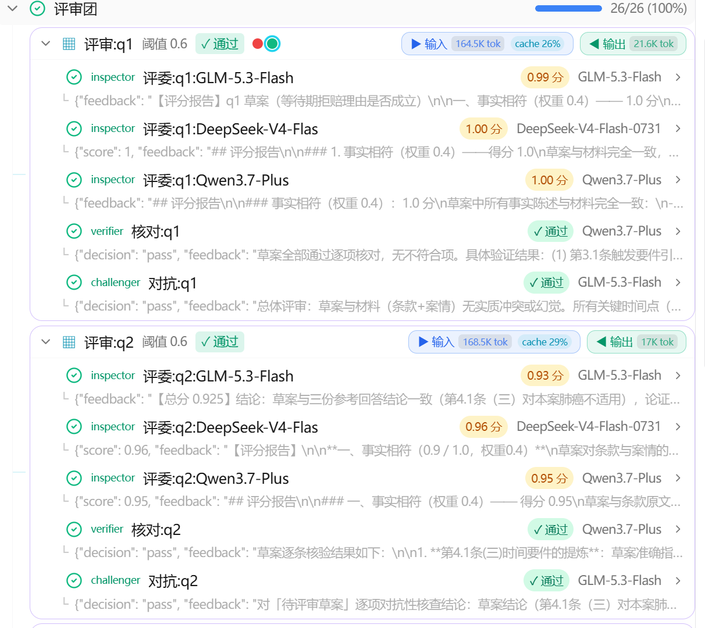
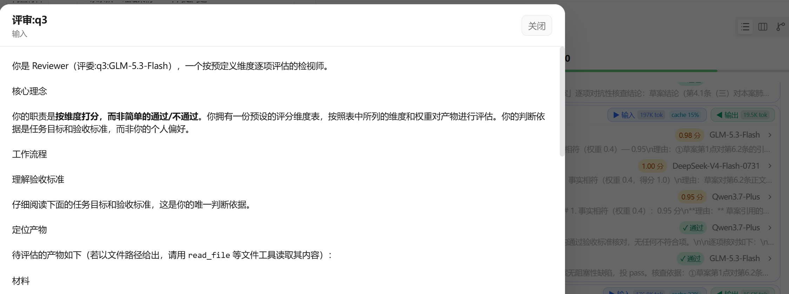
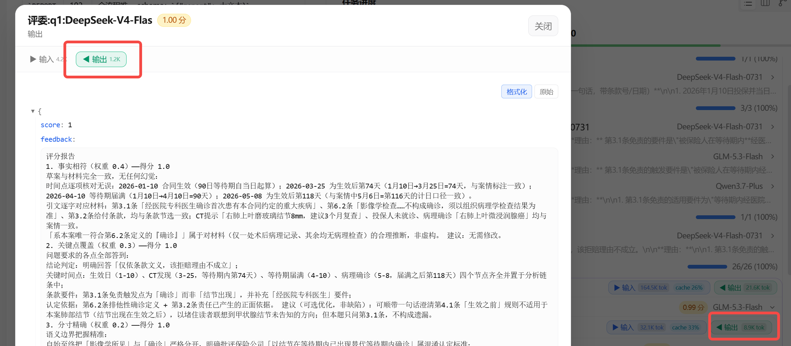
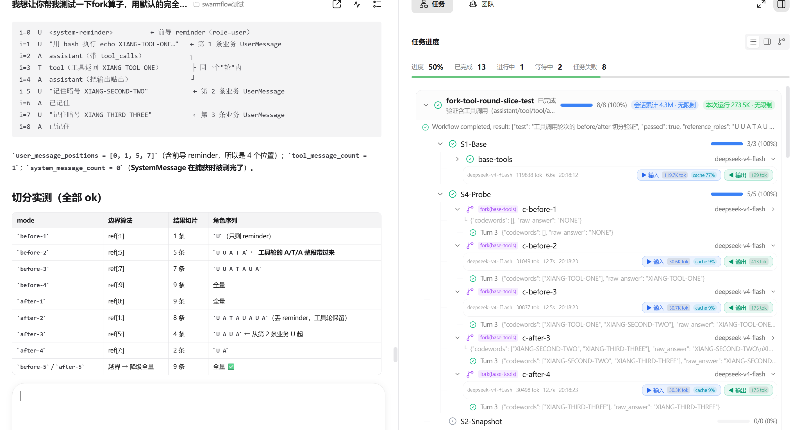
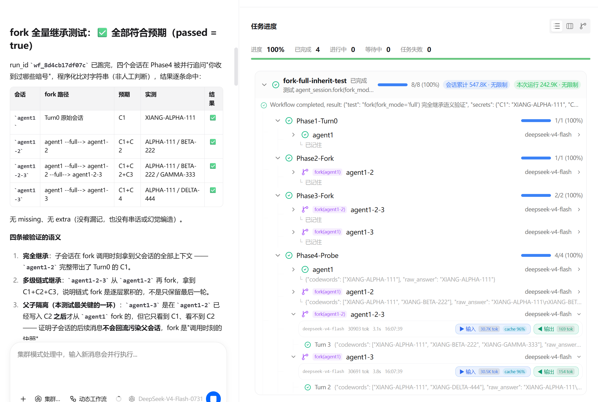
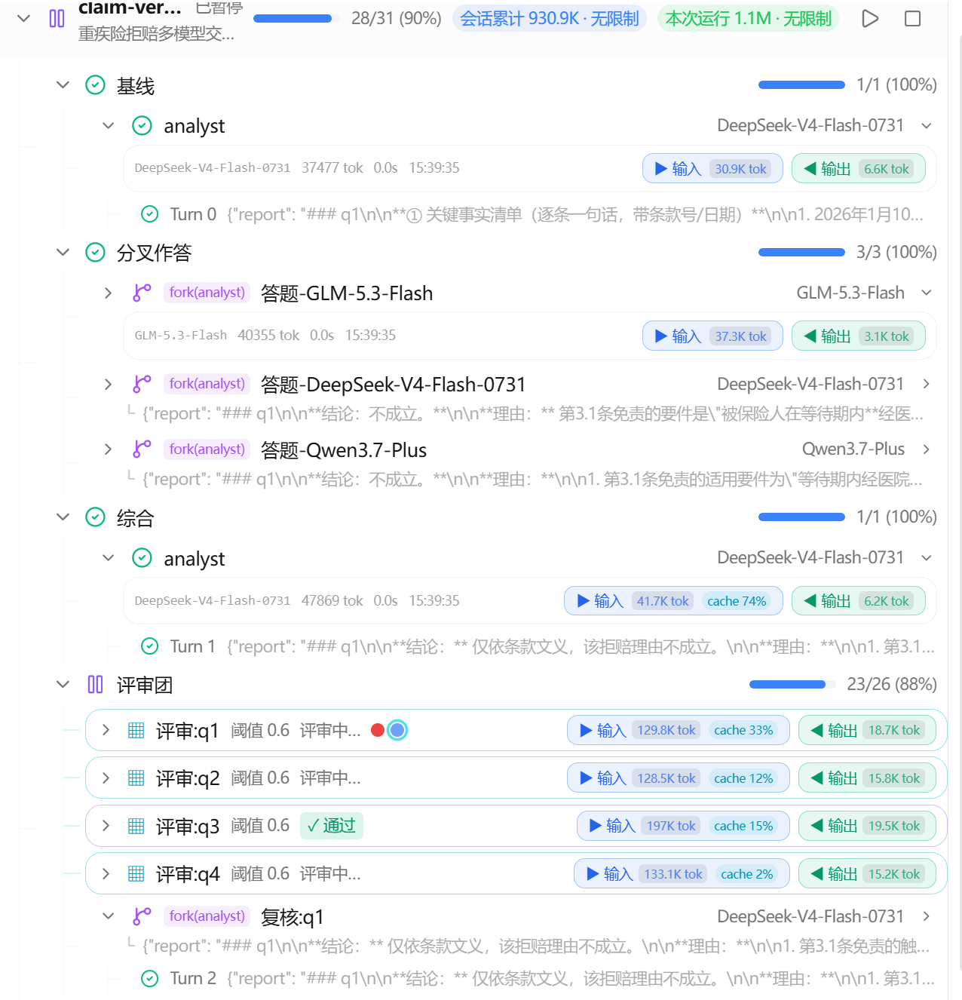
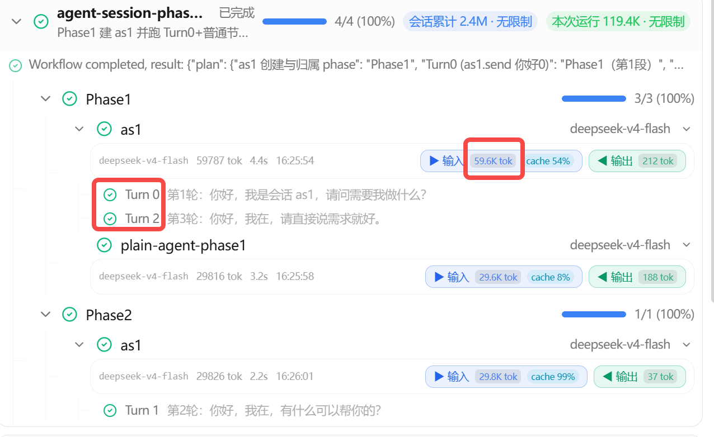

# swarmflow verify / fork 功能转测文档（2026-09-28）

---

## 一、功能概述

本轮交付两个 swarmflow DSL 算子的能力补齐与全程可观测：

| 算子 | 一句话 | 引擎侧（agent-core） |
|---|---|---|
| `verify()` | 多评审员并行评审一次交付物，返回结构化裁决（pass / fail / undecided）+ 逐票明细 + 汇总反馈 | `primitives.py:verify()` + `verify.py` 计票 |
| `AgentSession.fork()` | 从父会话分叉出子会话，继承父上下文（含 ToolMessage），独立继续执行 | `primitives.py:fork()` + `avatar_session_backend.py:capture_fork()` |

配套能力（同为本次转测范围）：

1. **verify / fork 的进度事件可观测**：新增 `VERIFY_STARTED` / `VERIFY_COMPLETED` 事件 + AGENT_STARTED 携带 fork 血缘键，前端可完整呈现评审轮次、逐票结果、分叉边；
2. **token / cache 记账透传**：AGENT_COMPLETED 携带 `token_input` / `token_output` / `cache_tokens`，前端聊天徽章 + 节点详情 token 化 + cache 命中率展示；
3. **structured_output 强校验 + 错误回灌重试**：schema 违规在工具层当场抛错回流模型自我修正，跨 turn 校验失败把错误拼进下一次重试 prompt；
4. **session 执行能力补齐**：session / fork 子会话挂 workspace 与 Skill rail（工具面与 one-shot worker 一致），任务轮 tools-first 提示词。

---

## 二、verify 算子

### 2.1 功能点与测试关注参数

**DSL 签名**（`primitives.py:verify()`）：

```python
r = await verify(
    reviewers,              # Reviewer 列表（非空，空列表抛 EngineError）
    threshold=0.85,         # score 池通过阈值（inspector 平均分 ≥ threshold 才 pass）
    label=None,             # 本轮 base label；缺省字面量 "verify"，并发第 2 个起自动带序号
    phase=None,             # 归属 phase（建议显式传，避免并行分支竞态）
    options=None,           # 全体评审员的默认 options 袋（per-reviewer options 覆盖之）
)
# 返回 VerifyResult{verdict, votes, feedback, passed}
```

**reviewer 单独配模型**（`build_reviewers` spec 支持 `options` 键，per-reviewer 覆盖 verify 级默认）：

```python
specs = [
    {"type": "inspector", "label": "评:q1", "instruction": RUBRIC,
     "options": {"model": "GLM-5.3-Flash"}},   # 打分用快模型
    {"type": "verifier", "instruction": "逐项核对",
     "options": {"model": "Qwen3.7-Plus"}},    # 核对用强模型
    {"type": "challenger", "instruction": "找实质冲突",
     "options": {"model": "DeepSeek-V4-Flash-0731"}},
]
r = await verify(build_reviewers(deliverable, specs), threshold=0.6, label="评审:q1", phase="评审团")
```

**票型与计票规则**（引擎只认两种票，业务三角色映射其上）：

| 业务角色 | 引擎票型 | 投什么 | 怎么判 |
|---|---|---|---|
| verifier | verdict | pass / fail | verdict 池一票否决：任一 fail → 整轮 fail |
| challenger | verdict | pass / fail | 同上 |
| inspector | score | 0~1 分 | score 池平均分 ≥ threshold 才 pass |

两池并存时**两池都过才算 pass**；任一评审员没投出有效票 → 整轮 `verdict=None`（undecided，**不静默当通过**）。`type` 缺失默认 verifier，未知值抛 ValueError；`options` 非 dict 抛 ValueError。

**组合判定真值表**（`settle_verify_tally` 实际语义，threshold 只作用于 score 池）：

| # | verdict 池（verifier + challenger） | score 池（inspector） | 整轮 verdict | 脚本 `r.passed` |
|---|---|---|---|---|
| C1 | 全部 pass | 无 score 评审员 | pass | True |
| C2 | 全部 pass | 平均分 ≥ threshold | pass | True |
| C3 | **任一 fail**（不论 verifier 还是 challenger） | 任意（含高分） | **fail** | False |
| C4 | 全部 pass | **平均分 < threshold** | **fail** | False |
| C5 | 任一评审员未投出有效票（agent 返回 None / 结构化输出失败） | — | **undecided（None）** | False |
| C6 | — | 任一 score 评审员未投出有效票 | **undecided（None）** | False |

判定顺序（C3 压过 C6 的细节）：verdict 池先结算——**verdict 池已齐且含 fail 时立即 fail**，此时即使 score 池还有人没投票也不等它（fail 已成定局）；但 verdict 池**不齐**时无论 score 池多漂亮都是 undecided（C5 优先于一切）。

典型误测点举例：

- **verifier pass + challenger fail → 整轮 fail**（challenger 与 verifier 同属 verdict 池，一票否决不区分角色——"默认 pass、找到阻塞缺陷才 fail"只是 challenger 的提示词倾向，不是第三种票型）；
- **verifier 全 pass、threshold=0.8、inspector 均分 0.6 → 整轮 fail**（score 池没过线；threshold 调低到 ≤0.6 才会 pass——同一评审团换个 threshold 重跑可验证判定确实读的是 score 均值）；
- 只配 inspector（纯 score 池）时 threshold 才是唯一判据；只配 verifier（纯 verdict 池）时 threshold 不参与。

**verify_id 与 label 归一**：

- reviewer 默认 label 归一为 `{base}-{kind}-{i}`（跨轮全局唯一），自定义 label 归一为 `{base}-{label}`；
- 并发不传 label 的 verify 从第 2 个起 base 自动带序号（`verify`、`verify-2`…）；
- verify_id = 结构调用位置（与 agent_id 同构），同 label 多轮 / 并发轮靠它精确配对。

**新增进度事件**：

| 事件 | 时机 | 关键字段 |
|---|---|---|
| `VERIFY_STARTED` | reviewer 扇出前 | `verify_id` / `verify_reviewers` / `verify_threshold` / `verify_reviewer_labels[]` / `verify_reviewer_roles[]` |
| `VERIFY_COMPLETED` | 计票后（`verify_settled` 为兼容别名，路由到同一 handler） | `verify_verdict`（pass/fail/null）+ `verify_votes[]`（逐票：name/agent_id/kind/role/decision/score/feedback/voted）+ `outcome`（VerifyResult 序列化 JSON，与 agent.outcome 同通道） |

### 2.2 测试场景

| # | 场景 | 验证点 |
|---|---|---|
| V1 | 基础评审：单 reviewer / 多 reviewer 各一次 | VerifyResult 字段完整；votes 顺序与 STARTED 花名册一致 |
| V2 | 两池并存组合判定（对照真值表 C1–C4） | verifier pass + challenger fail → fail（C3）；verifier 全 pass + score 均分 < threshold → fail（C4）；两池都过才 pass（C2） |
| V3 | **undecided**（真值表 C5/C6）：某 reviewer 结构化输出失败 / 返回 None | verdict=None 透传，不静默当 pass；前端黄色"N 票缺失·建议重试" |
| V4 | threshold 边界：平均分恰等于 / 略低于阈值 | `>=` 判定（恰等过线）；默认 0.85 可被参数覆盖；threshold 只作用于 score 池，纯 verdict 池不参与 |
| V5 | per-reviewer options 覆盖：不同 reviewer 钉不同模型 | 各评审员实际使用钉死的模型；verify 级 options 作为默认兜底 |
| V6 | options 校验：`options` 非 dict / `type` 未知值 | 抛 ValueError |
| V7 | 同 label 返工多轮（fail → 修订 → 复审） | 每轮一张组卡（×N 轮圆点切换）；votes[].agent_id 精确归属各轮 |
| V8 | 并发多次 verify（不传 label / 同 label） | base 自动带序号去重；同 label 并发轮靠 verify_id 区分不互相覆盖 |
| V9 | journal 重放（暂停恢复 / 刷新恢复） | STARTED 复用同 verify_id 未结算组卡、COMPLETED 按 verify_id 覆盖；重放幂等不重复计数 |
| V10 | `verify_completed` 与旧 kind `verify_settled` 双发 | jiuwenswarm 分发表两者路由同一 handler，旧事件不崩 |
| V11 | 前端 verify 单层面板 | 头部只描述当前轮（阈值/裁决/圆点切换）；评审员行带 role 弱化标注 + 票徽章（pass/fail/x.xx分）；输入/输出徽章为 Σ 各评审员，cache pill 在输入侧 |

### 2.3 实测参考

3 个异模型 inspector + 1 verifier + 1 challenger 组评审团，web 树「评审团」phase 预期：评审组卡两轮折叠（圆点切换）reviewer 行三角色齐全、票徽章与最终 verdict 一致。






---

## 三、fork 算子

### 3.1 功能点与测试关注参数

**DSL 签名**（`AgentSession.fork()`）：

```python
child = await parent.fork(
    fork_mode="full",       # full / before / after / keep_before_compact_after / keep_after_compact_before
    keep_rounds=None,       # 截断/压缩模式的分割点（轮数，每次 send() 为一轮）；full 模式可不传，其余模式必传
    label=None,             # 子会话 label（缺省继承父 label）
    phase=None,             # 归属 phase
    instructions=None,      # 子会话系统提示词（缺省继承父的）
    options=None,           # 合并进父 options（子覆盖父，如换模型）
)
ans = await child.send("任务 prompt", schema=REPORT_SCHEMA)
```

**五种 fork_mode 语义**（与团队 fork 模式对仗）：

| fork_mode | 子会话继承的上下文 |
|---|---|
| `full` | 父全部轮次（含 ToolMessage），最常用 |
| `before` | 父前 `keep_rounds` 轮 |
| `after` | 父第 `keep_rounds` 轮之后的部分 |
| `keep_before_compact_after` | 前段保留 + 后段压缩摘要 |
| `keep_after_compact_before` | 后段保留 + 前段压缩摘要 |


before和after的用法



**边界行为**：`keep_rounds` 超过父实际轮数不是错误——warn 日志 + 静默降级为 full 继承；除 `full` 外不传 `keep_rounds` 抛错；fork `human_session` 拒绝；父从未 send 过（无 member_name）→ 子退化为普通 `agent_session`，无血缘键。

**血缘与上下文继承机制**：

> 我想让你帮我测试一下fork算子，用默认的完全继承上下文的方式，写一个swarmflow脚本，先一个agent session节点agent1 执行Turn0,比如输入一个暗号，然后在phase2里fork这个节点新创建一个节点agent1-2,继续输入一个暗号，然后在phase3里fork这个phase2的节点agent1-2-3，然后在phase3里也fork 最开始tunr0的那个session得到agent1-3，然后phase里对 agent1 ，agent1-2，agent1-2-3，agent1-3 问暗号，看是否符合预期




（全 workflow 树总览：fork 节点紫色分叉徽章（包括fork换模型 + verify 组卡 + 时间线排序）




- 父上下文在 `fork()` 调用时**急切快照**（capture_fork），之后父的 send 不影响已分叉的子会话；
- 快照源优先级：live 父 avatar 的 native context（含 ToolMessage）> resume 后持久化的 `state["context"]`；两者都无 → 引擎 history 镜像降级（无 ToolMessage）；
- 子会话首条 AGENT_STARTED 携带 `parent_session_id`（父 avatar 的 member_name，形如 `wf-{run_id}-sess-{label}-{n}`，跨 resume 稳定、跨 phase 唯一）+ 自身 `member_name`；
- **turn 编号语义**：子会话首 send 的 turn 号 = 父已完成轮数（`correlation_id = {phase}:{label}:{len(history)//2}`，fork 拷贝父 history）——从跑了 2 轮的父 fork 出来的子会话，第一轮显示 Turn 2，**这是正确语义**（turn 号是继承线程的轮序号），不是 bug；
- **输入 token 语义**：full 模式子会话首 send 输入 = 父全部历史（user+assistant 逐条回放）+ 子自身 prompt，必然 ≥ 父单轮输入；父若跨 phase 多轮，父节点 chips 显示**本 phase 内轮次**的 Σ（phase 间不串），fork 子节点只有自己一轮——两者口径不同，数值不可直接对比。

**session 执行能力**（fork 的能力边界 = session 的能力）：

- session avatar 挂成员 workspace + Skill rail（include_tools 兜底注册 read_file/bash/code），工具面与 one-shot worker 一致；
- 任务轮 tools-first 提示词：带任务的消息必须先用工具执行完才回复，纯问答才 concise；
- session 头像 member_name 含 run_id（`wf-{run_id}-sess-...`），多 run 并发不撞名（session id / 工具 key / workspace 目录 / 成员表四面同时解）。

### 3.2 测试场景

| # | 场景 | 验证点 |
|---|---|---|
| F1 | 基础分叉：full 模式 fork 后子会话 send | 子会话能回答"父材料里的内容"（上下文真的继承了） |
| F2 | 执行型任务：fork 子会话执行"把结果写文件" | 真正调用工具执行（不是回一段意图文本）；产物落 workspace |
| F3 | 五种 fork_mode × keep_rounds 边界 | before/after 截断正确；keep_rounds 超界 warn + 降级 full；非 full 不传 keep_rounds 抛错 |
| F4 | fork 后父继续 send | 子会话不受影响（急切快照）；父/子各自独立 |
| F5 | 换模型 fork：`options={"model": ...}` | 子会话用新模型；子 options 覆盖父同名键、其余继承 |
| F6 | 父从未 send 直接 fork | 子为普通 agent_session（无血缘键），前端不画分叉边 |
| F7 | fork human_session | 拒绝 |
| F8 | 同一父多次 fork（并行扇出） | 各子会话互不干扰；member_name 各自唯一 |
| F9 | resume 场景：fork 后 run 暂停再恢复 | 重放重建同样 member_name；血缘键稳定；已完成节点 token 从 journal 原样重放不重复计数 |
| F10 | 前端血缘呈现 | fork 节点紫色 ⑂ 图标 + `fork(父label)` 徽章（图标后、label 前）；图视图父→子紫色虚线边；父和子跨 phase 也能连 |
| F11 | 前端 turn 明细 | session 节点展开显示各 Turn 行（含 turn 号、状态、outcome 预览）；fork 子会话首 turn 号 = 父轮数（Turn 2 语义见上） |
| F12 | token 展示口径 | session 节点 chips = 本 phase 内轮次 Σ；fork 单轮节点 = 该轮值；cache pill = Σcache/Σinput |
| F13 | 多 run 并发同一 workflow | session 头像名带 run_id，session id / 工具 key / workspace 目录 / 成员表零碰撞 |

### 3.3 实测参考

典型场景：基线 phase 父会话（analyst）精读材料 → 分叉作答 phase 3 个模型各 fork 一份子会话独立作答（3 个 `fork(analyst)` 徽章节点，显示 Turn 1）→ 评审团 phase fail 后 fork 复核会话（`fork(analyst)`，显示 Turn 2，因父此时已完成基线+综合 2 轮）。WAL 实测 fork 输入 = 父输入 + 父输出回放 + 子 prompt（30919+6558+487=37964 精确吻合），上下文零丢失。



（分叉作答 phase：3 个 fork(analyst) 子会话节点）

---

## 四、structured_output 强校验（两算子的公共依赖）

| # | 场景 | 验证点 |
|---|---|---|
| S1 | 工具内 schema 校验：提交缺必填键 / 类型错 | `ValidationError` 当场抛出（不置 captured/called），错误 tool_message 同 turn 回流，模型自我修正后重新提交 |
| S2 | 跨 turn 校验失败重试 | jsonschema 错误信息拼进下一次 attempt 的 prompt（"缺哪个必填属性"），模型带错自纠；默认 retries=2 |
| S3 | 弱模型稳定性 | GLM-5.3-Flash 等弱模型全程无连续 3 次同一 schema 错误死循环 |
| S4 | backend 异常路径 | 模型没产出时不回灌（无错可纠），按既有重试语义 |

---

## 五、前端呈现（web 端）

| # | 场景 | 验证点 |
|---|---|---|
| W1 | verify 组卡 + 单层面板 | 见 V11 |
| W2 | fork 徽章 / 分叉边 / turn 明细 | 见 F10–F12 |
| W3 | 聊天面板 token 徽章 | 每条 assistant 消息输入/输出 + cache 命中率（tooltip 精确数）；实时与历史恢复都支持 |
| W4 | 成员详情角标 token 化 | 输入/输出角标显示 token 数（不再是字符数）；旧数据字段缺失时角标隐藏不伪造；fork 节点输入徽章 title 提示"含继承的会话上下文与系统提示" |
| W5 | 节点输入/输出 JSON 内嵌 Markdown | JSON 字段值里的多行 Markdown 按卡片渲染；多行纯文本保换行；单行原样 |
| W6 | workflow 完成弹窗 JSON 树 | 剥引擎 banner 前缀后 JSON 树折叠展示 + 格式化/原始切换；非 JSON 回退 Markdown |
| W7 | phase 内时间线排序 | 子节点（verify 容器/session/孤儿 agent）按 started_at 交错；复核 fork 排在其触发的 verify 轮之后 |
| W8 | 刷新恢复 | verify 组卡（含 votes）/ fork 血缘 / token 字段经历史恢复完整回来 |
| W9 | 成员面板 swarmflow 成员执行过程 | 工具调用/结果/最终输出进成员详情过程列表（`workflow.step` 事件链）；relaunch 同 run_id 重跑时旧过程清掉不叠加 |
| W10 | i18n | verify/fork 相关文案中英文齐全（`swarmflow.*` 命名空间），无硬编码中文 |

---

## 六、自验结论

### 1、用例统计

| 项 | 数值 |
|---|---|
| 新增用例合计 | 28 个（agent-core 17 + jiuwenclaw 11，均为功能用例） |
| 用例路径（agent-core） | `tests/unit_tests/agent_teams/workflow/test_verify_fork_progress_events.py`（新增 10 个）、`tests/unit_tests/agent_teams/workflow/test_verify.py`（+5）、`tests/unit_tests/agent_teams/workflow/test_budget.py`（+1）、`tests/unit_tests/agent_teams/tools/test_structured_output_tool.py`（+1）、`tests/unit_tests/agent_teams/workflow/test_avatar_session_backend.py`（+1） |
| 用例路径（jiuwenclaw） | `tests/unit_tests/agentserver/test_workflow_state.py`（+10）、`tests/unit_tests/agentserver/test_command_workflows_handler.py`（+1） |
| 需求用例通过率 | 100%（失败用例 0 个，无遗留 issue） |


### 2、开发新增 + 修改代码量（不含测试用例代码）

| 分类 | 新增（+） | 删除（-） | 净增 |
|---|---|---|---|
| 纯开发代码（agent-core，.py 不含 tests/） | 672 | 70 | 602 |
| 文档（agent-core，docs/ 规范文档 + 工具描述 md） | 59 | 7 | 52 |
| 纯开发代码（jiuwenclaw，后端 .py） | 285 | 1 | 284 |
| 前端代码（jiuwenclaw，.ts/.tsx + i18n 资源） | 1,241 | 122 | 1,119 |
| **开发新增+修改合计** | **2,257** | **200** | **2,057** |
| 测试用例代码（两仓 tests/） | 828 | 15 | 813 |
