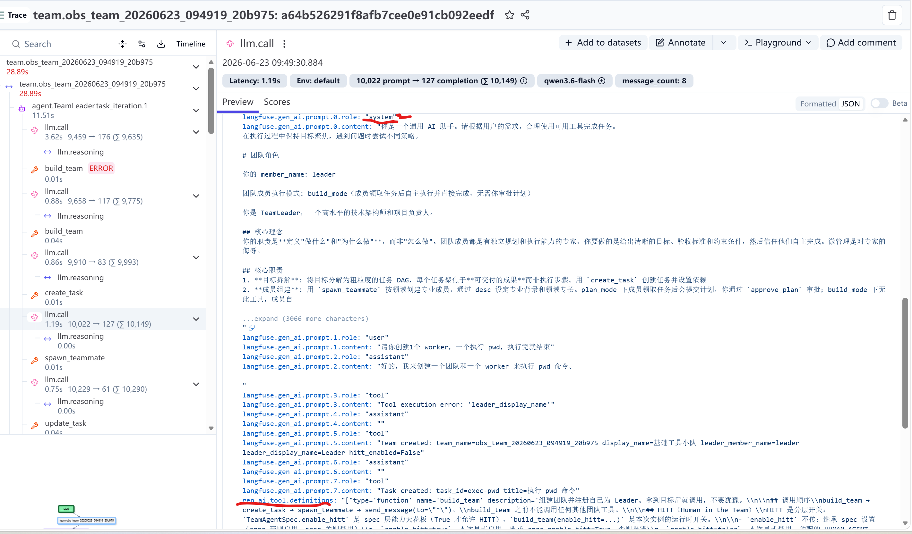
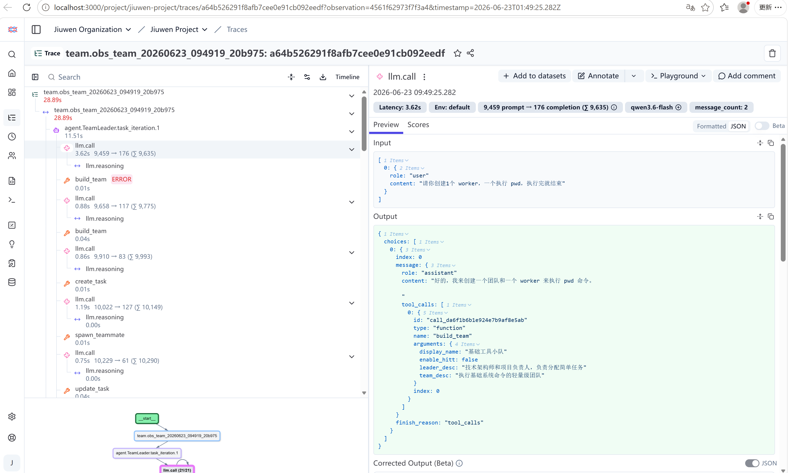
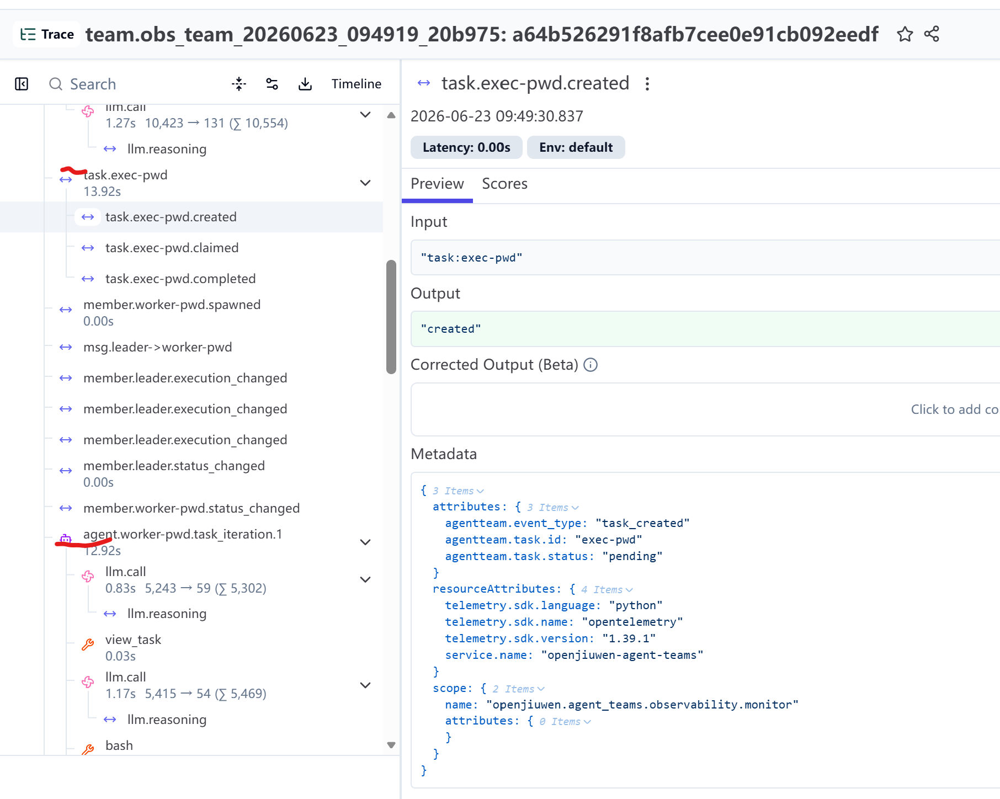

# Observability（OTel Trace）转测说明

## 0. 数据流架构

```
┌──────────────────────────────────────────────────────────────────────────┐
│                          Application (agent-core)                         │
│                                                                          │
│  Runner.run_agent_team                                                   │
│       │                                                                  │
│       ├─ ObservabilityRail ──── agent span (before/after iteration)      │
│       ├─ OtelCallbackHandler ── llm / tool / reasoning spans             │
│       ├─ OtelTeamMonitorHandler ─ task / member / msg / team spans       │
│       │                                                                  │
│       ▼                                                                  │
│  ┌─ TracerProvider ──────────────────────────────────────────────────┐  │
│  │  Resource: service_name                                           │  │
│  │  Sampler:  ParentBased(TraceIdRatioBased(sample_rate))            │  │
│  │                                                                    │  │
│  │  SpanProcessor 链（顺序执行）：                                     │  │
│  │    [0] ActiveSpanTracker  ← 内存管理：跟踪/兜底关闭活跃 span      │  │
│  │    [1] BatchSpanProcessor ← 批量导出：攒一批 span 再发送           │  │
│  │          └─ OTLPSpanExporter ──→ Collector / Langfuse Cloud       │  │
│  └───────┬───────────────────────────────────────────┬───────────────┘  │
│          │                                           │                  │
│          │ Method 1: OTLP gRPC                       │ Method 2:       │
│          │ endpoint=localhost:4317                    │ OTLP HTTP       │
│          │ 无认证                                    │ + Basic Auth    │
│          │                                           │ (pk/sk →       │
│          │                                           │  Authorization) │
│          │                                           │                  │
└──────────┼───────────────────────────────────────────┼──────────────────┘
           │                                           │
           ▼                                           │ (直连，绕过
┌──────────────────────────────────────────────────────┼─── Collector)
│  OTel Collector (docker-compose)                     │
│                                                      │
│  receivers:                                          │
│    otlp/grpc  ← :4317，应用上报，无认证             │
│    otlp/http  ← :4318，可选，无认证                 │
│                                                      │
│  processors:                                         │
│    memory_limiter → batch → transform/limit_strings  │
│                       (截断 16KiB)                   │
│                                                      │
│  exporters:                                          │
│    otlphttp ──→ Langfuse (:3000/api/public/otel)    │
│      Authorization: Basic <base64(pk:sk)>            │
│      ak/sk 配在此处，应用端无需知道                 │
│    debug ──→ console (调试用，生产应移除)            │
│                                                      │
└──────────┬───────────────────────────────────────────┘
           │
           ▼
┌──────────────────────────────────────────────────────────────────────────┐
│  Langfuse (docker-compose)                                              │
│                                                                         │
│  langfuse-web  (:3000)  ← UI 查看 trace                                │
│  langfuse-worker        ← 异步写入 ClickHouse                           │
│  postgres               ← 业务数据                                      │
│  clickhouse             ← trace 持久化                                  │
│  redis                  ← 队列 / 缓存                                   │
│  minio                  ← 大对象存储                                     │
└──────────────────────────────────────────────────────────────────────────┘
```

**认证说明**：

- Method 1（推荐）：应用 → Collector 无认证；ak/sk 在 Collector 出口配（`otel-collector-config.yaml`）
- Method 2（直连）：应用自带 `langfuse_public_key` / `langfuse_secret_key`，用于 Basic Auth header

---

## 1. 需求范围

将 Agent Team 运行期完整调用链通过 OTLP 协议导出到 OpenTelemetry 兼容后端（Langfuse / Grafana / Jaeger 等）。

**原则**：零侵入 — 不修改 team/member/task 运行逻辑。所有异常被 catch，不影响业务。

### 1.1 Span 树结构

```
team.{team_name}                                    ROOT（duration = 业务全生命周期）
├── agent.{member}.task_iteration.{n}               AGENT（duration = 单次 task_loop iteration）
│   ├── llm.call                                    GENERATION（duration = 单次 LLM 调用）
│   │   └── llm.reasoning                           SPAN（条件创建，有 reasoning_content 时）
│   └── tool.{name}                                 TOOL（duration = 单次工具调用）
├── task.{task_id}                                  SPAN（duration = 任务创建到关闭）
│   ├── task.{task_id}.created                      SPAN（duration≈0）
│   ├── task.{task_id}.claimed                      SPAN（duration≈0）
│   └── task.{task_id}.completed                    SPAN（duration≈0）
├── member.{name}.spawned                           SPAN（duration≈0）
├── member.{name}.status_changed                    SPAN（duration≈0）
├── member.{name}.execution_changed                 SPAN（duration≈0）
├── msg.{from}->{to}                                SPAN（duration≈0）
├── msg.broadcast.{from}                            SPAN（duration≈0）
├── team.completed / team.cleaned                   SPAN
├── team_standby                                    SPAN
└── ...（所有 TeamEvent 类型自动覆盖，见第 4 节）
```

### 1.2 采集范围

通过 `OtelTeamMonitorHandler` 反射自动发现 `TeamEvent` 的所有枚举值，**所有已发布的 TeamEvent 类型均会被采集**。具体分发：

| 事件类型 | Span 名称 | 采集方式 |
|----------|-----------|----------|
| CREATED | 写 team span 属性 | 直接设置 team span attribute |
| CLEANED | `team.cleaned` | `_record_team_cleaned` |
| TEAM_COMPLETED | `team.completed` | `_record_team_completed` |
| STANDBY | `team_standby` | `_record_team_completed` |
| TASK_CREATED | `task.{id}` / `task.{id}.created` | open/close cycle |
| TASK_CLAIMED / UNBLOCKED / UPDATED / CANCELLED | `task.{id}.{status}` | event span (duration≈0) |
| TASK_COMPLETED / TASK_FAILED | 关闭对应 task span | close existing task span |
| PLAN_APPROVAL | `plan.approval` | `_record_plan_approval` |
| MEMBER_SPAWNED / SHUTDOWN / CANCELED / RESTARTED / STATUS_CHANGED / EXECUTION_CHANGED | `member.{name}.{action}` | `_record_member_event` |
| MESSAGE / BROADCAST | `msg.{from}->{to}` / `msg.broadcast.{from}` | `_record_message_event` |
| WORKTREE_CREATED / REMOVED | `worktree.{created/removed}.{path}` | `_record_generic_event` |
| WORKSPACE_* | `workspace.{action}.{path}` | `_record_generic_event` |
| WORKFLOW_PROGRESS | `workflow.{action}` | `_record_generic_event` |
| 其他所有 TeamEvent（兜底） | `event.{event_type}` | `_record_generic_event`（反射自动发现） |

兜底机制：`_ALL_TEAM_EVENT_TYPES` 通过 `dir(TeamEvent)` 反射自动获取所有枚举值，新增事件类型无需手动维护白名单。

---

## 2. 各 Span 类型字段详解

### 2.1 Team Span

- **名称**：`team.{team_name}`
- **创建时机**：`_maybe_attach_observability`（Runner 在 agent.stream() 前调用）
- **关闭时机**：`_maybe_finalize_trace`（Runner.finally 块）
- **时长**：team 从 stream 开始到 Runner 退出（含 coordinator loop idle 时间）

| 属性 Key | 来源 | 说明 |
|----------|------|------|
| `agentteam.team.name` | `get_or_create_team_span(team_name)` | team name |
| `agentteam.team.display_name` | `TeamCreatedEvent.payload.display_name` | 显示名 |
| `agentteam.team.leader` | `TeamCreatedEvent.payload.leader_member_name` | leader 成员名 |
| `agentteam.event_type` | `TeamEvent.CREATED` | 事件类型 |
| `session.id` | `TeamCreatedEvent.payload.session_id` 或 `get_session_id()` ContextVar | 会话 ID |
| `langfuse.trace.name` | `f"team.{team_name}"` | Langfuse trace 名称 |
| `langfuse.trace.tags` | `[team_name]` | Langfuse trace 标签 |
| `langfuse.observation.input` | `TeamCreatedEvent.payload.input` 或 `payload.query` | 初始用户输入 |
| `langfuse.observation.output` | leader 最终 invoke output（如果 role==LEADER） | 最终输出 |

### 2.2 Agent Span

- **名称**：`agent.{member_name}.task_iteration.{n}`
- **创建时机**：`ObservabilityRail.before_task_iteration`
- **关闭时机**：`ObservabilityRail.after_task_iteration`
- **时长**：单次 outer task-loop iteration（含 LLM + tool 执行）

| 属性 Key | 来源 | 说明 |
|----------|------|------|
| `langfuse.observation.type` | 硬编码 `"agent"` | Langfuse 类型标签 |
| `agentteam.agent.id` | `f"{team_name}_{member_name}"` | agent 唯一 ID |
| `agentteam.agent.name` | `ctx.agent.card.name` | member 名称 |
| `agentteam.agent.role` | `ctx.agent.card.name` | 角色名 |
| `agentteam.team.id` | `ctx.agent.team_name` | 所属 team |
| `agentteam.team.name` | `ctx.agent.team_name` | 所属 team |
| `agentteam.member.id` | `ctx.agent.card.name` | member ID |
| `agentteam.member.name` | `ctx.agent.card.name` | member 名称 |
| `agentteam.session.id` | `get_session_id()` ContextVar | 会话 ID |
| `session.id` | `get_session_id()` ContextVar | Langfuse session |
| `deepagent.task.iteration` | `ctx.inputs.iteration` | 迭代序号 |
| `deepagent.task.is_follow_up` | `ctx.inputs.is_follow_up` | 是否后续追问 |
| `deepagent.task.loop_event` | `ctx.inputs.loop_event` | 触发事件 |
| `gen_ai.request.message_count` | 上一次 LLM 调用的消息数 | 用于 delta 输入计算（见关键机制） |
| `langfuse.observation.input` | `ctx.inputs.query`（脱敏后） | 输入 query |
| `agentteam.agent.input` | 同上 | 输入 query |
| `langfuse.observation.output` | `ctx.inputs.result`（脱敏后） | 迭代输出 |
| `agentteam.agent.output` | 同上 | 迭代输出 |

**异常关闭时**：cascade-drain 子 span（LLM/tool）不设 Status(OK)，保持 UNSET 以便 Langfuse 辨识。

### 2.3 llm.call Span

- **名称**：`llm.call`
- **创建时机**：`LLM_INVOKE_INPUT` 回调事件（流式/非流式均在此创建）
- **关闭时机**：非流式——`LLM_INVOKE_OUTPUT`；流式——最后一个 `LLM_NEW_TOKEN` 之后
- **时长**：LLM_INVOKE_INPUT 到 LLM_INVOKE_OUTPUT（或流式最后一个 chunk）的实际耗时

| 属性 Key | 来源 | 说明 |
|----------|------|------|
| `gen_ai.system` | `_gen_ai_system_name()` | 固定 `"openjiuwen"` |
| `gen_ai.operation.name` | 硬编码 `"chat"` | → Langfuse 推断为 GENERATION |
| `gen_ai.provider.name` | `kwargs["model"]` 推导 | 模型提供商 |
| `gen_ai.request.model` | `kwargs["model"]` 或推导 | 模型名 |
| `gen_ai.request.temperature` | `kwargs["temperature"]` | 温度参数 |
| `gen_ai.request.top_p` | `kwargs["top_p"]` | top_p |
| `gen_ai.request.max_tokens` | `kwargs["max_tokens"]` | 最大 token 数 |
| `gen_ai.request.message_count` | `len(messages)` | 消息总数 |
| `gen_ai.prompt.{i}.role` | `messages[i].role` | 每条消息角色（全量） |
| `gen_ai.prompt.{i}.content` | `messages[i].content`（脱敏后） | 每条消息内容（全量） |
| `langfuse.gen_ai.prompt.{i}.role` | 同上 | Langfuse 兼容键 |
| `langfuse.gen_ai.prompt.{i}.content` | 同上 | Langfuse 兼容键 |
| `gen_ai.tool.definitions` | `kwargs["tools"]`（JSON 序列化） | 可用工具定义 |
| `gen_ai.completion.0.role` | 硬编码 `"assistant"` | 回复角色 |
| `gen_ai.completion.0.content` | response.content（脱敏后） | 回复内容 |
| `langfuse.gen_ai.completion.0.role` | 同上 | Langfuse 兼容键 |
| `langfuse.gen_ai.completion.0.content` | 同上 | Langfuse 兼容键 |
| `gen_ai.tool_calls` | response.tool_calls（JSON 序列化） | 工具调用（如有） |
| `gen_ai.usage.prompt_tokens` | usage_metadata.input_tokens | prompt token 数 |
| `gen_ai.usage.completion_tokens` | usage_metadata.output_tokens | completion token 数 |
| `gen_ai.usage.total_tokens` | usage_metadata.total_tokens | 总 token 数 |
| `gen_ai.response.finish_reason` | response.finish_reason | 结束原因 |
| `gen_ai.response.model` | usage_metadata.model_name | 实际模型名 |
| `gen_ai.response.time_to_first_token_ms` | 流式：首个 chunk 时间 - 调用开始时间 | 首 token 延迟（仅流式） |
| `langfuse.observation.input` | **delta 策略**：上次 LLM 调用之后新增的消息（JSON），首次调用/压缩后展示去 system 全量；截断 81920 字符 | Langfuse UI 输入显示（精简） |
| `langfuse.observation.output` | choice JSON（含 role/content/tool_calls/finish/usage） | Langfuse UI 输出显示 |

**关于 `gen_ai.prompt` vs `langfuse.gen_ai.prompt`**：
- `gen_ai.prompt.{i}` → OTel 标准语义键，零基索引。Langfuse 的 OTel processor 对此键有特殊映射逻辑
- `langfuse.gen_ai.prompt.{i}` → Langfuse 命名空间下的镜像键，避免与标准键的映射冲突

**异常关闭时**：output 设置为 `"cancelled"`。

### 2.4 llm.reasoning Span

- **名称**：`llm.reasoning`
- **创建时机**：`_finalize_llm_span_output`（LLM 输出组装阶段）
- **关闭时机**：同上（同步代码块）
- **时长**：≈ 0（同步创建+关闭，不代表实际推理耗时）
- **条件**：仅当 `reasoning_text` 非空时创建

| 属性 Key | 来源 | 说明 |
|----------|------|------|
| `gen_ai.completion.0.role` | 硬编码 `"reasoning"` | 角色 |
| `gen_ai.completion.0.is_reasoning` | 硬编码 `True` | 标记为推理 |
| `gen_ai.completion.0.content` | `reasoning_text`（脱敏后） | 推理/思维链内容 |
| `langfuse.observation.input` | 硬编码 `"llm reasoning"` | |
| `langfuse.observation.output` | `reasoning_text`（脱敏后） | |

**已知限制**：reasoning span 在 `_finalize_llm_span_output` 中同步创建+关闭——此时所有 reasoning chunk 已收齐（流式）或 response 已返回（invoke），span 仅作为数据容器存在，时长 ≈ 0。非 invoke/流式差异问题，无论哪种调用方式，reasoning span 创建时机都在 LLM 输出完成之后。如需真实推理耗时，需要在第一个 reasoning chunk 到达时（`on_llm_new_token`）创建 span，在最后一个 reasoning chunk 到达时关闭。

### 2.5 Tool Span

- **名称**：`tool.{tool_name}`
- **创建时机**：`TOOL_CALL_STARTED` 回调事件
- **关闭时机**：`TOOL_CALL_FINISHED` 回调事件
- **时长**：TOOL_CALL_STARTED 到 TOOL_CALL_FINISHED 的实际耗时

| 属性 Key | 来源 | 说明 |
|----------|------|------|
| `langfuse.observation.type` | 硬编码 `"tool"` | Langfuse 类型标签 |
| `gen_ai.tool.name` | `kwargs["tool_name"]` | 工具名 |
| `gen_ai.tool.id` | `kwargs["tool_id"]` | 工具调用 ID |
| `gen_ai.tool.input` | `kwargs["inputs"]`（JSON 序列化 + 脱敏） | 输入参数 |
| `gen_ai.tool.output` | `kwargs["result"]`（JSON 序列化 + 脱敏） | 返回结果 |
| `langfuse.observation.input` | 同上 | Langfuse UI 输入显示 |
| `langfuse.observation.output` | 同上 | Langfuse UI 输出显示 |

**异常关闭时**：output 设置为 `"cancelled"`。

### 2.6 Task Span

- **名称**：`task.{task_id}` / `task.{task_id}.{status}`
- **时长**：task span（open/close cycle）从 TASK_CREATED 到 TASK_COMPLETED/FAILED
- **状态 event span**（duration≈0）：claimed / unblocked / updated / cancelled

| 属性 Key | 来源 | 说明 |
|----------|------|------|
| `agentteam.event_type` | 事件类型 | TASK_CREATED / TASK_CLAIMED 等 |
| `agentteam.task.id` | `payload["task_id"]` | 任务 ID |
| `agentteam.task.status` | 从事件类型推导 | 任务状态 |
| `agentteam.task.assignee` | `payload["member"]` | 指派人（如有） |
| `agentteam.team.name` | `payload["team_name"]` | 所属 team |
| `session.id` | `get_session_id()` ContextVar | 会话 ID |
| `langfuse.observation.input` | `f"task:{task_id}"` 或 status 描述 | |
| `langfuse.observation.output` | status 描述（含 member 信息） | |

### 2.7 Member Event Span

- **名称**：`member.{member_name}.{action}`（action ∈ {spawned, shutdown, canceled, restarted, status_changed, execution_changed}）
- **时长**：≈ 0（瞬时事件）

| 属性 Key | 来源 | 说明 |
|----------|------|------|
| `agentteam.event_type` | 事件类型 | |
| `agentteam.member.name` | 事件 payload | member 名称 |
| `agentteam.team.name` | payload 或 event.team_name | 所属 team |
| `agentteam.member.status.old` | MEMBER_STATUS_CHANGED 时 | 旧状态 |
| `agentteam.member.status.new` | MEMBER_STATUS_CHANGED 时 | 新状态 |
| `agentteam.member.restart_reason` | MEMBER_RESTARTED 时 | 重启原因 |
| `agentteam.member.restart_count` | MEMBER_RESTARTED 时 | 重启次数 |
| `agentteam.member.shutdown_force` | MEMBER_SHUTDOWN 时 | 是否强制 |
| `session.id` | `get_session_id()` ContextVar | 会话 ID |
| `langfuse.observation.input` | 事件 payload（JSON） | |
| `langfuse.observation.output` | action 描述 | |

### 2.8 Message Span

- **名称**：`msg.{from}->{to}`（点对点）/ `msg.broadcast.{from}`（广播）
- **时长**：≈ 0（瞬时事件）

| 属性 Key | 来源 | 说明 |
|----------|------|------|
| `agentteam.event_type` | MESSAGE 或 BROADCAST | |
| `agentteam.message.id` | `payload["message_id"]` | 消息 ID |
| `agentteam.message.from` | `payload["from_member_name"]` | 发送方 |
| `agentteam.message.to` | `payload["to_member_name"]` | 接收方 |
| `agentteam.message.broadcast` | 是否广播 | bool |
| `agentteam.team.name` | event.team_name | 所属 team |
| `session.id` | `get_session_id()` ContextVar | 会话 ID |
| `langfuse.observation.input` | 事件 payload（JSON） | |
| `langfuse.observation.output` | 消息内容 | |

### 2.9 其他 Span（Plan / Worktree / Workspace / Workflow / 兜底）

- PLAN_APPROVAL → `plan.approval`
- WORKTREE_CREATED → `worktree.created.{path}`
- WORKTREE_REMOVED → `worktree.removed.{path}`
- WORKSPACE_* → `workspace.{action}.{path}`
- WORKFLOW_PROGRESS → `workflow.{action}`
- 其他所有 TeamEvent → `event.{event_type}`（兜底）

均设置 `agentteam.event_type`、`agentteam.team.name`、`session.id`，有 name/path 时附加对应属性。

---

## 3. 使用方法

### 3.1 安装依赖

Observability 功能依赖 OpenTelemetry 相关包。根据使用场景选择安装方式：

**agent_teams SDK（openjiuwen）— 可选依赖**

observability 是 openjiuwen 的可选依赖组（`[observability]`），不在默认安装中。使用前需单独安装：

```bash
# 方式一：pip 安装可选依赖组
pip install openjiuwen[observability]

# 方式二：本地开发（agent-core 仓库）
cd D:\workdir\agent-core
pip install -e ".[observability]"
```

包含的包：
- `opentelemetry-api>=1.25.0`
- `opentelemetry-sdk>=1.25.0`
- `opentelemetry-exporter-otlp-proto-grpc>=1.25.0`
- `opentelemetry-exporter-otlp-proto-http>=1.25.0`

> **说明**：未安装这些包时，`init_observability()` 和 `ObservabilityRail` 的 import 会抛 `ImportError`，不会影响非 observability 功能。

**jiuwenclaw（jiuwenswarm）— 已内置**

jiuwenswarm 的主依赖已包含 observability 相关包（见 `pyproject.toml` 的 `dependencies`），无需额外安装。

### 3.2 启动 OTel Collector + Langfuse（Docker）

在 **jiuwenclaw** 仓库的 `deploy/observability/` 目录下提供了完整的 docker-compose 配置，包含 OTel Collector + Langfuse + Postgres + ClickHouse + Redis + MinIO 全套服务。

```bash
# 进入 jiuwenclaw 仓库的 observability 部署目录
cd D:\workdir\jiuwenclaw\deploy\observability

# 启动所有服务（首次启动约需 30-60s 等待健康检查）
docker-compose up -d

# 查看服务状态
docker-compose ps

# 查看 OTel Collector 日志（确认 span 导出正常）
docker-compose logs -f otel-collector
```

**架构流程**：

```
Application --(OTLP gRPC :4317)--> OTel Collector --(OTLP HTTP)--> Langfuse (:3000)
Application --(OTLP HTTP  :4318)--> OTel Collector                (Basic Auth)
```

**访问 Langfuse UI**：

- URL: `http://localhost:3000`
- 登录账号: `jiuwenswarm@jiuwen.local`
- 登录密码: `jiuwenswarm`
- 项目密钥: `pk-lf-jiuwen` / `sk-lf-jiuwen`（用于 OTLP Basic Auth）

**停止与清理**：

```bash
# 停止服务（保留数据卷）
docker-compose down

# 停止并清除所有数据
docker-compose down -v
```

> **说明**：生产环境请修改 `docker-compose.yml` 中的 `NEXTAUTH_SECRET`、`SALT`、`ENCRYPTION_KEY` 及数据库密码，切勿使用默认值暴露在公网。

### 3.3 启用 Observability（两种场景）

#### 3.3.1 agent_teams SDK 独立使用（Python API）

```python
from openjiuwen.agent_teams.observability import (
    ObservabilityConfig, ObservabilityRail,
    init_observability, shutdown_observability,
)

# 1. 初始化 observability
init_observability(ObservabilityConfig(
    enabled=True,
    service_name="openjiuwen-agent-teams",
    exporter="otlp_grpc",         # otlp_grpc | otlp_http | console
    endpoint="http://localhost:4317",
    sample_rate=1.0,
    redact_prompts=False,          # True → 输入(prompt/tool input)替换为 sha256:哈希，原文不可见
    redact_completions=False,      # True → 输出(LLM回答/tool结果)替换为 sha256:哈希，原文不可见
    attribute_value_max_length=8192,
))

# 2. 在 spec 中配置 rail（TeamAgentSpec 构建时加入 ObservabilityRail）
#    Runner 框架自动调用 attach / finalize

# 3. 应用退出时关闭
shutdown_observability()
```

#### 3.3.2 jiuwenclaw（jiuwenswarm）配置启用

jiuwenswarm 已内置 observability 适配，只需在配置文件中打开开关即可：

编辑 `~/.jiuwenswarm/config/config.yaml`（或 `jiuwenswarm/resources/config.yaml`），将 `team_observability.enabled` 设为 `true`：

```yaml
team_observability:
  enabled: true                    # 将 false 改为 true
  exporter: otlp_grpc              # otlp_grpc / otlp_http / console
  endpoint: http://localhost:4317  # OTLP gRPC endpoint（与 docker-compose 对应）
  service_name: jiuwenswarm        # 服务名称
  sample_rate: 1.0                 # 采样率
  redact_prompts: false            # 输入脱敏：True → prompt/tool input 替换为 sha256:哈希
  redact_completions: false        # 输出脱敏：True → LLM回答/tool结果 替换为 sha256:哈希
  attribute_value_max_length: 10240
  langfuse_public_key: ""          # Langfuse Cloud 认证（可选）
  langfuse_secret_key: ""          # Langfuse Cloud 认证（可选）
```

重启 jiuwenswarm 服务后生效。应用会自动将 `OtelTeamMonitorHandler` 注册到 `TeamAgent`，将所有 `TeamEvent` 转为 OTel span 导出。

> **说明**：`team_observability` 与 `telemetry` 配置是独立的。`telemetry` 负责 LLM 调用级别的采集，`team_observability` 专门用于 TeamAgent 的 team/member/task/message 级别 span。两者可以同时启用。

### 3.4 配置项

| 字段 | 默认值 | 说明 |
|------|--------|------|
| `enabled` | True | 总开关 |
| `service_name` | openjiuwen | OTel service.name |
| `exporter` | otlp_grpc | otlp_grpc / otlp_http / console |
| `endpoint` | http://localhost:4317 | OTLP 端点 |
| `sample_rate` | 1.0 | 采样率 |
| `redact_prompts` | False | 输入脱敏：True 时 prompt/tool input 替换为 `sha256:` + 前16位哈希，原文不可见；False 时原文写入（只做截断） |
| `redact_completions` | False | 输出脱敏：True 时 LLM 回答/tool 结果替换为 `sha256:` + 前16位哈希，原文不可见；False 时原文写入（只做截断）。两个开关独立，可分别配置 |
| `attribute_value_max_length` | 8192 | 属性值截断长度 |
| `langfuse_public_key` | - | Langfuse Cloud 直连 |
| `langfuse_secret_key` | - | Langfuse Cloud 直连 |

### 3.5 Langfuse Trace 查看示例

启用后运行一次 TeamAgent 任务，在 Langfuse UI（`http://localhost:3000`）中即可看到完整的 trace 树。以下截图展示了关键观测维度：

**系统提示词与工具列表** — agent span 中记录了每个 member 的系统提示词和可用工具定义，便于追溯 agent 的行为边界：



**Trace 树结构展示** — 完整的 span 树层级：team → agent → llm.call / tool，以及 task/message 等事件 span：



**Teammate 与任务分配** — task span 展示任务的创建、认领、完成流程，以及 member 的 spawned/status_changed 事件：



---

## 4. 所有 TeamEvent 采集覆盖

`OtelTeamMonitorHandler` 通过 `dir(TeamEvent)` 反射自动发现所有事件类型，新增类型**无需手动维护**。具体分发路径：

| 分发优先级 | 匹配条件 | 处理函数 |
|-----------|----------|----------|
| 1 | CREATED | `_record_team_created` — 写 team span 属性 |
| 2 | CLEANED | `_record_team_cleaned` — 创建 team.cleaned span + close_team_agent_spans |
| 3 | TEAM_COMPLETED | `_record_team_completed` — team.completed span |
| 4 | STANDBY | team_standby span |
| 5 | TASK_OPEN_TYPES（TASK_CREATED） | `_open_task_span` — 创建 task.{id} span |
| 6 | TASK_CLOSE_TYPES（TASK_COMPLETED / TASK_FAILED） | `_close_task_span` — 关闭 task span |
| 7 | TASK_EVENT_TYPES（TASK_CLAIMED / UNBLOCKED / UPDATED / CANCELLED） | `_record_task_status_span` — 瞬时 event span |
| 8 | PLAN_APPROVAL | `_record_plan_approval` — plan.approval span |
| 9 | MEMBER_TYPES（SPAWNED / SHUTDOWN / CANCELED / RESTARTED / STATUS_CHANGED / EXECUTION_CHANGED） | `_record_member_event` |
| 10 | MESSAGE_TYPES（MESSAGE / BROADCAST） | `_record_message_event` |
| 11 | \_ALL_TEAM_EVENT_TYPES（**所有** TeamEvent 值，反射自动发现） | `_record_generic_event` — **兜底，永不漏** |

在兜底之前有特殊处理的：WORKTREE_CREATED/REMOVED、WORKSPACE_*、WORKFLOW_PROGRESS 在 `_record_generic_event` 内有专门的 span 命名逻辑（`worktree.{action}.{path}` 等）。

---

## 5. 时长计算规则

| Span 类型 | 开始时间点 | 结束时间点 | 说明 |
|-----------|-----------|-----------|------|
| team span | `tracer.start_span()` | `span.end()` (finalize_trace) | 跨多次交互，persistent team 可能很长 |
| agent span | `before_task_iteration` | `after_task_iteration` | 单次 task loop 迭代 |
| llm.call | `LLM_INVOKE_INPUT` 回调 | `LLM_INVOKE_OUTPUT` 或流式最后 chunk | 含网络延迟 |
| llm.reasoning | `_finalize_llm_span_output` 内同步 | 同上 | ≈ 0（仅容器） |
| tool span | `TOOL_CALL_STARTED` | `TOOL_CALL_FINISHED` | 含工具执行 |
| task span | `TASK_CREATED` 事件 | `TASK_COMPLETED` / `TASK_FAILED` | 跨 worker 执行 |
| 瞬时 event span | 事件触发时 | 同一代码块 | ≈ 0 |
| **TTFT** | `LLM_INVOKE_INPUT` | 流式首个 chunk | 仅流式，记录为 `gen_ai.response.time_to_first_token_ms` |

---

## 6. 测试覆盖

### 6.1 单元测试（无需真实 LLM / 网络，CI 可跑）

| 文件 | 覆盖场景 |
|------|----------|
| `test_observability.py`（15 用例） | LLM 流式+非流式、tool 嵌套、错误标记、完整 span 树、脱敏、双 trace 隔离、team span 生命周期、member 不关 team span、enabled=False |
| `test_observability_runner_integration.py`（2 用例） | Runner.run_agent_team_streaming 完整链路、enabled=False |
| `test_team_observability_mock_llm.py`（1 用例） | Runner.run_agent_team_streaming + mock LLM，验证 team/agent span 结构、无孤儿 |

### 6.2 覆盖矩阵

| 检查项 | 单元测试 |
|--------|:---:|
| team span ROOT | ✅ |
| agent span parent = team | ✅ |
| llm.call parent = agent | ✅ |
| tool parent = agent | ✅ |
| llm.reasoning 存在且有 content | ✅ |
| TTFT 记录（流式） | ✅ |
| LLM 错误标记 ERROR | ✅ |
| 脱敏 sha256: | ✅ |
| enabled=False 无 span | ✅ |
| 双 trace 隔离 | ✅ |
| 跨 member ContextVar 清理 | ✅ |
| agent/tool type 标签正确 | ✅ |
| span input/output 填充 | ✅ |
| member event span | ✅ |
| task span | ✅ |
| message span | ✅ |
| 无孤儿 span | ✅ |

---

## 7. 异常场景

### 7.1 Task 取消 / 协程中断

**场景**：Task 迭代中途被取消，LLM/tool span 的正常关闭回调未触发。

**行为**：
- 未正常关闭的 LLM/tool span 在 `after_task_iteration` 或 `close_team_agent_spans` 中 cascade-close
- status 保持 UNSET（不设 OK），Langfuse 中肉眼可辨

### 7.2 Pause / Resume

**场景**：Phase1 pause → Phase2 resume。

**行为**：
- 两个独立 trace（不同 trace_id），各有自己的 team span
- Phase1 中断时残留 span 通过 `ActiveSpanTracker` 强引用保留，`finalize_trace` 兜底关闭
- `ActiveSpanTracker` 用强引用 set（非 WeakSet），解决 task 取消时 span 被 GC 导致子 span 孤儿

### 7.3 跨 Member ContextVar 污染

**场景**：Leader 的 inprocess spawn worker，worker task 通过 ContextVar copy 继承 Leader 的 span 引用。

**行为**：
- `before_task_iteration` 检测到不同 member 的 stale span 时，只清 LLM/tool ContextVar，**不关闭** 其他 member 的 agent span
- 每个 member 独立创建 agent span

### 7.4 无有效 Parent 时拒绝创建

**场景**：team span 不存在或已结束时尝试创建 LLM/tool span。

**行为**：
- `_get_parent_context_for_llm_tool()` 返回 None
- 调用方跳过 span 创建（不 attach 到 root context 避免孤儿）

### 7.5 Persistent Team Idle

**场景**：persistent team coordinator loop idle 等待用户交互。

**行为**：
- 每次 `run_agent_team` 调用产生独立的 trace（finally 块调用 `_maybe_finalize_trace` 关闭 team span）
- 每次 iteration 产生新 agent span
- 正常关闭的 span 在 `ActiveSpanTracker.on_end` 中移除，不泄漏

### 7.6 超大 Input 截断

**场景**：LLM prompt 过长导致 Langfuse 静默丢弃 span。

**行为**：`langfuse.observation.input` 写入前截断到 `max(attribute_value_max_length * 10, 81920)` 字符

### 7.7 异常不影响业务

**场景**：span 创建/关闭/导出中抛异常。

**行为**：所有回调被 `try/except` 包裹，仅日志记录，不向上传播

### 7.8 Shutdown 兜底

**场景**：`shutdown_observability()` 时仍有未关闭 span。

**行为**：
- `ActiveSpanTracker.flush_all_spans()` 强制关闭所有残留 span
- `TracerProvider.force_flush()` 确保已关闭 span 导出

---

## 8. 已知限制

| 限制 | 说明 |
|------|------|
| reasoning span 耗时 ≈ 0 | 同步创建+关闭，不反映实际推理耗时 |
| mock LLM 测试不产生 LLM/reasoning span | `mock_llm_context` 补丁层级不够深（OpenAIModelClient bypass），由 `test_observability.py` 直接回调覆盖 |
| E2E example 待适配 | 原始 e2e 文件（依赖 `config.yaml` + `_e2e_utils.py`）已从 `examples/` 迁到 `tests/system_tests/agent_swarm/`。`config.yaml` 中 `project_root` 为 Mac 路径需改为本地路径，模型配置通过 `_e2e_utils.expand_env_vars` 从 `.env` 加载。`run_observability_e2e.ps1` 待更新指向正确路径 |
| DAO 层错误不采集 | DAO 层错误未发 TeamEvent，无数据源 |
